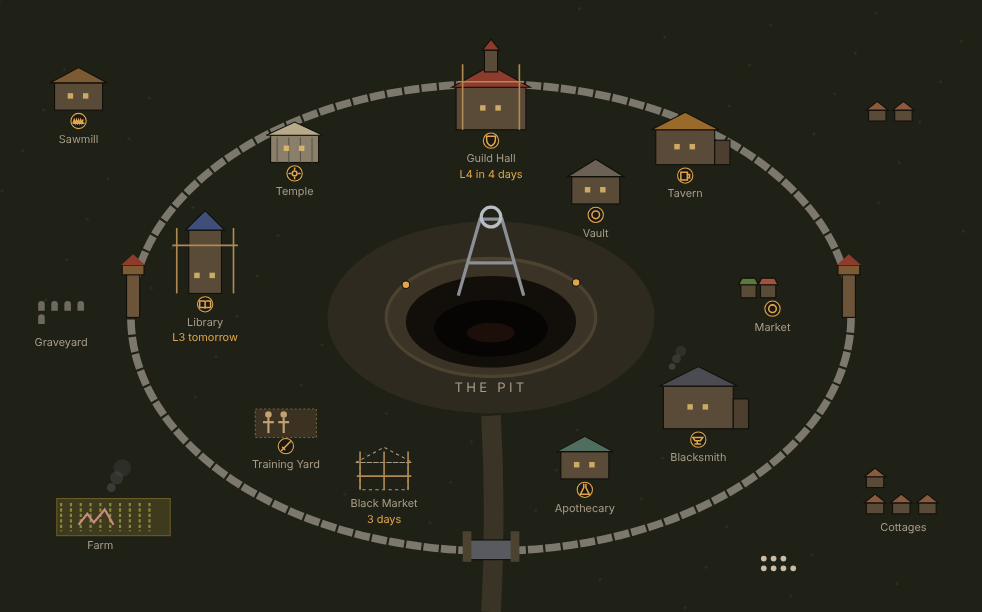
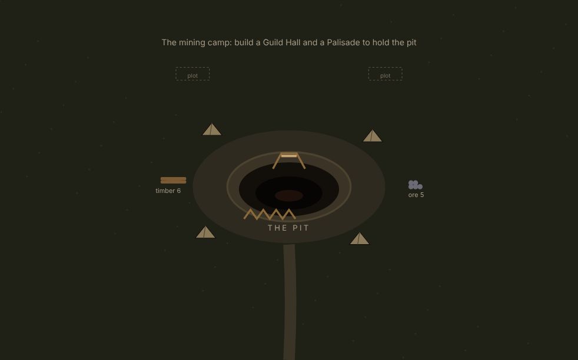
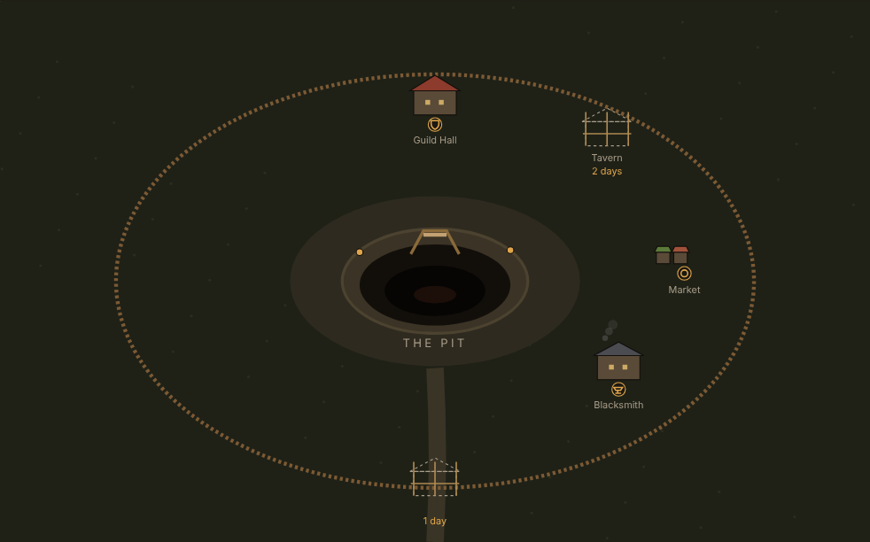
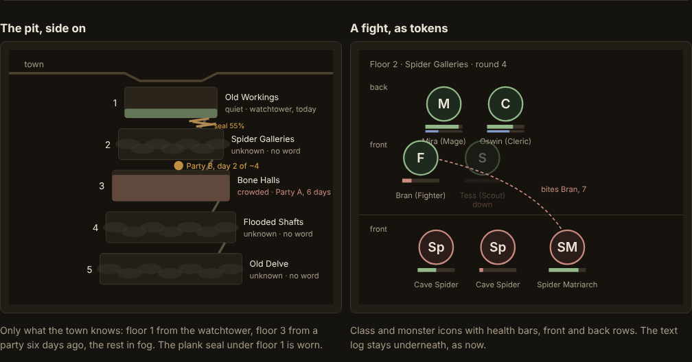

# Dungeon Party Builder: Design & Build Plan

> **Status:** agreed design, 2026-11-20. Built so far: M0 (project setup), M1 (simulation core), M2 (expeditions), M3 (the town), M4 (time, raids and saves), M5 (morale, levels and rescue runs) and M6 (balance and content). M7 (the choices come back to town, §17 and §18) is built. **Next: M8, the graphical pass (§19).**
> Items marked **✅ DECIDED** were open questions; Mike accepted the recommended option for each.
> A summary of every decision is at the end.

---

## 1. The pitch

You run the guild hall in a town built around the edge of a pit. The town started as a mining camp, and the miners dug too deep: they broke into a dungeon that was already full. Now the pit is the way in.

You recruit heroes, kit them out, and send a party down. Once they leave town **you can only watch**. If they come back, their loot and experience let you build a better party. If they don't, you can send another party down after them to recover whoever and whatever is left.

The dungeon is getting worse. The deepest level keeps breeding, and the overflow is shoved upward, floor by floor, until monsters with nowhere left to go climb out of the pit. Your job is to keep the population down by killing everything you can.

## 2. Core loop

```
 ┌──────────── TOWN ─────────────┐        ┌──────── DUNGEON ────────┐
 │ recruit / dismiss heroes      │        │ auto-simulated           │
 │ buy, sell, equip gear         │ launch │ floor → rooms → events   │
 │ pick party + standing orders  │ ─────► │ (fights, traps, loot)    │
 │ spend level-ups               │        │ you watch the log/view   │
 │ build / upgrade buildings     │        │                          │
 └───────────────▲───────────────┘        └────────────┬────────────┘
                 │   return: loot, XP, morale changes  │
                 └──────────── or wipe → rescue run ◄──┘
                       dungeon clock advances
```

**Standing orders** are the player's only influence after launch, so they matter. They are set in town before departure, for example:

- Target: "clear floor 2", "push to floor 4", "recover the lost party on floor 3".
- Retreat rule: "turn back when any hero is below 30% HP" / "when potions run out" / "never".
- Loot rule: "grab everything" vs "only what the appraiser rates highly".

Heroes don't always obey. Low morale or a cowardly/greedy motivation can override orders (see §6). That gives the watching phase some tension.

> **Changing in M7 (§17):** after playing M6, Mike found watching gets skipped once the novelty wears off, because there's nothing to decide. In M7 trips run in the background while town days tick, the decisions move to a debrief when the party gets home, and watching becomes an optional replay.

## 3. Difficulty: depth and time

Every floor has a **threat level**. Two things push it up: how deep the floor is, and how long the dungeon has been left to breed.

### Comparing the curves

| Model | Depth | Time | Feels like | Risk |
|---|---|---|---|---|
| **Linear** both | +X per floor | +Y per day | Predictable, gear outpaces it | Gets boring; deep floors don't feel scary |
| **Exponential** both | ×k per floor | ×k per day | Tense, "roguelike run" | Death spiral: eventually unwinnable no matter what you do |
| **Hybrid (chosen)** | ×k per floor | Driven by population sim, pushed back by kills | Clear depth tiers, time pressure you can fight | Needs tuning of the population numbers |

**Chosen:** make depth **exponential** and time **not a fixed formula at all**. Instead, time difficulty comes from the monster population simulation in §4. The more you kill, the slower it rises; ignore a floor and it climbs fast. That ties the lore directly to the mechanic, and the player always has a lever to pull.

Starting numbers to tune from (power ≈ total monster strength in a typical encounter):

| Floor | Base power (×1.3 per floor) |
|---|---|
| 1 | 10 |
| 2 | 13 |
| 3 | 17 |
| 4 | 22 |
| 5 | 29 |
| 10 | 106 |

A fresh party of three should handle floor 1 comfortably, floor 2 with some risk, and get badly hurt on floor 3.

✅ **DECIDED 1: difficulty curve.** Decision: exponential depth + population-driven time (above). Alternative: a plain formula like `threat = base(floor) + days × rate`, which is simpler to build but ignores what the player does.

✅ **DECIDED 2: what is a "day"?** Decision: an in-game day, advanced by expeditions (a trip to floor 3 might take 3 days, plus 1 rest day in town). Alternative: real-time clock (idle-game style). I'd avoid real time, because it punishes people for not playing.

## 4. The push-up mechanic (lore as a system)

Each floor tracks a **population** and a **capacity**, plus a **level band** (the weakest and strongest monster level living there).

Each day:

1. The bottom floor spawns new monsters at its level band. Its spawn rate creeps up slowly over time (this is the source of all escalation).
2. Any floor over capacity **evicts its weakest monsters** to the floor above.
3. Evicted monsters arrive at the upper floor's *strong* end. As they keep arriving, the upper floor's level band rises, and its own weakest get evicted upward in turn.
4. Floor 1 overflow **climbs out of the pit** toward the town (see Decision 3 and the defences in §8).

The result is exactly the lore: over time, the *weakest* thing on floor 1 is no longer a level-1 slime, because the "weak" rejects from below are stronger than they used to be. Killing monsters on a floor lowers its population, so the overflow stops and that floor's band stabilises.

A nice side effect: you can show the player a simple **dungeon pressure** map in town (per floor: population bar + level band) so they can see where the problem is building and choose targets.

✅ **DECIDED 3: what happens when floor 1 overflows?** Options:
- (a) **Town raids** (chosen): monsters climb out of the pit and attack the town, damaging buildings or injuring resting heroes. Bad, but not game over. Defences around the pit (§8) soften them.
- (b) **Game over** when overflow passes a limit. Gives a clear loss condition, roguelike style.
- (c) Nothing; floor 1 just gets harder.

## 5. Heroes and stats

### Primary stats (7)

Range 1–20, with 8–10 being an average person. Recruits start around 6–14 depending on class.

| Stat | What it's for |
|---|---|
| **STR** Strength | Melee damage, carry capacity, heavy armour |
| **DEX** Dexterity | Accuracy, evasion, initiative, locks and traps |
| **END** Endurance | HP, stamina, resisting poison and disease |
| **PER** Perception | Spotting ambushes and traps, ranged accuracy, appraisal |
| **INT** Intelligence | Spell power, mana, lore, medicine |
| **WIL** Willpower | Magic resist, fear resist, morale stability, mana |
| **CHA** Charisma | Party morale, leadership, town prices, recruit quality |

### Derived (secondary) stats

Starting formulas. These will change with balancing, but the shape is the point:

| Secondary | Formula |
|---|---|
| Max HP | 10 + END×3 + STR |
| Mana | INT×2 + WIL |
| Melee attack | STR + weapon bonus |
| Accuracy | DEX + PER/2 + weapon bonus |
| Evasion | DEX + PER/2 − armour penalty |
| Initiative | DEX + PER |
| Spell power | INT + focus bonus |
| Resist (magic/fear) | WIL |
| Carry slots | 4 + (STR + END)/5 |
| Morale stability | WIL (+ best party CHA as leader bonus) |

### Non-combat skills

Skills are a 0–100 value per hero, seeded from two primary stats and raised by use and perks. Party-wide checks use the **best** hero's value (one good scout covers the party), which makes picking party roles meaningful.

| Skill | Based on | Effect |
|---|---|---|
| **Appraisal** | PER + INT | Know loot's real value; when carry slots are full, keep the best items instead of random ones; spot cursed items |
| **Scouting** | PER + DEX | Detect ambushes and traps before they spring; sometimes avoid a fight or strike first |
| **Medicine** | INT + WIL | Heal between fights; stabilise downed heroes so they survive to be rescued |
| Trapwork | DEX + PER | Disarm traps, open locked chests *(later)* |
| Survival | END + PER | Supplies last longer, longer trips possible *(later)* |
| Lore | INT | Know monster weaknesses, bonus damage *(later)* |

The first slice ships with **Appraisal, Scouting and Medicine** only.

Appraisal works hand-in-hand with carry slots: a party can only bring back so much, and a good appraiser brings back the gem instead of the rusty helmet.

## 6. Morale and motivation

Every hero has:

- **A motivation**: Gold, Glory, Knowledge, or Comrades (more later, e.g. Revenge, Faith).
- **Likes/dislikes**: a preferred weapon or school of magic, and sometimes a disliked one.
- **Morale**: 0–100, starts around 60.

After each expedition, morale moves based on what the hero cares about:

| Motivation | Up when… | Down when… |
|---|---|---|
| Gold | Good loot share, high pay | Empty-handed return |
| Glory | Many kills, deep floors, boss kills | Retreating early, "boring" floors |
| Knowledge | New floors, new monster types, magic items | Repeating the same floor |
| Comrades | Party survives together | A party member dies or is abandoned |

Everyone also gets morale from using a liked weapon, and loses it from a disliked one, injuries, or too little rest.

- **Below 30**: the hero complains (shown in town). In the dungeon they may ignore standing orders (a Glory hero refuses to retreat; a Gold hero lags behind to loot).
- **At 0**: the hero quits the guild.

✅ **DECIDED 4: does a quitting hero take their gear?** Decision: they keep what they're wearing and leave the rest. That stings enough to matter without wiping out your stash.

## 7. Alignment (after the first slice)

> Added 2026-11-20. Not part of the first playable slice. It slots in once morale and motivations exist (M5), and is data-driven like everything else.
>
> **Built in M6.11 (2026-11-21).** What's in the game now:
> - Every hero (and recruit) is Good, Neutral or Evil (`content/alignments/`, about 35/40/25), worked out from their id and name like their personality, so old saves get stable alignments. Shown on hero and recruit cards and in the watch view.
> - The party panel shows the party alignment or what's wrong with it, and the launch warnings name anyone who clashes. Nothing is ever banned.
> - Morale per day on the trip: a hero two steps from the party alignment, and the heroes they clash with, lose 2 (cap 10); a divided party costs everyone 1 (cap 5); Good and Evil together under a Neutral majority costs them 1 per 2 days (cap 3).
> - Alignment is a second motivation: Good heroes grieve the fallen and the abandoned harder and feel good about rescues; Evil heroes like a fat purse and the killing.
> - Classes can require an alignment: Paladin needs Good, Assassin needs Neutral or Evil.
> - Not yet: low-morale walkouts specific to clashes, Temple healing discounts for Good heroes, townsfolk wary of an Evil guild.
>
> **Built in M6.23 (2026-11-21):** alignment in the dungeon and in town.
> - **Room events** (`content/events/`, room `strange-meeting`, behaviour `event`): a side passage now and then holds something to decide about, played out by the party's alignment as it stands (the living). A wounded stranger is healed by a Good party (60%: they send 15-40 gold to town later), left water by a Neutral one, robbed by an Evil one. A cornered goblin is let go, shooed off, or finished off and searched. The miners' shrine (floors 2-5) heals a praying Good party 30% (20%: a holy relic), a resting Neutral one 10%, and an Evil party loots the offerings and may get burned by holy fire. A dark altar (floors 3-5) is smashed by a Good party, avoided by a Neutral one, and fed blood by an Evil one for unholy gear. A divided party argues and does nothing. Outcome effects (`loot`, `healParty`, `hurt`, `deed`, `gift`) are registered by id in `src/sim/events.ts`.
> - **Deeds are morale:** facts `goodDeeds` and `evilDeeds`. Good heroes +2 for a kind deed (cap 4) and -3 for a vile one (cap 6); Evil heroes +1 for a cruel one (cap 2) and -1 for "wasting time being kind" (cap 2). Neutral heroes don't mind either way.
> - **Monsters react:** `MonsterDef.hunts` (hero tags such as `align:good`) makes skeletons, ghouls, ghasts and the Lost Delvers go for Good heroes first when they're in reach. `MonsterDef.reactions` lists reactions registered by id in `src/sim/reactions.ts`: goblins may parley with an Evil party (25%: no fight) or demand a toll (25%: the party hands over its cheapest loot, or fights if it has none).
> - **Holy and unholy gear:** Holy Symbol (offhand: spell power, resist, +15% vs undead) and Blessed Blade (+30% vs undead), sold at the Temple (L1 symbol, L2 blade) and found at the shrine. Cursed Blade (+8 attack, -2 WIL) and Bone Charm (spell power and mana, -2 CHA) are unholy: from the dark altar, rarely on ghouls and Lost Delvers, and at the Black Market. Good heroes aren't stopped from carrying unholy gear (alignment never bans), but lose 3 morale a trip for it (fact `unholyGear`) and the launch warnings say so; Evil heroes gain 1.
> - **Black Market** (180 gold, 3 days): `BuildingDef.dealsWith: ["evil"]`, so it only works while the guild has an Evil hero on its books. It fences the haul for 8 points more (`fence` effect, still capped at the haggling max) and sells unholy gear. With no Evil hero the Buildings panel shows it as shut.
> - **Balance:** event rooms (weight 1.5) would have thinned out the fights, so the Occupied chamber went from weight 6 to 7; fights per trip are back where they were (`npm run balance`: floor 3 with "below 30% HP" 27% home, 24% wiped, was 28%/27%). Gold from trips is up about 3-6% in the days bot (gifts, the fence), and the bot now builds the Black Market too.

Every hero is **Good**, **Neutral** or **Evil**. Alignment is shown when recruiting and never changes on its own (perks or events might shift it later).

### Party alignment

- If **at least two-thirds** of the party share an alignment, that is the **party alignment**.
- Every other member should be **within one step** of it. Good and Evil are two steps apart; Neutral is one step from both.
- So a **Good** party can take Neutral heroes, an **Evil** party can take Neutral heroes, and a **Neutral** party can take *both* Good and Evil heroes. A Neutral-majority party is the only way Good and Evil heroes go into the dungeon together.
- With no two-thirds majority, the party is **divided**: no alignment bonuses, and the friction penalty below applies.

| Party (example) | Party alignment | OK? |
|---|---|---|
| Good, Good, Neutral | Good | Yes |
| Good, Good, Evil | Good | Mismatch: the Evil hero is two steps away |
| Neutral, Neutral, Good | Neutral | Yes |
| Neutral ×4, Good, Evil | Neutral | Yes, Good and Evil held together by the Neutral majority |
| Good, Neutral, Evil | Divided | Friction |

**Mismatches are a morale cost, not a ban.** You can always send any party, because sometimes the only heroes free for a rescue run are the wrong ones. A mismatched hero, and the heroes they clash with, lose morale on every day of the expedition, and a mismatched hero at low morale is more likely to ignore standing orders or walk out. Good and Evil heroes in the same party also feel a small amount of friction even when it is allowed. A Neutral majority keeps the peace, but doesn't make them friends.

### What alignment changes

- **Morale:** alignment acts like a second motivation. Good heroes lose morale when the party abandons a downed ally or robs a stranger; Evil heroes gain it from taking extra loot or finishing off fleeing monsters.
- **Room events:** the same event plays out differently. A wounded stranger is healed by a Good party (maybe a reward later), ignored by a Neutral one, and robbed by an Evil one.
- **Monsters:** some monsters react to the party's alignment. Undead go after Good heroes first; some goblin bands will parley with, or demand tribute from, an Evil party instead of fighting.
- **Loot:** holy and unholy items. Good heroes refuse to carry cursed or unholy gear, and Evil heroes are happy to use it.
- **Town:** the temple offers cheaper healing to Good heroes; a black market only deals with Evil ones. Too many Evil heroes in the guild could make townsfolk wary (worse recruit pool).

### Built to grow

Alignment is just another kind of content (`content/alignments/`): each alignment is a definition with a position on the scale, and party alignment is worked out as a tag on the party (`party:good`, `party:divided`). Events, monster behaviour, item rules and morale effects check those tags through the normal effects system (§13). A second axis (for example Lawful / Chaotic) could be added later without changing the engine.

✅ **DECIDED: small parties.** The plain two-thirds rule stays. Party size grows with the Guild Hall (§8), so early parties of 3 to 5 can't mix Good and Evil, and a 6-slot hall (4 Neutral, 1 Good, 1 Evil) unlocks it. Mixing the two becomes something you earn.

## 8. The town: guild hall and buildings

> Added 2026-11-20. The Guild Hall is in the first slice; the wider building system grows from M4 onward.

Your progress lives in two places: your **heroes** (who can die) and your **town** (which can't). Loot pays for both.

### Party size comes from the Guild Hall

How many heroes you can send at once is set by the size of your **Guild Hall**. You start small and upgrade it, so the game begins with simple parties and the complexity grows as you do.

| Guild Hall level | Party slots | Roster size | Notes |
|---|---|---|---|
| 1 (start) | 3 | 6 | |
| 2 | 4 | 8 | |
| 3 | 5 | 10 | |
| 4 | 6 | 12 | Good and Evil can now share a Neutral party (§7) |

Six is the planned cap for now. More levels are just more rows of data.

> **Changed in M7.05 (§17.5):** how many heroes go well together comes from the party's leader (Leadership, stretched or shrunk by alignment); the Guild Hall is the hard cap, now 4 / 5 / 6 / 8 / 10 per party and 8 / 10 / 12 / 16 / 20 on the roster.
>
> **Changed in M7.10:** the Guild Hall no longer caps the party. Mike promoted two porters going with a party of four and they were locked out, though the leader had command to spare. Any number of heroes can go; past the leader's command the party is unruly (disobeying, deserting) as in §17.5, and fights grow +18% per fighter over 3. The hall's 4 / 5 / 6 / 8 / 10 is now only the size it plans for: new hires and trained heroes join the next party until it's that big, and a porter trained while going with the party stays in it as a hero. The roster size is the real limit.

### Buildings

- Buildings cost a **one-off** price, with no upkeep.
- Better buildings need more than gold: **materials only found on deeper floors** (iron ore, spider silk, bone dust…) and sometimes a guild **renown** level. So stronger heroes, who can reach deeper, are what unlock the better buildings.
- Buildings are **permanent**. If a party wipes, the town is still there. This is the safety net that stops one bad expedition ending the game.
- **Town raids** (decision 3) can damage a building. A damaged building stops working until it is repaired (cheap), but it is never destroyed.

Starting list (more later):

| Building | Does | Slice? |
|---|---|---|
| **Guild Hall** | Party slots and roster size (above) | **First slice** (levels 1–2) |
| **Market** | Buy and sell basic gear and potions | **First slice** (built from the start) |
| Tavern | Better recruits to choose from; resting heroes recover morale faster | Later (M4) |
| Blacksmith | Better gear for sale; repair and upgrade items | Later (M4) |
| Apothecary | Cheaper potions; injuries heal faster | Later |
| Training Yard | Heroes resting in town gain a little XP | Later |
| Library | Identify trinkets; Knowledge heroes like it; teaches the Lore skill | Later |
| Pit defences | Hold back monsters climbing out of the pit (see below) | Later (M4, with raids) |
| Vault | Protects your stash from raids | Later |
| Temple | Resurrection (§10); cheaper healing for Good heroes (§7) | Later (M6+) |
| Graveyard | Bury the fallen: friends' morale recovers faster (§10) | Later (M6+) |
| Black Market | Alignment services for Evil heroes (§7) | With alignment |

### Defences around the pit

Whatever overflows floor 1 climbs out of the pit. Defences built around the pit decide how much of it reaches the town.

| Defence | Does |
|---|---|
| **Palisade → Stone wall** | Adds defence. Each level holds back more climbing monsters |
| **Gate** | Lets parties in and out; a stronger gate stops raiders breaking straight through |
| **Watchtowers** | Early warning: shows a raid coming a day ahead, so you can keep strong heroes home. Also adds a little defence |
| Later: traps, a pit-edge garrison of resting heroes | More ways to defend |

How it works each day:

1. Floor 1 overflow climbs out. Its **strength** = number of monsters × their level.
2. The town's **defence** (from its defences) soaks up that much strength.
3. Anything left over becomes a **raid**: the bigger the leftover, the worse the raid (a damaged building, an injured resting hero, stolen stash).

So raids measure how well you're keeping the population down. A town that clears floor 1 often hardly sees raids, even with weak walls. A town that neglects the dungeon will eventually be overrun, whatever its walls are made of, because overflow keeps growing and walls don't. Defences buy time; only clearing the dungeon fixes the problem.

In town, a simple **pit gauge** shows the overflow climbing out against your defence. It's the most direct sign of how things are going.

Defences are ordinary buildings in `content/buildings/` with a `defence` (or `raidWarning`) effect, so new kinds of defence are just new data.

### Later: the opening, holding the pit

> Added 2026-11-20. Built in M6.16: see the note below the list.

The game starts when you arrive at a mining site that has just dug too far. There are no defences, no Guild Hall, and monsters are already climbing out of the pit.

1. **Hold the line.** There's no delving yet. You assign your first heroes to **makeshift defence posts** around the pit (barricade, gate gap, lookout) and to **makeshift roles** (whoever is holding the pick-axe is the fighter). Then you watch them hold. Each night's overflow is fought with the normal combat sim, as waves against the posts.
2. **Gather materials.** Fallen raiders drop materials, and the miners salvage what they can. Losses still hurt, and heroes still have morale.
3. **Build up.** Once you have enough, you build the first real defences (palisade, gate) and the Guild Hall.
4. **Push down.** With the town secure enough, delving unlocks and the normal game begins: send parties down to thin the population at its source.

> **Built in M6.16 (2026-11-21).** A new game now starts at the camp (it can be skipped on day 1; saves from before stay as they were). Numbers in `content/opening.ts` and `content/posts/`:
> - **The camp:** 120 gold, no Guild Hall, a roster of 5, and makeshift kit (two pick-axes, a sling, a staff, work leathers, bandages). Anyone without proper kit takes something makeshift, a ranged one for the back row. No delving until the **Guild Hall** (6 timber, no gold, 3 days at the camp) and a **Palisade** (80 gold, 4 timber) are up. Then the guild's wagons bring proper kit to the store room and the camp-only posts close.
> - **Posts** (`content/posts/`), for any hero at home and fit, in any game: **the barricade** (3 heroes, 2 defence each), **lookout** (1, sees tomorrow night, 1 defence), **salvage crew** (3, a roll a day: mostly timber, some iron ore), and at the camp only **work the seam** (2, two rolls a day: mostly coins, some ore). Porters can salvage and keep lookout, not hold the barricade. Heroes on posts still fight raids. A hero away on a trip leaves their post empty until they're back.
> - **Raid spoils:** every raider killed at the pit drops a roll of `pit-spoils` (timber or iron ore, never gold), in any game.
> - **Timber**, a new material: salvage and raid spoils. The Palisade's first level now needs 4 of it in every game, so an older town without walls puts someone on the salvage crew first.
> - ~~Makeshift roles are makeshift **kit**, not temporary classes: heroes still pick a real class when they sign.~~ Changed in M6.18 (Mike: kit out spent the camp's gold, and real classes at the camp felt wrong): everyone at the camp is a **Miner** (`content/classes/miner.ts`, a new `camp` class kind: plain 10s, front row, pick-axe and work leathers, never offered to recruits or at level-ups). The four starting heroes are already there as miners, so there's no hiring step (anyone signed at the camp later joins as a miner too). Once the camp is held, each miner picks a base class on the roster, or "pick for me" (`trainMiner` / `trainMiners`); their stats move by that class's training as a recruit's would, and any levels earned at the camp move over to it. Miners can't go down until they've picked. Nothing is bought at the camp (Kit out only uses the store room) and wages read 0 there.
> - **No dead ends (M6.17, after Mike got stuck: ore kept dropping, wages drained the gold, and the Guild Hall was out of reach).** Nobody is paid at the camp; wages start when it's held. The Guild Hall costs timber only. The miners swap **2 iron ore for 1 timber** (`trades` in `content/opening.ts`), so bad luck in drops can't stall the build. Whatever the build order, gold only goes on the palisade, and the seam keeps topping it up. The bot holds the camp around **day 10**; with `--unlucky` (no timber ever drops, so it trades for all of it) around day 13, palisade first or not, in every town.
> - **Balance before M6.17** (`npm run days -- --camp`, 100 towns): the camp was held around **day 18**, after about 3 raids, all beaten off, with nobody lost. Over 60 days a camp game on floor-1 trips ends with 13.7 building levels against 15.8 without the opening, and no worse for raids. A guild that never goes down still runs dry, because the seam closes with the camp and raid spoils are never gold.

This works as a tutorial in disguise. It teaches assigning heroes, watching auto-battles, morale and building, before the player has to think about expeditions. It reuses the combat sim and the defence buildings, so it is mostly new content and a few new rules rather than new systems. Defence posts and makeshift roles are data like everything else (`content/posts/`, roles as temporary class definitions).

### Favourite buildings

Every hero has a **favourite building**, usually linked to their motivation (a Comrades hero loves the Tavern, a Knowledge hero the Library, a Glory hero the Training Yard, a Gold hero the Vault or Market). Their profile shows it.

- **Built:** a small morale boost on every rest day in town.
- **Missing:** a small morale drain on every rest day, and a grumble shown in town ("Bram keeps asking when we're getting a tavern").
- Later, a strong recruit might refuse to join a town without their favourite building.

This turns building choices into hero management: the town you build shapes which heroes are happy to stay.

### Built to grow

Buildings are data (`content/buildings/`): each has a cost, required materials and renown, levels, and its effects written in the normal effects system (§13). For example, the Guild Hall's levels just set `partySlots` and `rosterSize`, and the Tavern adds a `restMorale` bonus. A favourite building is a field on the hero, picked from a list weighted by motivation. Adding a building never changes the engine.

## 9. Levelling up

Options:

- **Class-baked**: stats rise automatically by class. Simple, but the player has no input.
- **Player-chosen**: the player spends points and picks perks. Lots of agency, harder to balance.
- **Hybrid (chosen)**: each level the class gives fixed small stat gains, *and* the player picks **1 perk from 3 offered** (weighted toward the class). Every 3rd level, +1 free stat point.

Why hybrid: this is a watch-only game, so nearly all of the player's agency lives in town. Level-ups are one of the best places to give them real choices. Class baselines keep classes distinct and keep balance manageable.

Optional twist that ties into morale: a hero may *want* a particular perk ("Bram wants to learn Cleave"). Granting it gives a morale bump.

✅ **DECIDED 5: level-up style.** Decision: hybrid, as above.

### Later: freeform classes and progression

> Added 2026-11-20. Class names below are examples only, not commitments. Numbers are starting points to tune.
>
> **Built in M6.10 (2026-11-21).** What's in the game now:
> - Hero level goes to **50**, with +1 max HP per hero level. Each level-up first asks which class gets the level (skipped when only one is open), and that class's stat gains come in then. Old saves put every past level into the hero's one class.
> - **Base classes** open at a stat minimum: Fighter STR 12, Scout DEX 12, Mage INT 12, Cleric WIL 12 (the hero's own stats, before gear). Free stat points can open a new class.
> - **Depth**: each class has `perLevel` bonuses for every class level past the first (Fighter +0.4 attack and +1 HP, Mage +0.4 spell power and +1 mana, Scout accuracy/evasion/scouting, Cleric spell power/resist/medicine), and **milestone perks** at class levels 5 and 10 (pick 1 of 2), 20, 30, 40 and 50 (one each, the capstone last). Milestone perks are never offered at random. Class abilities key on class level.
> - **Advanced and combo classes** (examples): Spellblade (Fighter 5 + Mage 5, STR 12, INT 12), Paladin (Fighter 5 + Cleric 5, STR 12, WIL 12), Frost Mage (Mage 10, INT 16, a Library), Assassin (Scout 10, DEX 16, a Training Yard). Each has its own abilities and a level-5 milestone perk. They can't be recruited into.
> - A hero's main class (most levels; the first learned on a tie) sets their fighting style and usual kit. Fighters and Scouts with spells will cast them: they heal a downed friend and use damage spells after their techniques.
> - Not yet: motivations favouring a path, alignment requirements (with §7), a Mage Tower or Arena.

Two rules keep this simple:

1. **Heroes only move forward, never swap.** A hero keeps every class they learn. Nobody stops being a Fighter; they become *more* than one.
2. **Depth is rewarded.** Spreading levels out gives breadth and opens combos; staying in one class gives the strongest perks and abilities. A level-50 Fighter should hit very hard.

#### Hero level and class levels

- **Hero level** runs from 1 to about **50**. It drives HP and general power, and its XP is what heroes earn on expeditions.
- **Each level-up, you choose which of the hero's known classes gets the level.** That class gives its stat gains and a perk offer (pick 1 of 3) from its own pool at its new class level. The free stat point every 3rd hero level stays.
- **Class levels are not capped.** A hero who puts every level into Fighter ends up Fighter 50. A hero's class levels always add up to their hero level.
- **Learning a new base class:** at any level-up, a hero can put the level into a base class they don't have yet, if they meet its stat minimum. It starts at class level 1.

#### Rewarding depth

- **Class abilities scale with class level**, not hero level: a Fighter's weapon bonus or a Mage's spell power grows with Fighter or Mage levels.
- **Milestone perks** sit at class levels 5, 10, 20, 30, 40 and 50, and the deeper ones are the strongest (a level-50 capstone). Only a hero who commits gets them.
- So a Fighter 25 / Mage 25 has two good kits and access to combos, but nothing close to a Fighter 50's damage. Spread too thin (five classes at level 10) and the hero is a jack of all trades.

#### Unlocks are thresholds, not caps

Advanced and combo classes open up when a hero reaches certain class levels and stats. Once unlocked, they're another class to put levels into, uncapped like the rest, and the earlier classes stay.

| Kind | Unlocks at (example) | Example |
|---|---|---|
| **Base** | Recruited, or learned at any level-up if the stat minimum is met | Fighter, Scout, Mage, Cleric |
| **Advanced** | One base class at a threshold, plus a stat minimum | Mage 10 + high WIL → Necromancer; Mage 10 + high INT → Ice Mage |
| **Combo** | Two (or more) classes at thresholds, plus stat minimums | Fighter 5 + Mage 5 → Spellblade |

There's no forced choice at any level: a hero who qualifies for nothing just keeps levelling what they have, and specialises later if they ever meet a requirement. Because unlocks are just requirements, the system keeps growing: deeper unlocks (an advanced class at level 20 that opens a further one) are just more class definitions.

**Extra requirements**, all optional per class:

- **A town building**: training a new advanced class needs the right building (a Mage Tower for spellcasting specialisations, an Arena for fighting ones). This links class progression to the town (§8).
- **Alignment**: some classes might need or forbid an alignment (§7).
- **Motivation**: a hero's motivation can favour a path ("Mira wants to be a Necromancer"). Granting it gives a morale boost; when it's possible and you choose something else, they lose morale.

**Built to grow:** every class, whatever its kind, is a class definition with a `requires` block, so adding one is just data:

```ts
export default defineClass({
  id: "spellblade",
  kind: "combo",
  requires: {
    classLevels: { fighter: 5, mage: 5 },
    stats: { STR: 12, INT: 12 },
    building: "mage-tower",
  },
  milestonePerks: { 5: [...], 10: [...], 20: [...] },
  // stat growth per class level, perk pool, gear likes, AI behaviour…
});
```

## 10. Death, wipes and recovery runs

- At 0 HP a hero is **downed**, not dead. A downed hero bleeds out over a few turns unless stabilised (Medicine) or the fight ends. Allies carry downed heroes out if they have the carry slots.
- If the whole party goes down, it's a **wipe**. Each hero then rolls: dead, or alive and **trapped/captured**, with a rescue window of a few days.
- The wipe leaves a **lost party site** on that floor with their gear.
- A **recovery run** is a normal expedition with the target "recover lost party on floor N". It brings back surviving heroes (injured) and whatever gear is still there.
- Over time, monsters **pick up gear from the site**. Those monsters get stronger, and killing one drops the gear. This makes delay costly and gives a great "we got Bram's sword back" moment.

### Later: what happens to the fallen

> Added 2026-11-20. **Not in the first playable version** (M3 shows dead heroes on a memorial). This builds on rescue runs (M5) and needs the Temple and Graveyard buildings, so it lands in M6+.
>
> **Built in M6.12 (2026-11-21).** What's in the game now (numbers in `content/fallen.ts`, the Temple and Graveyard building files, and `content/transforms/risen.ts`):
> - Every dead hero leaves a **body**. A party that comes home carries its dead with it; after a wipe the bodies lie at the site with their gear. A rescue run (now also offered for sites with only bodies) carries every body it finds home. Raid dead are carried indoors.
> - **Temple** (220 gold): resurrect for 100 + 20 × level gold, losing max(2 levels, 20%) off the top; level 2 (450 gold) makes it 80 + 15 × level and max(1, 10%). The hero comes back at 30% HP with no gear, no injuries, and a −10 morale shock. Each level a hero gains is now recorded (class, stat gains, perk, free stat), so lost levels come back exactly as they were, in order, as the XP is re-earned. Levels from older saves come off the main class with its usual gains, and keep their perks.
> - **Graveyard** (60 gold): bury for 5 gold. Everyone in town +2 morale, Comrades heroes +4 more. Bodies wait in town until you decide.
> - A body left in the dungeon **rises after 7 days** as "Bram, Risen": their class, AI, perks and whatever of their own gear still lies at the site, plus the risen transform (+50% HP, undead tag and weaknesses, a little stronger and slower). They haunt that floor and climb one floor every 10 days. A fight on their floor has a 35% chance of them joining it (once per trip); the best scout may recognise them first. Heroes who knew them lose 6 morale (Good heroes 4 more), and the whole guild loses 3 when one rises (Good 4 more). Put down, they drop their gear, and their body comes home: it can only be buried.
> - Since M6.15 the Temple also wants **bone dust** (§11 "As built in M6: materials"): 3 per resurrection, 2 at Temple level 2.
> - Not yet: risen joining raids, and a body in town without a Graveyard costing anything.

A dead hero leaves a **body**, and the body matters. Recovery runs (above) can bring bodies home as well as survivors and gear. Once a body is in town, you choose:

| Choice | Needs | Result |
|---|---|---|
| **Resurrect** | A **Temple** (§8), plus a cost: gold and rare materials | The hero comes back, but **loses a level** (or a percentage of their levels; the amount is tunable data). See below |
| **Bury** | A **Graveyard** (§8) | The hero is laid to rest. Their friends' morale recovers faster, and Comrades-motivated heroes especially care that it was done |

**The resurrection cost.** The lost levels come off the top: the most recent levels go first, in reverse order. Stat gains from those levels disappear. The levels aren't gone for good, though. As the hero earns XP back, each lost level is restored exactly as it was, with the same class, stat gains and perk. So death costs time, not the choices you made.

**If neither happens**, because the body is never recovered or there's nowhere to bury it, the dungeon keeps it. After a while it rises as an **undead version of the hero**. It has their name ("Bram, Risen"), their class and fighting style, and the gear they died in. It joins the population of the floor where it fell, and pushes upward like any other monster (§4). A later party might run into it:

- Heroes who knew the fallen hero lose morale fighting them, and Good heroes especially.
- Killing it returns the gear and the body. The body can then only be buried, not resurrected.
- A scouting or lore check might recognise it before the fight ("That's... Bram's shield").

This gives every death a story and a reason to run a recovery, without making death meaningless.

**Built to grow:** "rising" is a transform applied to a snapshot of the dead hero (adds the `undead` tag and an undead stat template, and keeps class AI and gear), defined in `content/transforms/`. Resurrection and burial are building actions with costs and effects in the building definitions. Rise time, resurrection cost and morale effects are all numbers in data.

✅ **DECIDED 6: permadeath.** Decision: yes, dead heroes stay dead, but the rescue window means a quick recovery run can save some. Later, a recovered body can be resurrected at a Temple, at a cost (above). Alternative: nobody dies, only "lost until rescued".

## 11. How an expedition is simulated

1. A floor is a short chain of **rooms** (5–8 for floor 1), generated from a seed.
2. Entering a room: a **Scouting check** may reveal what's inside (ambush, trap, treasure).
3. Room types: fight, trap, treasure, rest spot, event (a wounded stranger, a strange shrine…).
4. **Fights** are turn-based and fully automatic:
   - Two rows: front (melee, takes most hits) and back (ranged, casters). The player sets the formation in town.
   - Turn order by initiative. Hit = accuracy vs evasion. Damage = attack − armour.
   - Each class has a simple AI (fighter attacks the biggest threat, mage uses spells on groups, etc.).
5. After each room: check standing orders (retreat?), morale, and supplies.
6. Every step writes to an **event log**. The "watch" screen is just a player for that log.

The simulation is **deterministic**: same seed + same party = same result. That makes it easy to test, debug, balance and replay.

✅ **DECIDED 7: how the watching looks.** Decision: start with an animated, readable text log (like a battle report), with HP bars. Add a simple 2D view later. Building the sim first and the visuals second means the game is playable much sooner.

### As built in M2

> Added 2026-11-20. The numbers are starting points for tuning.

- **Floors** are content (`content/floors/`): a name, a room count (5–7 on floor 1, 6–8 on floors 2–3) and rooms every floor always has. Each floor has one **rest spot**, placed somewhere in the middle.
- **Rooms** are content (`content/rooms/`). Each names a behaviour: `fight`, `trap`, `treasure`, `rest` or `quiet`. New behaviours (shrines, a wounded stranger) are registered by id, like combat AIs.
- **Scouting:** before a fight, the best scout may get the jump on the monsters (chance = Scouting − 30, up to 60%). The party then gets a free opening round. Traps are spotted with chance Scouting − hidden + 50, and a spotted trap is simply avoided. Disarming waits for Trapwork.
- **Traps** hurt one hero or the whole party, ×1.3 per floor like monsters. Resistances help; armour doesn't.
- **Medicine:** the fight ending stops the bleeding. After every room, the best medic tries to get downed heroes up (30% + 60% × Medicine) and uses bandages on anyone below 60% HP, getting more out of each one the better their Medicine. A hero who can't be brought round is carried and takes up 4 carry slots.
- **Rest spots** restore HP (60% of max, scaled from half to full by Medicine) and 60% of mana. Casters also get back WIL ÷ 4 mana per room walked. This fixes the M1 problem of the mage running dry.
- **Loot:** monsters and chests roll loot tables (`content/loot/`). Valuables have a value range, and the party only knows its *guess*: Appraisal 100 is exact, Appraisal 0 can be 90% off. Carry slots are shared across the party; when packs are full, the best appraiser leaves behind whatever looks least valuable per slot.
- **Standing orders:** a target floor, a retreat rule (below 30% HP, below 50% HP, anyone down, out of potions, never) and a loot rule (carry everything, or leave the junk). Orders are checked after every room. Heroes always obey for now; disobedience comes with morale in M5.
- **The way home** goes back through cleared floors, with a 20% chance per floor of meeting wandering monsters.
- **Wipes:** the party and its haul stay where they fell, and the result records the spot for a rescue run (M5). A trip takes one day per floor reached.

Balance with a fresh starter party (500 trips each, `npm run balance`):

| Target floor | Orders | Came home as ordered | Turned back | Wiped |
|---|---|---|---|---|
| 1 | below 30% HP | 100% | 0% | 0% |
| 2 | below 30% HP | 85% | 13% | 2% |
| 3 | below 30% HP | 27% | 54% | 19% |
| 3 | never turn back | 47% | 0% | 53% |

Floor 1 is unchanged from M1. Careful orders on floor 3 trade reaching the bottom for staying alive, so the orders are a real choice.

### As built in M3: the town

> Added 2026-11-20. The numbers are starting points for tuning.

- **Town rules are content** (`content/town.ts`): 100 starting gold, a roster of 4 (Fighter, Scout, Mage, Fighter), two rolls of bandages in the store room, 3 recruits on offer, 60 gold to hire, the Market pays 50% of value, and heroes heal 40% of max HP per day in town.
- **Buildings are content** (`content/buildings/`). Each level lists its cost, a one-line summary and its effects (`partySlots`, `rosterSize`, `sells`). Guild Hall level 1 (3 slots, roster 6) and level 2 (4 slots, roster 8, 300 gold); the Market is built from the start. New effect types are added once in `src/sim/town/` (read.ts).
- **Town logic** lives in `src/sim/town/` (one file per topic) as pure functions over a plain-data `TownState`: hire, dismiss (the guild keeps their gear), buy, sell, equip, pack supplies, set row, pick the party, set orders, upgrade, rest a day, launch. Same seed, same town.
- **Recruits** bring their class's starting kit. A new batch turns up every day.
- **Launch** simulates the whole trip at once, then the UI plays back the log. The town already reflects the outcome, so there's nothing to change while watching.
- **Coming home:** the Market pays the real value of the haul (the results screen shows the party's guess next to it). The trip takes one day per floor; heroes who stayed home rest that long, the party gets one night's rest. Each hero keeps a record of trips and kills.
- **Wipes:** the dead go on the memorial; the rest are listed as lost on that floor, with their gear. Rescue runs come in M5.
- The town is saved in the browser (localStorage) so a refresh doesn't lose it. Proper save slots are still M4.

### As built in M4: time, the pit and saves

> Added 2026-11-20. The numbers are starting points for tuning. `npm run days` plays a town with a simple bot and prints the dungeon night by night.

- **The dungeon keeps a population** (§4). Each floor has a capacity and a starting population (`content/floors/`: 40/50/60, starting at 28/38/50) and an average **monster level**. Levels are depth-equivalent: level 1.6 means "between a floor-1 and a floor-2 monster".
- **Every night** (`src/sim/dungeon.ts`, rules in `content/dungeon.ts`): the bottom floor breeds 6 monsters, plus 0.15 more each day. A floor over capacity pushes its extra up; they arrive half a level below their old floor's average and pull the new floor's level up. Every floor settles 5% of the way back to its own depth each day. Floor 1's extra climb out of the pit. No dice, so it can be forecast exactly.
- **Expeditions feel it.** A floor's level sets how big its fights are (power = 10 × 1.3^(level − 1), so a floor-1 at level 1.6 fights like 11.7 instead of 10), deeper floors' monster groups can turn up, and a floor can't throw more monsters at you than it has left. Every kill comes off the population, and a floor that's been cleared out has quiet fight rooms. Clearing floor 1 makes room, so for a while stronger rejects from floor 2 move in: you see the lore happen.
- **The pit** (§8): what climbs out has **strength** = monsters × level. Defences hold back that much. Whatever's left is a **raid**: raiders worth 3 power per point of leftover strength come for the town, and the healthy heroes at home (at least 50% HP, up to 6) fight them with the normal combat sim. The fight is saved and can be watched. Nobody bleeds out in town: defenders who fall wake up hurt. If nobody is fit to fight or the defenders lose, the raiders steal 5 gold per point of leftover and damage one building per 4 points. A damaged building does nothing until it's repaired (25% of what it cost); it's never destroyed. The Guild Hall is raid-proof so a raid can never cost you party slots.
- **Nights pass one at a time.** Resting a day is one night. A trip of N days is N nights, and while the party is away only the heroes left home can defend. That's the watchtower decision: when a raid is coming, keep someone strong home.
- **Building takes time** (added after Mike played M4). Every building level has a `days` build time. You pay up front, the builders start, and the new level takes effect on the morning the work is done. Until then the building keeps working at its old level. Each building can have one job at a time, but several buildings can go up at once, and work goes on while a party is away. Repairs are still instant.
- **New buildings** (all data in `content/buildings/`, with new effect types `defence`, `raidWarning`, `recruitOffers`, `recruitPicks`):

| Building | Levels |
|---|---|
| Palisade → Stone wall → High stone wall | 80 / 250 / 600 gold, 2 / 4 / 6 days: defence 6 / 12 / 20 |
| Pit Gate | 60 / 180 gold, 1 / 3 days: defence 3 / 6 |
| Watchtower | 100 / 220 gold, 2 / 3 days: see 1 / 2 nights ahead, defence 1 / 2 |
| Tavern | 150 / 400 gold, 2 / 4 days: +1 / +2 recruits a day, each the best of 2 / 3 rolls. Morale comes in M5 |
| Blacksmith | 200 / 450 gold, 3 / 5 days: sells Iron Sword, War Axe, Longbow, Iron Shield; then Scale Mail and Iron-shod Staff. Repairs and upgrades later |
| Guild Hall levels 2, 3 and 4 | 300 / 600 / 1000 gold, 3 / 5 / 7 days: 4 / 5 / 6 per party, roster 8 / 10 / 12 |

- **In town**, the pit panel shows last night's gauge (strength vs defence), the watchtower's forecast, the last 30 nights as a chart, the home guard if the party leaves, recent raids (with "Watch the fight"), and a **pressure map**: population, level band and today's fight power per floor. The trip results say what happened at the pit while the party was away.
- **Saves:** three save slots in the browser, each autosaving after every action, plus save to and load from a file. Saves carry a version number and are upgraded step by step on load (`src/sim/save.ts`); an M3 save is moved into slot 1 and upgraded.

What the bot sees over 60 days (40 towns each; the bot rests to 90% HP, then goes down):

| Plan | First raid (median) | Raids | Overflow strength on day 60 |
|---|---|---|---|
| Never go down | day 6 | 55 (almost all beaten off by 4 heroes at home) | 20 |
| Floor-1 trips, no defences | day 37 | 15 (half beaten off) | 10 |
| Floor-1 trips, building defences | none | 0 | 5 |
| Floor-2 trips, building defences | none | 2.5 | 12 |

Not yet: renown as a building cost (materials arrived in M6.15), the Tavern's morale bonus, Blacksmith repairs and upgrades, the Vault (stash protection), and garrisons or traps at the pit.

### As built in M5: personalities, levels and rescue runs

> Added 2026-11-20. The numbers are starting points for tuning. Alignment (§7) is still M6+.

- **Personalities** (§6). Every hero has a **motivation** (Gold, Glory, Knowledge, Comrades; `content/motivations/`), a gear tag they **like** (from their class's likes) and sometimes one they **hate**, a **favourite building** (picked from their motivation's list) and **morale** 0-100, starting 52-68. Personalities are worked out from the hero's id, name and stats rather than the shared dice, so no fight changed, and old saves get the same personality every time they load.
- **Morale is data.** Things that happen are boiled down to *facts* (gold share, kills, new floors, same old floor, new monsters, retreated, fallen comrades, everyone home, a rescue, came home hurt, sent down hurt, liked or hated gear, a quiet day, favourite built or missing, the Tavern, a wanted perk, a level-up). Rules in `content/morale.ts` (everyone) and each motivation turn facts into morale: `{ fact, amount, per, cap, below, reason }`. Losses are softened by WIL (3% per point above 10) and on a trip by the party's best CHA. Each hero keeps a short log of what moved their morale and why, shown in town.
- **Low morale** (below 30): the hero complains in town. A low-morale **Glory** hero may refuse to turn back when the orders say retreat (50%, once per floor); a low-morale **Gold** hero pockets junk the loot orders say to leave. **At 0** they quit, keeping what they wear and leaving their pack (decision 4).
- **Favourite buildings:** +1 morale each day in town while it stands (up to 80), −1 while it's missing or damaged, and a grumble in town. A quiet day also gives +1 to anyone below 50. New buildings so every favourite exists: **Library** (+10% / +20% trip XP), **Training Yard** (heroes in town earn 4 / 8 XP a day), **Vault** (raiders can't touch 50% / 100% of the gold). The **Tavern** now adds +1 / +2 morale a day.
- **XP and levels** (§9, rules in `content/levels.ts`). A trip gives 3 XP per point of monster power killed, shared by the survivors, plus 10 per floor reached each. Raids teach a quarter of that. Level L needs 100 × (L−1)^1.8 XP (100, 350, 720, 1210...), up to level 50 (freeform classes, §9: the level goes into a class the player picks). Each level that class's `growth` applies (Fighter +1 STR/END, Scout DEX/PER, Mage INT/WIL); the player then picks **1 perk of 3** (class perks twice as likely as general ones; some need level 3), plus **a free stat point every 3rd level**. 35% of the time a hero wants one of the perks; granting it gives +8 morale. 16 perks in `content/perks/`.
- **Wipes** (§10). The dead lie where they fell with their gear. Everyone else rolls: 55% (+3% per END above 10) they're alive and **trapped**, with **5 days** from the news to be reached. A site (`LostSite`) holds the trapped, the bodies, the dead's gear and the haul. Each night monsters pick over it (8% per item); gear they take is **carried by monsters on that floor**: a fight there has a 35% chance one of them wields it (with its bonuses), and killing it gets it back ("Got Bram's sword back!"). A trapped hero nobody reaches dies, and the whole guild takes it hard. When a party loses someone but gets home, it brings their gear home.
- **Rescue runs** are an order on a normal trip (`orders.rescue`). The party goes down to the site's floor and, after as many rooms as the room they fell in, finds it: the trapped walk out with them at 25% HP (they don't fight; if the rescuers fall too, they're lost again), and the party picks up what it can carry, heroes' gear first. Heroes' own gear goes back to the store room instead of being sold.
- **Town:** each hero card shows morale (with "Why?"), XP, motivation, likes, favourite, perks and the level-up picker. New panels: *Around the guild* (news and grumbles) and *Lost in the dungeon* (sites, days left, what monsters carried off, "Send the next party to find them"). Trip results add XP, level-ups and each hero's morale change with reasons. Saves are version 4; older saves upgrade.

What the bot sees over 60 days (40 towns each; it spends level-ups, rescues the trapped, and with `--build` builds favourites once the walls are up):

| Plan | Average level at the end | Morale | Unhappy | Quit per town | Lost per town |
|---|---|---|---|---|---|
| Never go down | 2.0 (raids only) | 55 | 0% | 0 | 0 |
| Floor-1 trips, no building | 4.8 | 78 | 10% | 1.0 | 0 |
| Floor-1 trips, building | 5.8 | 87 | 2% | 0 | 0 |
| Floor-2 trips, building | 5.9 | 89 | 0% | 0 | 0.4 |
| Floor-3 trips, building | 6.1 | 93 | 0% | 0 | 3.5 (rescues rarely get through) |

Gold is plentiful in every plan (thousands by day 60), which keeps morale high once buildings go up. That's for the M6 balance pass.

### As built in M6 (part 1): the balance pass, monster stats and the Cleric

> Added 2026-11-20. All numbers are content (`content/town.ts`, `content/morale.ts`) and starting points for tuning.

**Where the gold goes.** M5 left every guild with thousands of gold by day 60 and nothing to spend it on, and morale sat at 85-95. Three changes:

- **Wages.** Every hero on the roster is paid at the end of each day: 2 gold plus 1 per level (`town.wages`). A roster of five level-5 heroes costs 35 gold a day, so wages grow with the guild. If the gold runs out, unpaid heroes lose 3 morale a day ("wasn't paid"), and Gold-motivated heroes another 4. A guild that never goes down now goes broke and its heroes walk out.
- **The Market's cut.** The Market pays 70% of the real value for loot in a trip's haul (`town.haulRate`); coins are always face value. Selling from the store room is unchanged (50%).
- **The books.** The town keeps 30 days of accounts (hauls, sales, purchases, hiring, wages, building, repairs, gold stolen by raiders). A new *The books* panel shows the last week, each hero's wage and how many days the gold would last. The town bar shows the daily wage bill. Saves are version 5; older saves start with empty books.

**Morale settles instead of climbing.**

- Above 70 morale, good news counts half (rounded down; `morale.contentAbove`).
- A day sitting in town above 70 costs 1 morale ("restless after days in town"): the shine of the last trip wears off. Rules can now say `above` as well as `below`.
- Favourite buildings and the Tavern now lift morale only up to 70 (was 80 and 75).

What the bot sees over 60 days (40 towns each). With `--build` it now builds and upgrades everything once the walls are up, cheapest first, keeping a few days' wages in hand: a guild that spends what it earns.

| Plan | Gold from trips | Gold in hand, day 60 | Buildings (of 20 levels) | Level | Morale | Unhappy | Quit per town |
|---|---|---|---|---|---|---|---|
| Never go down | 0 | 0 | 0 | 1.7 | 11 | 100% | 3.6 |
| Floor-1 trips, no building | 3,900 (was 5,100) | 2,600 (was 5,000) | 0 | 4.9 | 61 (was 78) | 7% | 0.9 |
| Floor-1 trips, building | 3,850 | 330 | 12.8 | 5.2 | 70 (was 87) | 1% | 0.5 |
| Floor-2 trips, building | 3,900 | 400 | 12.6 | 5.4 | 71 (was 89) | 1% | 0.1 |
| Floor-3 trips, building | 2,250 | 0 | 7.5 | 5.8 | 78 (was 93) | 0% | 0 |

A guild that builds now has about two-thirds of the town by day 60 instead of all of it with gold to spare. Floor-3 trips are still the most rewarding for morale but lose 3 heroes per town and leave the coffers empty from raids.

**Monster stats in the watch view.** Each monster in a fight gets a card like the heroes': HP, row, weapon and damage type, tags, the 7 stats and the six numbers that decide a fight (attack, accuracy, evasion, armour, resist, initiative). They're the monster's real numbers in that fight, so one carrying a lost hero's gear shows the bonus. The sandbox test fight has the same cards. Trips saved before M6 just show the HP bars.

**The Cleric** (§12's fourth class). WIL/CHA, front row, likes maces and holy things. Starts with a mace (+2 spell power), leather armour, a wooden shield and bandages. *Prayer of Mending* heals more than a mage's Mend; *Smite* is holy damage, and skeletons now take 50% extra from holy. A new `healer` AI heals anyone below 60% HP, saves its spells for the undead (or a full mana pool) and otherwise swings the mace. Three class perks: Devout (+3 spell power, +6 mana), Turn Undead (+40% vs undead, level 3+) and Rallying Voice (+2 CHA, which softens the party's morale losses on a trip). Clerics turn up among the recruits; the starting roster is unchanged. Balance (`npm run balance -- 300 fighter,cleric,scout`): fighter, cleric and scout return from floor 2 91% of the time (fighter, scout and mage: 85%). Without a scout to spot ambushes, fighter, cleric and mage do worse (79%).

### As built in M6 (part 2): restocking, fatigue and injuries

> Added 2026-11-20 after Mike played M5: "once you had a group, there wasn't really any need to change it." The goal for the rest of M6 is pressure that makes changing the party worthwhile. Rules in `content/wear.ts` and `content/injuries/`.

- **Restocking.** Potions and bandages a hero used on a trip have to be replaced. After each trip the town shows a *Restock* list: each used item, for whom, from the store room if there's a spare or bought at the Market. Untick anything you don't want, then okay it. Nothing is bought without the okay.
- **Fatigue** (0-100). A trip adds 8 per day and 5 per fight. A day in town takes off 15. At 35 a hero is **tired** (−2 accuracy and evasion, −3 initiative); at 70 **exhausted** (−5 accuracy and evasion, −6 initiative, −2 attack and spell power). Sent down tired: −3 morale. The same party sent to floor 1 every day is tired within a week; a floor-2 trip (about 3 days, 5 fights) tires a hero out in one go.
- **Injuries** are rare and serious (Mike: "injuries that prevent delving"). A hero knocked down in a fight has a 50% chance of coming home injured; one who dropped below a third of their HP, 30%. END lowers both, by 3% a point. Raid defenders can be injured too. **An injured hero can't go down the pit until it heals**, a day at a time in town: broken arm 12 days, cracked ribs 8, concussion 6, twisted ankle 5, deep gash 5. The injury's penalties still apply if they have to defend the town in a raid. Getting injured costs 2 morale.
- **In town:** each hero card has a fatigue bar and lists their injuries with the days left. Launch warnings name tired heroes; an injured hero in the party stops the launch. Trip results show each hero's fatigue and new injuries. Saves are version 6; older saves start everyone rested and whole.

The bot now restocks, keeps a hero on the bench and sends the freshest heroes (`--static` keeps the same party). Over 60 days (40 towns each, building):

| Plan | Trips | Gold from trips | Buildings (of 20) | Level |
|---|---|---|---|---|
| Floor 1, rotating | 58 | 3,900 | 12.4 | 5.0 |
| Floor 1, same party | 47 | 3,250 | 11.2 | 5.0 |
| Floor 2, rotating | 20 | 2,950 | 9.5 | 4.8 |
| Floor 2, same party | 16 | 2,400 | 7.8 | 4.2 |

Rotating gets about a quarter more trips and gold out of the same 60 days. Injuries are rare: about one per town over 60 days on floors 1 to 3.

**Floors that suit different parties.** Encounters can weigh more on particular floors (`weightOn`): spider nests are twice as likely in the Warrens (floor 2), and skeleton patrols dominate the Bone Halls (floor 3, half of all monster groups). Without a scout, floor-2 trips get home 73% of the time instead of 83%. Fighter, cleric and scout do best on floor 3.

**The scouting report.** Under the party, before launch: each monster on the target floor and what share of the monster groups there include it, its weaknesses, what it shrugs off, and whether it ambushes. Monsters nobody in the guild has met show as "???". It warns when this party is a bad fit, for example: "Cave Spiders lie in wait in 29% of the groups here, and nobody in this party scouts well (best 48)", or "Skeletons are in 50% of the groups here and nobody brings crushing or holy damage, which hurts them most". Worked out from content in `src/sim/report.ts`.

**Veterans ask for raises.** Every 3 levels since their last raise talk, a hero asks for 2 more gold a day (Gold heroes ask for 4; `town.raises`). Agree: their wage goes up for good, +5 morale. Refuse: −8 morale, and a Gold hero takes another −6. Ignore it for 3 days and it counts as a no. Strong veterans get expensive, so a cheaper, newer hero can be the better pick.

**The bench.** A Glory hero who was fit to go and was left at home while the party went down loses 3 morale ("left behind while others went down"). Rotating keeps them happy; benching them costs.

Saves stay at version 6 (this all landed before version 6 shipped): heroes get fatigue, injuries and a pay record.

### As built in M6 (part 3): picking classes, haggling, hidden caches and hunting

> Added 2026-11-21 from Mike's notes after M6 part 2: "the starting gear that heroes get feels like choice removal... you hire them and they have stats, but no gear or class. You have to pick. Tavern upgrades change this." Also: the best hero's Appraisal/CHA should cut the Market's take; scouting should find hidden treasure, enough to notice over time; and a "clear the level by %" order.

- **Untrained recruits.** Recruits turn up with stats and a personality, but no class and no gear. Raw stats are 10 ± 2 each, one of them +2, and the Tavern's picks favour recruits whose two best stats are high. On signing, the player picks the class (the card marks the best fit and previews the trained stats). ~~Training adds the class's offset (its base stat − 10) to each raw stat, so a born fighter makes a better fighter than a born mage does.~~ Replaced in M9.10 by training points and class gates (see below). They join empty-handed.
- **A new game** starts with no heroes, 4 free recruits (`town.startingRecruits`) and a store room of basic kit: 2 swords, a short bow, a staff, a mace, chainmail, 2 leather armours, 2 wooden shields, 3 potions and 3 bandages. **Kit out** on a hero card fills in their class's usual kit from the store room first, then buys the rest. **Pick for me** signs all the free recruits as fighter, scout, mage and fighter (`town.startingRoster`), each class going to the recruit who suits it best, and kits them out from the store room.
- **The Tavern** at level 2 sends one recruit a day already trained and kitted, for the hire fee plus the value of their kit.
- **Haggling.** The guild's best haggler raises what the Market pays: +0.2% per point of Appraisal above 50, and +1% per point of CHA above 10, never above 90% (`town.haggle`). A typical starting guild gets 74% for loot instead of 70%; a CHA 16, Appraisal 70 haggler gets 80%. The Market panel says who haggles and the rates; trip results say who haggled.
- **Hidden caches** (`content/secrets/`, rules in `content/searching.ts`). After each room, there's a 15% chance it hides a cache: a miner's cache (floors 1-2), a false floor (1-3) or a sealed niche (2-3, rich loot). The party's best Scouting finds it with chance (Scouting − how well hidden) / 40, at most 90%. A starting scout (Scouting ~70) finds about 40% of floor-1 caches; a party with no scout, about 5%. Nothing is logged for a cache nobody noticed, but the guild's books keep a running tally: caches found, gold from them, and roughly how many were walked past. Over 60 days of floor-1 trips a guild with a scout finds about 30 caches, worth about 1,200 gold (a quarter of its trip income). Caches roll on their own random stream, so they never change the rest of a trip.
- **"Clear the floor" orders.** Standing orders gain *Hunting: thin floor N out by 25/50/75/100%*. After walking the target floor, the party keeps searching side tunnels for monsters until that share of the floor's population (as it was when they arrived) is dead, the floor is empty, or they've hunted 12 extra rooms. Every 4 extra rooms add a day to the trip (`dungeon.hunting`), and retreat orders still apply. It's a trade: a 50% hunt on floor 1 makes trips about 70% longer, earns less gold per day and tires heroes, but keeps the pit quiet. Ignored on rescue runs.

Saves are version 7. Older saves keep their heroes, with no free hires and an empty cache tally.

### As built in M6 (part 4): porters

> Mike, 2026-11-21: "Pack mule characters. People that can't fight and are just there to watch (learning classes after the intro?) And carry loot." And: "They'll run on a party wipe, and try to get back to town." Rules in `content/town.ts` (`porters`).

- **Signing a porter.** Any untrained recruit can sign as a porter instead of training: 20 gold, and 1 gold a day in wages (a fighter starts at 3). Porters count towards the roster but not the party: up to 2 go down with each party, on top of its fighters.
- **Carrying.** A porter adds their carry slots (about 7) to the party's, so the party leaves less loot behind. They never fight; monsters ignore them (for now), and they don't defend the town in raids. The trip still tires them.
- **Watch and learn.** A porter counts the fights they've watched and banks half a fighter's XP for each trip. After 8 fights they can be **trained** in any class, like a recruit (best fit marked). They keep their name, mood and record, and the banked XP is paid out at once, so a long-serving porter can start at level 2 or 3.
- **When the party falls,** each porter runs for it. Chance of getting home = 60% + 2% per point of DEX + END above 20, − 15% per floor below the first (5-95%). A porter who makes it carries home the most valuable loot they have room for, and the town hears where the party fell. One who doesn't is dead.
- **In town:** "or sign as a porter" under each untrained recruit; porter cards show fights watched, XP banked and, once ready, a *Train as* picker; the party panel lists the porters going along and the extra carry room. Saves are version 8 (older saves start with no porters).

The bot can keep porters (`npm run days -- --porters 2`, training one when it is short of fighters). Over 60 days they add little on floors 1 and 2, where the party rarely fills its packs, and about a fifth more gold on floor 3, where hauls are big and wipes are common.

Still to come in M6+: freeform classes (§9), resurrection, burial and risen heroes (§10), alignment (§7), more buildings, the "holding the pit" opening (§8), more monsters and floors, the 2D watch view and multiple parties.

### As built in M6: class abilities and weapon moves

> Added 2026-11-21. Mike: "start looking at spell / ability lists for classes... and / or abilities that are weapon specific." Both, as data. Code in `src/sim/abilities.ts`; abilities are files in `src/content/abilities/`.

A hero's abilities come from three places, worked out fresh before every fight (nothing is stored on the hero, so swapping gear changes what they can do next time):

1. **The class list, by level.** A class lists `abilities: { id: level }`, keyed on the hero's level in that class (§9), so depth in one class is how you reach its best moves. A hero with several classes knows the moves of each.
2. **The gear in their hands.** Weapons and offhands list `abilities`. Anyone holding the item can use them: a cleric with an axe cleaves.
3. **Perks.** A perk can list `abilities` too (supported, none use it yet).

**Paying for them.** Spells cost mana as before. Martial moves have a `cooldown` (usable once every N of the hero's turns) and/or `perFight` (at most N uses per fight). A new target, `all-allies`, covers group heals. A melee `all-enemies` weapon attack (Cleave, Whirlwind) only reaches the front row while it stands.

| Class | Level 1 | Later |
|---|---|---|
| Fighter | Power Strike (+50% hit, every 3 turns) | Second Wind (4: once a fight, heal 10 when badly hurt), Whirlwind (7: whole front row at 80%) |
| Scout | Mark Prey (a hit, and −5 evasion for 3 turns so everyone hits it) | Flurry (5: two hits at 65%) |
| Mage | Firebolt, Flame Wave, Mend | Frost Lance (4: cold damage, chills), Fireball (7: big fire on every monster) |
| Cleric | Prayer of Mending, Smite | Circle of Healing (5: heal the whole party a little) |

| Gear | Move |
|---|---|
| Axe, War Axe | Cleave: whole front row at 75%, every 3 turns |
| Short Bow, Longbow | Aimed Shot: +60%, every 3 turns |
| Mace | Crush: a hit that cracks armour (−3 armour, 3 turns) |
| Sword, Iron Sword | Disarm: a hit, and −4 attack for 2 turns |
| Dagger | Backstab: +80%, every 3 turns |
| Wooden Shield, Iron Shield | Shield Bash: 75% hit that dazes (−4 accuracy and initiative), every 4 turns |

New statuses: marked, sundered, disarmed, dazed, chilled. New damage type: cold.

**The AIs** read tags, not ids. Fighters, scouts, casters and healers use a ready `martial` move before a basic attack: a sweep if two or more foes are in reach, otherwise a random ready move, aimed at a foe not already suffering its status. `recover` moves (Second Wind) come before potions. Casters and healers use a group heal when two or more allies are hurt, and prefer the bigger spell they can afford.

**In town** each hero card lists their abilities (gear ones say which item), with cost and description on hover, and the next class ability ("Next: Frost Lance at level 4"). The level-up picker says what's learned at that level.

**Balance** (`npm run balance`, 500 runs, starter party, retreat below 30%): floor 1 unchanged (99-100% home). Floor 2 81% → 86% home, floor 3 28% → 38%. Fighter, cleric, scout: floor 3 41% → 58%. Heroes are a bit stronger at level 1, mostly from Mark Prey and the weapon moves; monsters have no new tricks yet. Saves are unchanged (no version bump).

**Monsters fight back (same day).** Mike: give monsters "moves of their own. Maybe tied to variants? Or level?" Both:

- **By level.** A monster's `abilities` is `{ id: level }` like a class list, where level is the floor's monster level that day (§4). Floor 1 monsters are unchanged. From level 2: rats Gnaw (may cause bleeding), goblins Disarm, goblin archers Aimed Shot, slimes Acid Spit (−3 armour). From level 3: spiders Web (−4 evasion, −6 initiative), skeletons Power Strike. A crowded floor 1 whose level climbs towards 2 starts seeing these too.
- **Variants.** A monster can be a `variant` of another (`of`, `chance`, `minLevel`). When a fight rolls the base monster, one of them may be swapped for the variant, at most one per fight; variants never appear in encounter lists themselves. Three to start, each 15% from level 2 (the Captain from 2.5):
  - **Spider Matriarch** (heads a nest): Venom Bite, Web, and once a fight *Call the Brood* (two spiderlings join).
  - **Goblin Boss**: Disarm, and once a fight *War Cry* (every monster on its side +3 attack, +2 accuracy for 3 turns).
  - **Skeleton Captain**: Power Strike and War Cry, with the skeleton's resistances.
- Monster cards in the watch view list the moves that monster has in that fight.

Balance after both halves (`npm run balance -- 1000`, retreat below 30%): floor 2 79% home (was 81% before abilities), floor 3 23% (was 28%). Fighter, cleric, scout: 89% and 40% (was 93% and 41%). Close to the old pressure, with more going on in each fight.

### As built in M9.04: two daggers, and which row

> Added 2026-11-28. Mike: "Scouts that use daggers should be able [to carry a] good one in their off hand, too. Also if they're using daggers, should they be front line, or back?"

- **Dual-wielding is class data.** A class can list `offhand: { tags, damagePercent }`: weapons with one of those tags can also go in the off hand, beside a melee weapon or bare fists. Scouts: daggers at 60% (`-40`). Assassins: daggers at 75% (`-25`). With several classes, the best one counts. Bows and crossbows take both hands: equipping one sends an off-hand blade back to the store room, and an off-hand blade beside a ranged weapon sits idle.
- **The rule** (`offhandWeapon` in `src/sim/hero.ts`, the follow-up in `combat/battle.ts`): after any blow with the main weapon at one foe (a plain attack, Backstab, Flurry, Mark Prey; not sweeps), the off hand strikes the same foe once more, with its own roll to hit, if the foe is still standing. The second blow uses the hero's attack with the off-hand weapon's attack bonus in place of the main weapon's, at the class's percent. The off-hand weapon gives nothing else: no other bonuses and no moves (no second Backstab), so a better dagger means a harder second blow.
- **In town** the Off hand slot also offers the daggers in the store room to heroes who can use them, and says what the blow does ("strikes again after each blow at one foe: 60% damage, 4-7 before armour"), or why it's idle.
- **Daggers hit from DEX or STR, whichever is higher** (Mike, same day). Items tagged `finesse` (the dagger) use `max(STR, DEX)` for attack in place of STR (`baseDerived` in `src/sim/stats.ts`). Fighters keep hitting from STR; scouts (DEX 14) and assassins (DEX 16+) hit much harder with a dagger.
- **Front or back?** Reach doesn't depend on the attacker's own row: a melee blow from the back row reaches the enemy front row as well as one from the front. Rows only decide who can be hit (monsters' melee reaches the party's back row once the front has fallen), and brutes go for the thinnest armour in reach 80% of the time. So a dagger scout belongs in the back row for now (a rethink of what the back row means for rogues is being discussed). Starter party fighter/scout/mage, 1,000 runs of three fights with no rest, with finesse:

  | Scout kit | Floor 2 won | Scout dies (f2) | Floor 3 won | Floor 3 scout dies | Scout damage per fight |
  |---|---|---|---|---|---|
  | Short bow, back | 84% | 1% | 8% | 15% | 54 |
  | Dagger, back | 78% (58% before finesse) | 1% | 5% | 15% | 54 (40) |
  | Dagger, front | 63% | 72% | 7% | 92% | 40 |
  | Two daggers, back | 93% (79%) | 1% | 16% | 13% | 59 (45) |
  | Two daggers, front | 74% | 58% | 13% | 89% | 45 |

  The off hand adds about 15-24% to a scout's weapon damage on floors 1-3 (9-20% for a level-1 assassin, who uses plain blows less). Two daggers now edge out the bow at close quarters; the bow keeps its reach to the enemy back row (archers, casters) while their front stands. A 50% off hand instead of 60% only moved floor 2 from 93% to 91%, so 60% stays. No starter kit uses daggers, so `npm run balance` is unchanged; assassins (who start with a dagger) are stronger. Saves are unchanged: the off hand already held an item id.

#### Lurking: rogues in the back row (M9.05)

> Mike, 2026-11-28: "We may need to rethink how front/back works... A rogue at the back has the opportunity to sneak off and doesn't have to hit 'at range', but should be able to be discovered." Proposed and approved the same day ("write it, then build it").

1. **Hiding.** At the start of every fight, each hero in the back row with a melee weapon (or bare hands) that isn't a reach weapon tries to slip into the shadows. The chance is the sneak chance (§17.8): 50% + (their Stealth − the group's sharpest ear)%, kept within 5-95%. A level-1 scout (Stealth about 70) against goblins (ear 45) hides about 75% of the time. Noisy gear (chainmail, scale mail, iron shield, war axe) lowers Stealth, so it lowers this too.
2. **While hidden** no monster can pick them as the target of a blow or a spell aimed at one hero, even once the front row has fallen. Things that hit the whole party (Spore Burst, blasting powder) still catch them. Every weapon blow they land counts as an ambush: +50% damage, the surprise round's bonus.
3. **Being found.** After each strike (main and off hand together count as one), the foe they struck rolls to spot them with the same formula turned round: 50% + (that foe's ear − their Stealth)%, kept within 5-95%, plus 10% for every strike they've already made from hiding this fight. If the foe fell, the sharpest ear still standing rolls instead.
4. **Found** means out of the shadows for the rest of the fight. They stand in the front row now: melee reaches them while the front stands, and brutes, who go for thin armour, find them quickly.
5. **Everyone else in the back.** A hero who isn't hidden (they failed to hide, were found, or aren't trying) and fights with a melee weapon from the back row does 50% damage. Ranged weapons are exempt, and so are reach weapons: anything tagged `reach` (staves, the iron staff, the scale-piercer), so mages swinging staves don't change. Monsters are unchanged: their rows are set per monster and already balanced.
6. **Rules as data:** `lurk` in `content/stealth.ts` (`spotPerStrike`, `backRowMelee`). The hiding and spotting rolls use the sneak `base`, `min` and `max`.

**As built (M9.05).** `lurk()` and `spotCheck()` in `src/sim/combat/battle.ts`, the +50% and the back-row penalty in `weaponAttack` (`combat/effects.ts`); `Fighter.hidden` / `strikesHidden`, and `weapon.reach` from the `reach` tag. A found lurker's row changes only for that fight. The log says "Wren slips into the shadows.", "(from the shadows!)" on each hidden blow, and "Goblin A spots Wren!". No starting kit puts a melee weapon in the back row (mages carry reach staves), so `npm run balance` and the days bot (`--days 120 --policy climb --build --runs 60`) are byte-identical to M9.04.

A level-1 scout with two daggers in the back row (Stealth about 72), 2,000 fights a floor:

| Floor | Hides | Strikes from hiding a fight | Found before the fight ends |
|---|---|---|---|
| 1 | 74% | 2.0 | 53% |
| 2 | 63% | 2.0 | 72% |
| 3 | 67% | 2.5 | 83% |
| 4 | 69% | 2.4 | 75% |
| 5 | 67% | 2.6 | 92% |

Three fights in a row with no rest, 1,000 runs (fighter/scout/mage; then fighter/cleric/scout/mage):

| Scout kit | F2 won | Scout dies f2 | F3 won | Scout dies f3 | 4 heroes: F3 won / scout dies |
|---|---|---|---|---|---|
| Short bow, back | 84% | 1% | 8% | 15% | 85% / 3% |
| Dagger, back (lurks) | 72% (78% before lurking) | 16% | 9% | 39% | 78% / 18% |
| Dagger, front | 63% | 72% | 7% | 92% | 79% / 52% |
| Two daggers, back (lurks) | 82% (93%) | 10% | 22% (16%) | 32% | 87% / 11% |
| Two daggers, front | 74% | 58% | 13% | 89% | 88% / 39% |

So the back row is no longer free: a dagger rogue there hits harder while hidden (floor 3 wins up from 16% to 22%), but once found they're in the thick of it and die more often (2% to 10% on floor 2). It's still far safer than standing in the front row from the start, and the bow is still the safe choice.

### M9.10: training points and class gates

**Why (Mike, 2026-11-28).** Swapping "Train as" barely seemed to matter, and a recruit's own stats didn't either. Checked on 5,000 rolled recruits: training added the class's offset (base stat − 10: a Mage got INT +4, WIL +3, STR −3...), and nothing checked the recruit could do the job, so an INT 8 recruit made an INT 12 mage. The class decided most of the hero (spell power 7 as a Fighter, 14 as a Mage, same recruit); the recruit's own stats moved the numbers about ±15% (Mage spell power 12 to 17, 5th to 95th percentile).

**The rule.**
- Training gives **10 points** to place on the recruit's own stats, at most **+4 on any one stat** (and no stat over 20). There are no penalties any more: nothing goes down.
- Each base class has **gates** on its two main stats, checked after the points are placed: the first main stat **14**, the second **12**. Fighter STR 14 / END 12, Scout DEX 14 / PER 12, Mage INT 14 / WIL 12, Cleric WIL 14 / CHA 12. Classes whose gates the recruit can't reach are shut to them.
- Points left over after the gates go anywhere (a born mage, INT 13 WIL 12, needs 1 point to qualify and has 9 to spend).
- **No dead ends:** a recruit who can't reach any gate (about 1 in 100) may still train in the class they are closest to, without its gates. They can always sign as a porter too.
- The same applies to **porters** who have watched enough fights and to **miners** picking a class once the camp is held (gates checked against their stats as they are then, levels and all).
- **Tavern recruits** who arrive trained are unchanged: they come already made from the class template.
- The card's default placement ("as they'd train themselves"): meet the gates, then the class's main stats up to +4, then END, then whatever else is highest. The player can move every point by hand before signing, and the confirm step shows the result.

**Numbers (20,000 rolled recruits).** A recruit can reach 2.6 of the 4 classes on average; 18% can reach all four, 1% none. After the gates about 5 points are left on average. Trained heroes come out a little stronger than before (no −3 dump stats), so the days bot is compared before and after.

**Data.** `ClassDef.gates` (base classes), `town.training: { points, maxPerStat }`. Rules in `sim/training.ts`: `trainingCost`, `openClasses`, `autoSpend`, `checkSpend`; `trainRecruit(ix, hero, classId, spend?)`; `hire`, `trainPorter`, `trainMiner` take the spend. No save change: heroes already signed keep their stats.

### As built in M6: materials

> Added 2026-11-21 (M6.15). Mike approved materials first, then the opening (§8), because both the opening and resurrection need them. Materials live in `src/content/materials/`.

- **Materials are items** in a new `material` slot, made with `defineMaterial`. Loot tables drop them like anything else, so they take carry slots, porters can carry them, and a party with full packs weighs them against the rest of the haul by their `value`. When the party gets home they go into the **guild's store** (`town.materials`) instead of the Market.
- **Three to start:** **iron ore** (value 12): **ore seams**, a new room on every floor (2 rolls of the `ore-seam` table, mostly ore, now and then a gem), and the odd goblin. **Spider silk** (18): spiders, mostly floors 2 and 3. **Bone dust** (20): skeletons, mostly floor 3. Ore seams took half of the quiet passages' weight, so trips have as many fights as before.
- **Building costs.** A building level can list `materials` as well as gold; they're used up when the work starts. First levels stay gold only, except the Blacksmith (3 ore for its forge). Iron ore goes into the walls, gate, watchtower, Blacksmith, Vault and Training Yard upgrades; spider silk into the Tavern and Library upgrades; the Guild Hall's levels 3 and 4 want both (6 ore + 3 silk, then 10 + 6). The Temple's level 2 wants 4 bone dust.
- **Resurrection** (§10) costs bone dust too: the `resurrect` effect takes `materials`.
- **In town**, the Buildings panel opens with the store (every material, with where it turns up), each upgrade lists what it needs and what's missing, and the trip results say what went into the store.
- **Balance** (`npm run days`, 60 days, building): floor-1 trips bring home about 40 ore, 13 silk and 8 bone dust a town; floor-2 trips about 28 ore, 14 silk and 6 bone dust. Raids, gold and buildings built are the same as before within noise, so gold is still what holds building back; materials mostly decide *which* upgrades come first. The opening (next) leans on them harder.
- Saves: `TOWN_VERSION` 13 adds the empty store. Tests and scripts that aren't about materials can use `stocked()` (`src/sim/stocked.ts`).
- Not yet: selling or buying materials, raiders stealing them, renown. (M6.16 added timber, for the opening.)

### As built in M6: the deep floors

> Added 2026-11-21 (M6.21). Mike approved "more dungeon": new floors, monsters and buildings, all as content.

- **Two new floors.** **Floor 4, the Flooded Shafts** (where the miners hit water and kept digging) and **floor 5, the Old Delve** (the gallery the town dug too deep into). Same shape as the others: 6-8 rooms and a rest spot, fight power 22 and 29 on the usual ×1.3 curve, capacity 70 and 80.
- **The dungeon still breeds at the bottom**, now floor 5. Floors 4 and 5 start full and push their rejects up a whole level weaker (a new optional `evictedLevelDrop` on a floor), so a floor fed from below stays at its own depth. That leaves floors 1-3 and the raids exactly as before (same numbers from `npm run days`, policies 1-3), while killing on floors 4 and 5 now soaks up breeding before it reaches the pit. Older saves get the two new floors on load, full, as a new game starts them (no save bump).
- **Monsters** (floors 4-5 only; the old floors never meet them):
  - **Ghoul** (undead, front): *Numbing Claws* (may numb: −3 accuracy, −6 initiative). Variant **Ghast** (level 4.5+): bigger, and *Rend* (a heavy hit that bleeds).
  - **Cave Troll** (one is a whole fight, 80 HP): once it's hurt badly its wounds start to close (*Regenerating*, 6 HP a turn for 4 turns). Weak to fire. *Crush* from level 4.5.
  - **Sporecaller** (back row, caster): *Spore Burst* poisons the whole party. Weak to fire, shrugs off poison.
  - **Lost Delver** (floor 5, undead spirit, back row caster): the miners who never came up. Blades and maces do 40% less; holy does 50% more. *Grave Chill* (cold, chills). Variant **The Foreman's Shade** (level 5+, front row): *War Cry*, and once a fight *Call the Crew* rings the shift bell for another Lost Delver.
- **Rooms and finds.** Every old room (fights, traps, rest spots, the hoard) carries on down; ore seams stop at floor 4. New: the **silver vein** (deep silver), the **flooded gallery** (a trap: cold water, the whole party) and a hidden cache, the **Delvers' strongbox** (the old mine's pay chest).
- **Two new materials.** **Glowcap** (Sporecallers) and **deep silver** (silver veins, trolls' ledges, Lost Delvers).
- **Buildings:**
  - **Apothecary**: level 1 (180 gold) injuries mend twice as fast; level 2 (400 gold, 5 glowcap) three times as fast, and sells **greater healing potions** (heal 40). New effect `healing`.
  - **Mine Cage**: the old winch rigged again. Level 1 (300 gold, 8 ore, 4 silk) carries parties past floor 1, down and back up; level 2 (600 gold, 10 ore, 4 deep silver) past floors 1 and 2. A skipped floor costs no day and has no fights, so deep trips are shorter, but it also isn't thinned out and its monsters still climb towards the town. Never skips the target floor or a floor a rescue party must search. New effect `lift`.
  - **Blacksmith level 3** (650 gold, 6 ore, 6 deep silver): the **silver sword** (+50% against the undead).
- **Balance.** A veteran party (`npm run expedition`-style trips, fighter/scout/mage, all perks, full health) comes home from floor 3/4/5: level 3: 74% / 49% / 15%; level 5: 98% / 91% / 57%; level 7: 100% / 100% / 95%. Each new floor is about two hero levels harder than the one above. `npm run days -- --policy climb --build --days 120` (go one floor deeper for every two party levels): 97 of 100 towns reach floor 4 by day 120 at level 6.8, none floor 5 yet; first raid moves from never to about day 110, because nobody is thinning floors 1-2 any more. Each town brings home about 5 glowcap and 5 deep silver: most build the Apothecary and the first Mine Cage, a few the second, almost none the silver forge yet. Deep silver is meant to be what floor 5 is for.
- `npm run days` has a new `--policy climb`, and the summary says how deep each town got.

## 12. First playable slice

Small on purpose. Everything here is data, so adding more later means adding entries, not rewriting code.

**Classes (3)**

| Class | Main stats | Role | Likes |
|---|---|---|---|
| Fighter | STR, END | Front row, soaks hits | Swords, axes, shields |
| Scout | DEX, PER | Scouting + appraisal, ranged | Bows, daggers |
| Mage | INT, WIL | Back row, area damage, medicine | Staves; fire spells |

The Cleric (healer, WIL/CHA) is the obvious 4th class to add next. (Added in M6.)

**Monsters (5), floors 1–3**

| Monster | Gimmick |
|---|---|
| Slime | Weak, splits when hit hard |
| Giant Rat | Comes in swarms, low HP |
| Goblin | Mixed groups with archers in the back row |
| Cave Spider | Ambusher: big first strike unless scouted |
| Skeleton | Resists piercing; rewards bringing an axe |

**Items (~12)**

- Weapons: sword, axe, dagger, short bow, staff
- Armour: leather, chainmail, wooden shield
- Consumables: healing potion, bandages
- Loot: coins, gems (value varies a lot, so appraisal matters), unidentified trinkets

**Dungeon:** 3 floors, a starting roster of 4 recruits, one party out at a time.

**Town:** Guild Hall level 1 (3 party slots), upgradeable to level 2 (4 slots), plus a Market. That's enough to prove the building system without much content.

✅ **DECIDED 8: one party or several at once?** Decision: one at a time in the first slice; multiple parties later (which also makes rescue runs work while your main party is busy).

## 13. Built to grow (extensibility)

The game will start small and grow, so the main design rule is: **new content is data, not code.** Adding a class, monster, item, skill or perk should mean adding one entry to a data file, with no changes to the engine.

**Everything is a definition.** Each kind of content has its own folder of definitions, checked against a schema when the game loads:

```
content/
  classes/fighter.ts      # stat growth, likes, starting kit, perk pool
  monsters/goblin.ts      # stats, level band, behaviour, loot table
  items/sword.ts          # slot, stat bonuses, damage type, tags
  skills/scouting.ts      # base stats, where it is checked
  perks/cleave.ts         # effects + who can be offered it
  motivations/glory.ts    # what raises and lowers morale
  rooms/shrine.ts         # room/event types
```

For example, a monster is just:

```ts
export default defineMonster({
  id: "cave-spider",
  name: "Cave Spider",
  levelBand: [2, 5],
  stats: { STR: 6, DEX: 14, END: 6, PER: 12, INT: 2, WIL: 6, CHA: 1 },
  tags: ["beast", "ambusher"],
  behaviour: "ambush-then-bite",
  abilities: ["venom-bite"],
  loot: "spider-loot",
});
```

**Effects, not special cases.** Perks, items, spells and monster abilities are built from a small shared set of **effects** (`modifyStat`, `dealDamage`, `heal`, `applyStatus`, `bonusVsTag`, `modifySkill`, `onEvent`…). A new perk like "+20% damage vs undead" is a combination of existing effects, not new engine code. New effect types get added only when something genuinely new is needed, and then every kind of content can use them.

**Tags drive the rules.** Items, monsters and heroes carry tags (`undead`, `piercing`, `heavy`, `fire`, `ambusher`). Resistances, likes/dislikes, perk conditions and AI choices all look at tags, so a new monster or weapon type plugs into existing rules automatically.

**Hooks for behaviour.** Things that really do need code (a class AI, an unusual room event) register under an id and are referenced from data by that id. The sim calls them through a fixed interface, so adding one never means editing the combat loop.

**Stable ids and versioned saves.** Every definition has a permanent id, and saves store ids, not copies of the data. Saves carry a version number with migrations, so old saves keep working as content changes.

**Guard rails.** A content check (run in tests and CI) fails if a definition references an id that doesn't exist, breaks the schema, or produces a wildly out-of-band balance number in a quick headless simulation. That keeps a growing content library from quietly breaking.

## 14. Tech stack and hosting

**Chosen: a TypeScript web game.**

| Part | Choice | Why |
|---|---|---|
| Language | TypeScript | One language for sim and UI, typed data for game content |
| Simulation | Plain TS package, no UI code, seeded RNG | Testable on its own, can run headless for balance testing |
| Tests | Vitest | Fast, simple |
| UI | React + Vite | The town screens are menus, lists and forms, which suit a web UI well |
| Watch view | Text log first, then PixiJS or Canvas for a 2D view | Visuals can come later without touching the sim |
| Game content | Typed TS definition files with schema checks (see §13) | Growing the game = adding data |
| Saves | Browser storage (IndexedDB) | No server needed |
| Hosting | GitHub Pages, deployed by GitHub Actions | Free, already on GitHub, auto-deploys on merge |

No backend is needed until something like cloud saves or leaderboards is wanted.

Alternatives considered:

- **Godot**: great if rich visuals and animation are the priority, but menu-heavy UI is slower to build and the web export is heavier.
- **Unity**: overkill for this, slow iteration.
- **Python**: fine for prototyping the sim, but hard to ship as a web game.

✅ **DECIDED 9: stack and hosting.** Decision: TypeScript + React + Vite, hosted on GitHub Pages.

## 15. Build plan

Each milestone ends with something you can run.

| # | Milestone | You can… |
|---|---|---|
| M0 | Project setup: Vite + TS, tests, CI, deploy to GitHub Pages | Open a "hello" page at a public URL |
| M1 | Sim core: content definitions + schema checks, effects system, stats, seeded combat between a party and a monster group | Run a fight from the command line and read the log |
| M2 | Expeditions: floors, rooms, scouting, traps, loot, appraisal, standing orders | Simulate a full trip to floor 1–3 |
| M3 | Town UI: roster, recruit, equip, formation, launch, watch the log, results screen (built, see §11 "As built in M3") | Actually play a loop in the browser |
| M4 | Time, town and saves: dungeon days, population push-up, pressure map, Guild Hall upgrades and first buildings (Tavern, Blacksmith), pit overflow, raids and the first defences (palisade, gate), save/load (built, see §11 "As built in M4") | Feel the dungeon getting worse over time |
| M5 | Heroes with personalities: morale, motivations, favourite buildings, level-up perks, wipes and recovery runs (built, see §11 "As built in M5") | Play the full design in miniature |
| M6 | Balance pass (wages, the Market's cut, morale that settles), monster stats in the watch view, the Cleric (built, see §11 "As built in M6") | Feel gold get tight and see what you're up against |
| M7 | The choices come back to town (§17): trip clock, background trips, debrief with sell / salvage / research, leadership and bigger parties, losses that sting, research, scout and stealth missions | Spend your time deciding in town, not watching |
| M8 | Graphical pass (§19): town map with the pit in the middle, icons, pit cross-section, fight tokens, portraits | See the town grow and who you're sending |
| M6+ | Grow content: freeform classes (§9), resurrection, burial and risen heroes (§10), alignment (§7), materials and the "holding the pit" opening (§8, built in M6.15 and M6.16), more buildings, more monsters/floors (floors 4-5 built in M6.21), 2D watch view, multiple parties | Keep growing |

## 16. Decisions (agreed 2026-11-20)

| # | Decision | Agreed |
|---|---|---|
| 1 | Difficulty curve | Exponential with depth; time difficulty driven by the population sim |
| 2 | What is a "day" | In-game days, advanced by expeditions, not real time |
| 3 | Floor 1 overflow | Town raids (penalties, not game over) |
| 4 | Quitting heroes and gear | They keep what they're wearing |
| 5 | Level-up style | Hybrid: class stat gains + pick 1 of 3 perks |
| 6 | Permadeath | Yes, with a rescue window after a wipe |
| 7 | Watch presentation | Text battle log first, 2D view later |
| 8 | Parties at once | One in the first slice, several later |
| 9 | Stack and hosting | TypeScript + React + Vite on GitHub Pages |
| 10 | Alignment | Good / Neutral / Evil; two-thirds sets party alignment, others within one step; mismatches cost morale rather than being banned. Added after the first slice |
| 11 | Party size | Set by the Guild Hall level: 3 slots at the start, up to 6. Good + Evil mixing unlocks at 6. **M7.05:** a leader's command, with the hall as the cap (4 up to 10) |
| 12 | Town buildings | One-off cost (gold, deep-floor materials, renown); permanent, survive wipes; raids damage but never destroy |
| 13 | Favourite buildings | Each hero has one; built = morale boost, missing = morale drain |
| 14 | Dungeon entrance and defences | An open pit dug by the original mining camp. Defences around it (walls, gate, watchtowers) soak up overflow; what gets past becomes a raid |
| 15 | Game opening (built M6.16) | Start at an undefended mining site, assign heroes to makeshift defences, gather materials, build up, then unlock delving. New games start here; it can be skipped |
| 16 | Classes and levels (later) | Freeform: hero level up to ~50; each level-up goes into a known class of your choice; class levels uncapped. Advanced and combo classes unlock at class-level and stat thresholds (optionally buildings, alignment). Depth rewarded through class-level scaling and milestone perks. Forward only, never swap. Class names are examples only |
| 17 | The fallen (later) | Bodies can be recovered. In town: resurrect (Temple; costs gold, materials and a level or a % of levels, regained as XP is re-earned) or bury (Graveyard). Left in the dungeon, a body rises as an undead version of the hero that later parties can meet |
| 18 | Where the choices are (agreed 2026-11-21) | In town. Trips run in the background, hidden until someone comes back or finds them; a debrief on return holds the choices (sell, salvage, research); watching is an optional replay afterwards. No runners. Parties can be overfilled past their leader's command, at the risk of disobedience |

## 17. M7: the choices come back to town

> Added 2026-11-21 from Mike's notes after playing M6. Design only; nothing here is built yet. Mike answered every open question on 2026-11-21; they're marked **✅ DECIDED** below.

### Why

Mike, after a few hours of play:

- **Watching gets old.** After a couple of trips you reach for the skip button straight away. There are no choices while the party is down, which is the point of the game, so even a fully animated 3D view would end up skipped. It gets worse with more parties, because more of your time goes on watching and less on the town.
- **Time below isn't signposted.** It's hard to tell how long a party has been down there.
- **Gloss and pictures** would help, but that's partly a symptom of the first point. With more interesting decisions it wouldn't stand out as much.

The simulation itself is good and stays. What changes is **where the decisions are**: they move to town, before and after each trip, and watching becomes optional. No runners: a party in trouble comes home, and a party trapped in a room can't send anyone up.

### The new loop

```
 ┌─────────────────── TOWN (time moves a day at a time) ──────────────────┐
 │ plan: scout reports, research, pick a leader and a party, set a mission │
 │ launch ──► the party is "away": its trip runs while town days tick      │
 │ meanwhile: build, hire, research, train, launch another party           │
 │ a party comes home ──► DEBRIEF: tally, then sell / salvage / research   │
 │ a party is overdue ──► "possibly lost" ──► the next party gets a        │
 │                         recovery order                                  │
 └──────────────────────────────────────────────────────────────────────────┘
        any trip can be watched afterwards from its debrief (a replay)
```

### 1. Trips run in the background

Today `launch()` simulates the whole trip at once and then fast-forwards every town day it took (§11 "As built in M3/M4"). In M7 a launched party becomes an **outing** that stays out while town days tick.

- **Town time is still turn-based.** Nothing runs in real time. The town gets a **Next day** button and a **Wait until someone's back** button (stops early for a raid warning, a finished building or news). Resting a day (`rest`) becomes just Next day.
- **An outing** (`town.outings[]`) holds the party, its orders, its seed, the day it left and the trip result. The trip is still simulated in one go at launch, so it stays deterministic and testable, but the town only *learns* what happened as the days pass:
  - Each night, the kills the party made that day come off the dungeon population, so a party thinning floor 2 makes tonight's push-up smaller, as it should.
  - On the day the party gets back, the outcome lands in town: heroes, haul, XP, morale, injuries and bodies.
- **Two parties out at once.** Parties A and B (M6.06) can both be down. A hero, porter or item can only be in one outing. Raids are fought by whoever is home, as now, so sending both parties leaves the town thin.
- **Rescue runs work while the main party is busy**, which was the original reason for multiple parties (decision 8).
- **Both parties on one floor:** each trip is simulated against the floor as it was at launch. Close enough; if it ever matters, a floor's population can't go below zero when the kills land.

### 2. The trip clock

Every trip gets a clock in hours, so you always know how long a party has been down.

- **Hours are data.** Each room behaviour has a time cost: walking a room ~1 hour, a fight 1 hour (plus a little for long fights), a trap ½ hour, searching a cache 1 hour, a rest spot 8 hours, stairs 1 hour, hunting side tunnels 1 hour each (built as 4: see below). The party camps after about 16 waking hours, and that's what makes a day.
- **Tuned to match today.** The numbers are set so a floor still takes about a day on average, so balance and raids don't move. `npm run balance` reports average hours per floor.
- **Where it shows:**
  - The watch view (now a replay) shows **Day 2, 14:00 · floor 3** above the log, ticking as it plays, with a marker at each camp.
  - The town header shows each party that's out: **Party A · away 2 days · expected back day 14**.
  - The debrief says how long the trip took ("3 days, 7 hours below").
- **Expected back** is worked out at launch from the orders alone (floors × the usual hours there and back, plus hunting), never from the real result, so it can't give the outcome away.

> **Built in M7.01.** The numbers live in `content/time.ts`: stairs 1 hour, walking a room 1 (a room can set its own `hours`), plus a trap, treasure or event ½ and a rest spot 8 (the night's sleep); a fight 1 hour plus 0.1 per round after the 8th; opening a hidden cache 1; each hunting side tunnel 4 (so about 4 a day, as before) plus its fight; climbing back through a floor 2½; the cage ½ per floor each way. After 16 hours awake the party camps for 8 in a tunnel (no healing: it's a guarded doze, not a rest spot). Parties set off at 08:00, and a trip's days in town are the midnights it crosses, at least one. Every log line carries the hour, and the result carries `hours`; trips saved before the clock show days only.
>
> **Balance:** trip outcomes are identical (the clock never touches the dice). A floor takes 21-24 hours there and back, and trips last as many days as before on average (floor 1: 1.00, floor 3: 2.95, floor 5: 4.94 against 1, 3 and 5), so the bot's raids, trips and gold don't move. One change: a short hunt now costs hours, not a whole extra day, so `--clear 50` on floor 1 gets about 50 trips in 60 days instead of 33 (57 without hunting).

### 3. Overdue and possibly lost

The town doesn't know a party has wiped until they fail to come home.

- **Overdue:** the day after a party's expected return, the header and news say so. Parties do come home late (hunting, long fights), so this is worry, not news.
- **Possibly lost:** two days past due (tunable), the party is marked **possibly lost**. The *Lost in the dungeon* panel (M5) shows the floor they were heading for, and the next party can be sent to find them (rescue or recovery, below).
- **Hidden until found (✅ DECIDED by Mike, 2026-11-21).** What happened to a party stays hidden until someone comes back or a later party finds them. No peeking at a trip in progress: the clock and "expected back" are all the town has. The replay unlocks in the debrief.
- **The rescue clock starts at the wipe, not at the news.** Trapped heroes have the 5-day window (§10) from the moment they went down, so the days spent waiting to hear eat into it. Sending a recovery party as soon as a party is overdue is a gamble that can pay off.
- If a porter runs home after a wipe (M6 part 4), or a deserter makes it back (section 5), the news arrives the day they do, but only what they saw.
- A search with no confirmed site combs the target floor; the searchers find the party after the room it's in, as now.

**Holed up: a party in trouble that hasn't wiped.** Mike wants rescue missions for the living, not just recovery of the dead. So a trip gets a new bad outcome between "came home" and "wiped":

- When a party can't get home (too many downed to carry, cut off by a fight it can't win, out of potions on a deep floor), it can **hole up** instead of fighting to the end: it barricades the nearest cleared room or rest spot and waits. The best Survival or Medicine sets how long its supplies last (about 3-6 days, tunable); each day there costs morale and a little HP, and each night there's a chance monsters find them (a fight with no retreat).
- A holed-up party is just overdue as far as the town knows. Nothing says it's alive until someone gets there.
- **Rescue mission** (for the living): travels light and fast to the party's last known floor, avoids fights where its scout can, carries spare potions and bandages, and brings the holed-up heroes home with it. It can also reach heroes trapped after a wipe (§10), as today's rescue order does.
- **Recovery mission** (for the dead): today's `orders.rescue` for bodies and gear after a wipe; slower, picks up the site and everything it can carry.
- If the searchers find a holed-up party, it rejoins them: the rescuers' haul and the stranded party's haul come home together, and both get the "rescued" and "rescue" morale facts (Comrades and Good heroes most).
- Too late, and the holed-up party has wiped since: the searchers find a site instead, exactly like a recovery.

> **Built in M7.02.** A launched party becomes an outing (`town.outings`, `src/sim/town/launch.ts`). The trip is still simulated at launch; each night the kills made that day come off the dungeon (`result.dayKills`), and on the day the party climbs out everything else lands (the haul, XP, morale, injuries, the dead). The town header and the *Down below* panel show only "away 2 days · expected back day 14", worked out from the orders alone (`usualDays`: the floors' usual rooms there and back, plus hunting). **Next day** replaces *Rest a day*, and **Wait until someone's back** stops for a party home or heard of, a raid, a finished building or any news. Finished trips go in *Back from below* (the last four, `town.trips`), each with **Watch the trip**.
>
> - Overdue the day after the expected day, possibly lost two days after (`content/rescue.ts`: `overdueDays`, `lostDays`). From overdue, a search can be sent for the party itself. When possibly lost, the player can **give them up for lost**: off the roster and the payroll, on the memorial as lost, welcomed back if they turn up. The guild gives up on its own `giveUpDays` (8) past due.
> - A party that falls or holes up leaves a site the town can't see (`site.outing`). The trapped's clock starts at the fall. The town hears when a porter runs home (the full report, watchable), a search party finds them, holed-up survivors fight their way home, or it gives up (then the site shows only "lost on the way to floor N", the heroes are *lost* on the memorial, and a search can still go). Bodies at a site rise `riseDays` after the town hears at the earliest, so there's always a week to fetch them.
> - Holing up: on the way home, from floor 2 down, a party with more downed than standing, or with everyone standing under 25% HP and nothing to heal, barricades itself in and waits. Supplies last 3 days plus one per 25 Medicine (up to 6). Each night they patch up (10% HP), and there's a 15% chance monsters find them. Once they're fit to walk, or the food runs out, they try for home on their own. Porters stay with them. About 2% of floor-3 trips hole up.
> - Searches take a mission: **rescue** (the living: rooms at half time, no cache hunting, the best scout slips past a fight at (Scouting − 20)%, up to 80%, and the dead and the gear stay for later) or **recover** (the old rescue run: everything it can carry). The searchers bring anyone alive home with them, and the news.
> - A site a party is on its way to waits for it (`site.visitor`): nothing rots or rises there until it's back.
> - Balance (`npm run days`, 30 towns, against M7.01): floor 1 and the camp unchanged; floor 2 trips 13.2 (was 14.2), raids up from 1.1 to 2.8 per 40 days (the first nights of a trip now feel only that day's kills); floor 3 a little better (11.7 raids, was 14.1; 2.7 heroes lost, was 3.4); `--parties` 20.9 trips (was 17.3), both parties out at once, heroes lost 1.5 (was 1.0); `--policy climb` 120 days about the same, but a wipe nobody hears about can now starve a small guild. The bot never sends a lone hero down and gives up a lost party when it has no one to search with.

### 4. The debrief

When a party comes home, the town opens a **debrief** before anything else. This is where the trip's decisions are. Watching is optional: the debrief has a **Watch the trip** button.

**The tally** (top of the debrief, always visible):

| Line | Opens to |
|---|---|
| Time below: 3 days, 7 hours; deepest floor 3 | The trip's timeline: floor by floor, rooms, camps |
| Rooms visited: 19 (2 caches found) | Rooms by floor and what was in them |
| Monsters slain: 27 | Each monster type and count, who killed what, the biggest kill |
| Haul: 14 items, 86 gold in coin | The haul list below |
| The party | Each hero: HP, injuries, XP and level-ups, morale change with reasons |
| The fallen | Who died, where, and whether the body came home |

**The choices.** The haul is no longer sold automatically on the way in. It waits in the debrief (and in the store room, if you leave it), and each item can be:

- **Sold** at the Market, at the haggled rate (as now).
- **Salvaged** into materials for building and crafting (below).
- **Researched**, if it's something the guild doesn't understand yet (section 7).
- **Kept** in the store room.

There are one-click buttons for **Sell all**, **Salvage all** and **Research what's new**, plus per item choices. Coins always go straight to the purse. Materials go straight to the store, as now. The debrief also shows the other town choices a return brings: level-ups to spend, who's hurt and benched, raises asked for, and what the scouts learned (section 6).

**Salvage.**

- Items list what they break down into (`ItemDef.salvage`: e.g. iron sword → 2 iron ore, leather armour → 1 hide, silk-lined cloak → 2 spider silk). Items without a list give a little scrap by their tags (`metal`, `cloth`, `bone`, `wood`).
- Salvaging needs the **Blacksmith**; its level raises the yield (60% / 80% / 100% of the list, rounded down, at least 1).
- Salvaging pays off when a building is short of a material, and selling pays off when gold is short, so it's a real choice.
- **Crafting** (later in M7 or M8): recipes at the Blacksmith (and later the Apothecary) turn materials into gear. Researching an item can unlock its recipe. Until then salvage feeds buildings only.

**Defaults.** A standing **haul rule** in town (sell everything / salvage metal, sell the rest / keep everything) pre-fills the debrief so a busy player can just confirm.

> **Built in M7.04** (the debrief, third in the order below; the version label is M7.04 because a bug fix took M7.03). When a party is back, the *Debrief* panel opens at the top of the town with the tally (`tripTally`, `src/sim/town/debrief.ts`): time below with each floor's hours, rooms, fights, rests and camps; the rooms by floor and what happened in each; monsters slain by kind and by who killed them, with the biggest kill; the haul; the party (HP, XP, morale with reasons, injuries, the fallen); and what's waiting on the player (level-ups, the hurt, raises). Each line opens to the detail, and earlier trips keep their own debrief and replay.
>
> - **The haul is held** (`town.haul`, `src/sim/town/haul.ts`). Coins go straight to the purse and materials to the store, as before; everything else waits until the player sells it (the haul rate, haggled by whoever is at home), salvages it or keeps it. Sell all / Salvage all / Keep all, or per piece, then **Done**. Research joins in M7.07.
> - **Salvage** needs a working Blacksmith: 60% / 80% / 100% of the item's `ItemDef.salvage` list by level, rounded down, at least 1 of each. Items without a list give scrap by tag (`town.salvage.byTag`: metal, silver, bone, wood, cloth), so a rusty helmet gives 1 iron ore. Gems, trinkets, coins and potions give nothing. Gear in the store room can be salvaged from the Market panel too.
> - **The haul rule** (`town.haulRule`: sell everything / salvage what breaks down and sell the rest / keep everything) pre-fills the choices. Old saves start on "sell".
> - Morale and the news still go by what the haul was worth the day it came home (`TripReport.goldEarned`); `coins` and `held` say what was paid and what waits. Saves version 16.
> - **Balance** (`npm run days`, 30 towns, the bot settling by the rule the day a party is back): floor 2 and floor 3 unchanged within noise (floor 2: 13.2 trips, 2.8 raids, 0.5 heroes lost; floor 3 over 60 days: 7.1 trips, 2.6 lost). `--haul salvage` on floor 2 gets about 1 iron ore and half a deep silver a town, since rusty helmets and silver rings are most of what salvages.

### 5. Leadership and party size

Parties still start at 3 to 4. How big they can grow depends on a **leader**, and the Guild Hall sets the ceiling.

- **A new skill, Leadership** (CHA + WIL, 0-100, like the other skills in §5). Perks and milestone perks can raise it.
- **You pick each party's leader in town** (✅ DECIDED by Mike, 2026-11-21), in the party panel. At first the choice rests on raw stats: Leadership comes from CHA + WIL, and the panel shows each hero's Leadership and the command it gives.
- **Leaders grow with the job.** Every trip as leader adds leadership experience, which raises Leadership a little (about +2 per trip, slowing down past 70; tunable), so a long-serving leader becomes a better one.
- **Leader traits** (`content/traits/`, data like perks): leaders pick up positive and negative traits from what happens on their watch. Each trait is a small effect on command, on the party's morale, or on how unruly heroes behave. Examples:
  - *Lost someone* (a party member died under them): **Haunted** (−1 command; the party's morale losses hurt a little more) or, for a Good leader, **Overcautious** (turns back sooner than the orders say).
  - *Pulled off a big fight* (beat a boss, a warded beast or a fight well above the floor's power): **Inspiring** (+1 command) or **Steady** (deserters less likely).
  - *Brought everyone home many trips in a row:* **Trusted** (heroes two steps away cost 1.5 instead of 2).
  - *A deserter left on their watch:* **Doubted** (the next few trips are more unruly).
  Traits are rolled from the event with odds shaped by the leader's alignment and motivation, can fade or be overwritten by later ones (tunable), and are shown on the hero card with the trip that earned them.
- **Clever monsters go for the leader.** Intelligent monsters (a new `cunning` tag: goblin archers and bosses, the Foreman's Shade, sporecallers) target the leader first when they can reach them, using the same `hunts` mechanism as undead hunting Good heroes (the leader carries a `leader` tag in fights). A leader who falls makes the party check morale, as below.
- The leader's **command** is how many heroes they can lead well: 3 at Leadership 0-39, 4 at 40, 5 at 55, 6 at 70, 7 at 82, 8 at 92 (tunable).
- **Alignment changes how far command stretches.** Each hero in the party costs command by their alignment step from the **leader**: same alignment 1, one step away 1.5, two steps away 2. The leader costs nothing. So a Good leader with command 6 can take 6 Good heroes, or 4 Good and 2 Neutral, but only 3 heroes if two of them are Evil. Porters don't cost command.
- **Over command is allowed, but they may disobey (✅ DECIDED by Mike, 2026-11-21).** You can fill a party past its command (alignment never bans, §7), but every hero over the line makes the party unruly: at each order check (retreat, loot, hunting) there's a chance someone ignores it, highest for the heroes furthest from the leader's alignment and with the lowest morale. The party panel shows command used / command available, and the launch warnings say who's likely to go their own way.
- **Deserters (Mike's idea).** The worst form of disobedience: before a fight that looks bad (a big group, a known killer, a warded beast), an unruly hero may slip away and head home alone. The chance is highest for heroes over command, two steps from the leader's alignment, with low morale; Evil heroes are the likeliest, Good heroes almost never. A deserter walks home on their own (a porter-style escape roll per floor, using their own stats), and the party fights a hero short.
  - **The deserter may be the only survivor.** If the party then wipes, the deserter is the guild's only look at what happened.
  - **Their account becomes the debrief.** It covers only what they saw, and cuts off when they left: the tally stops at their last room, the replay ends there ("Vex slipped away as the troll came round the corner"), and the floor and room of the fight are as close as they can say. Nothing after that is known until a rescue or recovery party gets there.
  - **It's slanted.** A deserter tells it their way: the debrief marks their account as theirs, and they may play down their own part or blame the leader ("Aldric led us straight into it"). The replay up to the cut-off is still the real one, so you can check.
  - **Back in town** the deserter is a survivor, but the guild knows what they did: the dead's Comrades and Good friends lose morale toward them (a grudge fact), and if the party made it home without them, the whole party resents it. You decide whether to keep them.
 the party's morale losses are softened by the leader's CHA (today it's the best CHA), and if the leader falls, the party checks morale at once and is more likely to turn back.
- **Party alignment** keeps the two-thirds rule (§7). Leadership is a second, separate pressure: a well-matched party is both happier and bigger.
- **The Guild Hall sets the hard cap**, and the cap goes up:

| Guild Hall level | Party cap | Roster size |
|---|---|---|
| 1 | 4 | 8 |
| 2 | 5 | 10 |
| 3 | 6 | 12 |
| 4 | 8 | 16 |
| 5 (new) | 10 | 20 |

  Level 5 wants deep-floor materials (deep silver and glowcap). Old saves keep their hall level and get the new numbers.
- **Fights grow with the party.** Today a floor's fight power doesn't depend on party size, so a big party just walks through. In M7 monster groups scale with the number of fighters (about +18% fight power per hero over 4), so a bigger party isn't safer, just more able to absorb a bad day.

> **Built in M7.05** (leadership, fourth in the order below; the label is M7.05 for the same reason as the debrief's). Rules in `content/leadership.ts`, traits in `content/traits/`, the sums in `src/sim/leadership.ts`.
>
> - **Leadership** is a fourth skill (CHA + WIL, ×2.5 like the others), so most heroes start between 40 and 65: command 4 or 5. Rallying Voice adds 10. Every trip led adds 2 points (1 past 70), kept on the hero (`Hero.lead`).
> - **Picking the leader**: the party panel's _Led by_ list (or _Make leader_ on a hero card); without a pick the best Leadership leads. Parties on file remember their leader. The panel shows command used / command, what each hero costs, and the leader's traits; over command, the launch warnings name who is likeliest to go their own way.
> - **Unruly parties**: each hero's chance to ignore an order is 8% per point of command over, ×1 / ×1.5 / ×2.5 by alignment step from the leader, ×0.5 to ×2 by morale (at most 50%). They ignore retreat orders (the party presses on) and hunting orders (the party heads home), each hero at most once a floor. The loot orders are still only ignored for low morale.
> - **Deserters**: before a fight of at least 1.3× a usual fight's power (or with a boss variant), each unruly hero may slip away: 5% per point over, the same step and morale factors, ×0.1 Good / ×1 Neutral / ×2 Evil, at most 35%; one per fight, never the leader or the last one standing. They get home on a porter's odds from that floor. Their account lands in the debrief the day they walk in (a log cut where they ran, their blame or excuse in the news); a deserter who never makes it home is lost. When the guild hears the rest, the party that made it home holds a grudge, and if anyone died so do Comrades and Good heroes in the guild (`Hero.grudges`, morale −4, and −3 each trip with them).
> - **Traits** (at most 3, newest wins): _lost someone_ (60%): Haunted (−1 command, +15% morale losses, 6 trips), Overcautious (Good only: turns back 15% HP sooner, 6 trips), Hardened (mostly Evil: −10% morale losses); _big win_ (a fight of 1.4× usual or a boss, 40%): Inspiring (+1 command), Steady (half the desertion); _5 trips in a row all home_ (50%): Trusted (two steps away cost 1.5); _a deserter_ (always): Doubted (unruly as if half a hero over, 3 trips). Shown on the hero card with the party and day.
> - **The leader in the fight**: goblin archers and bosses, sporecallers and the Foreman's Shade are `cunning` and go for the hero with the `leader` tag first. When the leader goes down, the next order check may turn the party back (40% at morale 50, more when unhappy). The leader's CHA (not the best CHA) softens the party's morale losses, and the leader gets +2 morale for leading (below 70).
> - **The Guild Hall** is 4 / 5 / 6 / 8 / 10 per party and 8 / 10 / 12 / 16 / 20 on the roster; level 5 costs 2000 gold, 12 iron ore, 4 deep silver and 6 glowcap. Old saves keep their level and get the new numbers. No save version change: the new fields are optional.
> - **Fights grow with the party**: +18% power per fighter **over 3**, not 4 as planned. With the hall's first level now holding 4, scaling from 4 made every floor easier at once (floor 3 over 60 days: heroes lost per town 2.6 → 0.9, raids 21.5 → 6.6). From 3 it's milder: floor 2 lost 0.4 → 0.2, raids 4.8 → 1.7; floor 3 lost 2.6 → 1.8, raids 21.5 → 13, trips 7.1 → 8.7. Bigger groups also hold up to 1.75× as many monsters. The rest is for the losses pass (section 6).

### 6. Losses that sting

With bigger parties, the usual bad outcome should be **losing someone**, not losing everyone. That makes the hero you didn't gear properly the one who doesn't come home.

- **Targets** (checked with `npm run balance`, then the days bot):
  - A party geared and levelled for its floor: under 3% of heroes die per trip; wipes under 2%.
  - One floor too deep, or with gear a floor behind: 10-20% of heroes die per trip; wipes under 10%.
  - Two floors too deep: deaths common, wipes about a third.
- **Levers** (all tuning, no new systems): monsters pick on the weakest-armoured hero more often (an `ai` preference by armour); bleeding out is a little faster when the party is still fighting; heroes downed in the last fight of the day are harder to bring round; retreat orders weigh the whole party's HP, so one hero going down doesn't always send everyone home, and a party that loses one member keeps going if the rest are fine.
- **A gear check** joins the launch warnings and the scouting report: each hero's attack and armour against what the floor usually throws at them ("Tamsin's leather won't stop much on floor 3").
- **The memorial and morale** already make a death hurt (§6, §10). Comrades and Good heroes take it hardest.

> **As built in M7.06:**
> - **Monsters pick on thin armour**: brutes (most monsters) go for the hero with the least armour in reach 80% of the time, the most hurt on a tie (`PREY_ON_WEAKEST` in `src/sim/ai.ts`). Cunning monsters still go for the leader, and the undead still hunt the Good.
> - **Bleeding out takes 2 rounds, not 3** (`BLEED_ROUNDS`): a hero who goes down mid-fight needs a healer quickly.
> - **The "badly hurt" order weighs the whole party** (`partyInTrouble` in `expedition/run.ts`): the party turns back when anyone still standing is below the percent, when half the party is down or dead, or when its HP (the downed count as nothing) is under half (`PARTY_HURT_BELOW`). One hero down or dead no longer sends everyone home; the downed are carried into the next fight, where they bleed out unless someone heals them. "Turn back if anyone goes down" is unchanged.
> - **Late in the day the downed are harder to bring round**: the Medicine revive chance drops by up to half as the party nears its camp time (`REVIVE_LATE`). Small on its own.
> - **The gear check** (`gearCheck` in `src/sim/report.ts`): a front-row hero whose armour stops under a third of the floor's usual hit, or a weapon fighter needing more than 4 hits to fell its usual foe, gets a line in the scouting report ("Corin's leather armour won't stop much on floor 3: a usual hit there is about 10, and it stops 3"); the launch warnings name who is under-geared. Starter kit passes on floors 1-2; a cleric's leather fails from floor 3.
> - **Fight scaling stays +18% per fighter over 3.** +30% or +45% got floor 2 closer to the 10-20% target but made floor 3 collapse (45%: raids per town 12 → 29). Kept as Mike approved.
> - **Results** (`npm run balance -- 400 fighter,fighter,scout,mage`, now with *Dead/hero* and *Some lost*: trips where someone died but not everyone). Fresh party of four, retreat below 30%:
>   | Floor | Before: dead per hero / wiped / lost someone | After |
>   |---|---|---|
>   | 1 (ready for it) | 0% / 0% / 0% | 0% / 0% / 0% |
>   | 2 (one too deep) | 1.6% / 0.5% / 3.8% | 2.1% / 0.3% / 6.8% |
>   | 3 (two too deep) | 16% / 16% / 21% | 24% / 20% / 27% |
>
>   Floor 1 and the two-floors-deep targets are met. Floor 2 for a fresh party is still under the 10-20% target: a fresh party of four rarely goes down there at all (about one hero downed per ten trips), so only harder fights would get there. ✅ Mike (2026-11-22): fine for now. The top 2-3 floors are **training floors** and can be a little easier; tweak later.
> - **Days bot** (100 towns, `--build`, 60 days; climb 120): floor 1 lost 0.0 → 0.0; floor 2 0.1 → 0.4; floor 3 1.8 → 3.3 (raids 12 → 18, trips 8.9 → 7.7); climbing as the party levels 0.1 → 0.2. Parties geared for their floor barely notice; parties sent too deep lose people.

### 7. Research

High-INT heroes study in town instead of delving. This is a real roster choice: your best mage can go down, or stay home and make everyone better.

- **The Library** (built in M5) becomes the research building. Level 1 gives 2 research desks, level 2 gives 4 (and keeps the trip XP bonus).
- **Researchers** are heroes assigned to a desk, like the camp's posts (M6.16). A researcher isn't on a party, earns a little XP each day (like the Training Yard), and adds research points every day: INT − 8, plus a share of a new skill, **Lore** (INT + PER, finally added from §5), with a bonus for Knowledge-motivated heroes (who also get morale from it).
- **What can be researched** (`content/research/`, one topic per monster, item or material):
  - **Monsters** the guild has met. Each monster has research tiers, with points per tier on the monster definition (`MonsterDef.research`). Kills and **specimens** (a new material-like drop: a goblin's ear, a troll's tooth, collected on kills when the party has room) speed it up.
    1. **Known:** full stat card in the scouting report (today any meeting gives this).
    2. **Studied:** its weaknesses and tricks are known. The guild deals +15% damage to it, the AIs use the right damage type against it, and the report names its tricks ("its wounds close unless burnt").
    3. **Mastered:** +25% damage, and its special defence can be broken (below).
  - **Items** from the haul: unidentified trinkets are identified (some turn out magic), unfamiliar gear gives up its **recipe** for crafting, and an unknown material shows where it's used.
- **Some monsters can't be killed until they're researched.** A monster can have a `ward` (e.g. "stone hide": immune to all damage) that only drops once the guild reaches its research tier, or for a hero carrying its **bane** (an item crafted from what research unlocks). A party that meets one unprepared can't hurt it; the retreat check sees that and the party flees, usually losing someone. The scouting report warns about it.
- **In town:** a *Research* panel (in a Fold) lists topics, progress, who's at the desks, and what each tier will unlock. Finished research appears in the news and the next debrief.

> **Built in M7.07.** Rules in `content/research.ts`, the Library's day and the player's choices in `src/sim/town/research.ts`, tiers in `src/sim/research.ts`; saves version 17.
>
> - **Desks:** the Library gives 2 (level 1) or 4 (level 2). A hero is on a desk or a post, not both; heroes away keep their desk. Injured heroes can still study. Each day a researcher adds INT − 8 plus 10% of **Lore** (INT + PER), +25% if Knowledge-motivated (who also get +1 morale a day for it), and earns 4 XP. A desk with no topic set takes whatever is nearest done. A sharp mage puts in about 15 points a day, a plodder about 7.
> - **Monsters:** Studied at power × 8 points, Mastered at power × 24 (a goblin 32 / 96, a cave troll 96 / 288), unless the monster sets its own. Every kill is worth 1 point when the party is home. Studied: +15% damage from the party, the scouting report shows its weak spots (meeting one now only shows what it shrugs off) and its tricks (`MonsterDef.research.tricks`), and casters pick the spell that hits a weak spot. Mastered: +25%, and its resistances only half work (immunities stay). Raids use the same research.
> - **Wards** (`MonsterDef.ward`): no damage at all until the guild reaches the ward's tier. Heroes aim at anything else first; once only warded foes stand, the party runs: each warded foe gets a parting blow, everyone on their feet carries one of the downed, and anyone left over is left behind. The trip then heads home whatever its orders. The first one is the **Foreman's Shade** on floor 5 (breaks at Studied); the scouting report warns about it once someone has met it. The Mire Behemoth follows in M7.08.
> - **Specimens** (`content/specimens/`): goblin's ear, spider fang, etched skull, troll tooth, foreman's tally. They drop from loot tables (taken from the "nothing" share, so other drops are unchanged) and, sent to the Library from the debrief, add their points at once to each monster they belong to. The foreman's tally is how a guild gets at the Shade, since it can't be killed.
> - **Finds:** a strange trinket sent to the Library goes on the shelf; after 20 points it turns out to be a tin charm, a silver ring, a gem, or one of two magic offhands (Miner's Luck, Ward Stone), which go to the store room. Recipes and banes wait for crafting.
> - **The debrief** gains a Research column and *Research what's new* (everything the Library can learn from goes there, the rest as the haul rule says).
> - **Balance** (days bot, 100 towns, no researchers, so only kill points): floor 1 and floor 2 unchanged (lost per town 0.0 and 0.4); floor 3 3.3 → 2.8 as kills study the training floors' monsters; climbing unchanged (0.2).

### 8. Scouting and stealth missions

Standing orders gain a **mission**: *Delve* (today's trips), *Scout*, *Sneak*, *Rescue* (the living, section 3) or *Recover* (the dead and their gear).

**Scout missions** map a floor before you commit a real party.

- A scout party avoids fights where it can: the best Scouting gets a chance to slip past each fight room (Scouting − 20, up to 80%); if it fails, it fights as normal. It never hunts, and it counts and studies what it sees.
- It brings back **floor intel** (`town.intel[floor]`, dated): the monster mix and roughly how many, the floor's level, its special rooms (ore seams, lairs, shrines), and known hazards. This expands the scouting report (§11 "As built in M6 part 2") from "what the guild has ever met" to "what's on this floor now". Intel goes stale: after 10 days the report says it may be out of date.
- Scouting reports also feed research: everything seen counts as a meeting.

**As built in M7.08 (scout missions).** `orders.mission = "scout"` (ignored on a search; `isScouting`). The best scout slips the party past each fight with chance (Scouting − 20)%, at most 80% (`content/scouting.ts`, same numbers as a rescue party); slipped-past monsters count as met. A scout party never hunts (`clearPercent` ignored, in `usualDays` too). It writes up every floor it walks (`ExpeditionResult.intel`, `FloorIntel`): monsters counted by kind (fought or slipped past), groups met and slipped, rooms walked of the floor's total, features (rooms worth knowing: seams, hoards, rest spots, strange meetings) and hazards (traps), with `RoomDef.intel` to override how a room is written up; the floor's level and rough population (rounded to 5) are taken as the scouts leave. Intel lands in `town.intel[floor]` (dated by the day the scouts were last there, newer replaces older) only when the scouts get home; a wiped party's notes are lost. The scouting report shows it ("scouts counted N" per monster, plus anything counted that the content odds don't list), warns once it's more than 10 days old, and warns about traps scouts found when this party scouts badly. Scouts don't get the "empty-handed" morale hit. A scout mission is a one-off: after launch the orders go back to delving, unless the party is on file as scouts (`SavedParty.orders.mission` keeps it). No save version bump: `town.intel` is optional. Ordinary trips are unchanged (balance and days bot output byte-identical). Starter party, 300 seeds: floor 2 scouts wipe 1% (delve 5%), floor 3 scouts 12% (delve 30%), with about half the fights.

**Stealth missions** fetch something from a place the party can't fight through.

- **A new skill, Stealth** (DEX + PER). Unlike the other party skills, stealth uses the party's **worst** hero, since one clanking fighter gives everyone away. Heavy armour and some weapons carry a `noisy` tag that lowers it. Small parties sneak best.
- A sneak mission names a **target room** (from floor intel) and goes there and back. Each fight room is a stealth check against the monsters' hearing (their PER, and a new `hearing` value). Caught means a fight, and against the wrong monster that's a disaster.
- **The first huge beast** (example, to show the idea): the **Mire Behemoth** on floor 4, the Flooded Shafts. 400 HP, hits like a landslide, a `ward` of stone-hard hide, and nearly deaf (`hearing` low) because it lives half under water. A Delve party that meets it can't hurt it and runs. A sneak party can reach its **wallow** and bring back **shed scales**. Researching the scales gives the Behemoth's weak spot (tier 2) and a Blacksmith recipe for a **scale-piercer** spear (its bane), so a well-prepared Delve party can then kill it, for a big prize: a hoard in its wallow, and floor 4 is much safer.
- Later beasts follow the same pattern as content: a ward, a hearing value, a lair room with something to fetch, and a research topic.

**As built in M7.09 (stealth and the Mire Behemoth).** New skill **Stealth** (DEX + PER). `partyStealth` (src/sim/stealth.ts) is the worst conscious hero's Stealth, less 5 for each hero over a pair. Noisy gear (tag `noisy` plus a `modifySkill stealth` passive): chainmail −15, scale mail −20, iron shield −10, war axe −10. A monster hears at PER × 5 + `MonsterDef.hearing`, and a group hears by its sharpest ear. The chance to get past unheard is 50% + (Stealth − hearing)%, kept within 5-95% (`content/stealth.ts`). Lairs are their own content (`content/lairs/`, `LairDef`: floor, beast, fetch table, hoard table, `calms`). They lie off the middle of their floor, so ordinary trips never go in, and normal play is byte-identical to M7.08. Scouts find a floor's lairs once they've walked half of it (`FloorIntel.lairs`) and glimpse the beast, which counts as met. Orders gain `mission: "sneak"` and `lair`. A sneak party tries to get past every group unheard (heard = a fight). At the lair it fetches from the edge if unheard, then heads straight home. If heard, it's cornered and fights the beast, which means running from a ward. A delve party with `lair` set fights the beast there (no slipping or parley), then carries on. `cantLaunch` needs a lair the scouts found, on the target floor. Sneak and scout missions, and the lair, reset after launch unless the party is on file. **The Mire Behemoth**: 700 HP, attack 26 crushing, Crush and a new Tail Sweep (front row, may daze), hearing −25, ward "stone-hard hide" (tier 2), research points 80/240. It lives only in the wallow on floor 4. **Shed scales** (specimen, 30 points each, 2-3 per fetch) feed its research. `ItemDef.unlock` keeps the **scale-piercer** (piercing spear, +100% vs tag `behemoth`) off the Blacksmith's list until the Behemoth is Studied. Killing it rolls the `behemoth-hoard` table, records `town.lairs[id].slain` and takes `calms` (15) off floor 4's population. No save version bump. Vet L7 party of three against the beast, fresh: unresearched they always run; Studied with no bane L6 wins 72% (1.7 deaths a fight); with one scale-piercer, 100% and almost no deaths. A sneak run to floor 4 by the same party fetches the scales 88% of the time.

### 9. Gloss (after the loop)

Pictures and polish come after the loop change, as Mike said, and the debrief is where they'll pay off most.

- **Portraits** for heroes (built from layered parts: class, alignment, a few faces and hair, so every hero is distinct without one image each) and monsters (one per monster and variant).
- **Room scenes** for the debrief timeline and the replay header: one image per room type.
- A styled debrief: the tally as cards with portraits, the fallen with their portrait greyed.
- The 2D watch view (decision 7) waits until the replay is something people want to watch again.

### Order of PRs

Each one is playable on its own. Version numbers go up by one per PR, starting at M7.01.

| PR | What | Why this order |
|---|---|---|
| M7.01 | **Trip clock**: hours as room data, the clock in the watch view, time below in the trip results, hours per floor in `npm run balance` | Small, answers Mike's point 2 at once, and the background trips need hours |
| M7.02 | **Background trips**: outings, Next day / Wait, kills landing by day, two parties out at once, expected back, overdue and possibly lost, rescue clock from the wipe, holed-up parties and rescue vs recovery missions. Saves version up | The core of the change. Watching becomes a replay |
| M7.03 | **The debrief**: tally with detail, haul held for sell / salvage / keep, salvage lists and the Blacksmith yield, haul rule. Saves version up | Puts the first new choices where Mike wants them |
| M7.04 → built as M7.05 | **Leadership and party size**: Leadership skill, leaders, command and alignment cost, disobedience and deserters (with their partial debrief), leader traits and leadership experience, clever monsters targeting leaders, Guild Hall caps and level 5, fights scaling with party size | Makes the bigger parties that losses need |
| M7.05 → built as M7.06 | **Losses that sting**: the tuning pass against the targets in section 6, and the gear check | Needs bigger parties first |
| M7.06 → M7.07 ✅ | **Research**: Library desks, researchers, Lore, monster tiers, specimens, item research and recipes, wards | Needs the debrief (research choice) and gives stealth its payoff |
| M7.07 → M7.08 ✅ | **Scout missions and floor intel**: the mission order, slipping past fights, dated intel in the report | Needed to find lairs |
| M7.08 → M7.09 ✅ | **Stealth and the Mire Behemoth**: Stealth skill, `noisy` gear, sneak missions, the first warded beast, its wallow and bane | Brings research, intel and missions together |
| M8 | **Gloss**: portraits, room scenes, styled debrief | After the loop, as agreed; now the graphical pass, §19 |

Crafting beyond the bane recipe can slot in after M7.06 or wait for M8.

### Questions Mike answered

- ✅ **DECIDED A: over command.** Mike: overfilling is allowed. A party can go over its leader's command (up to the Guild Hall cap) and the extras may disobey.
- ✅ **DECIDED B: who leads.** Mike: you pick the leader in town, from raw stats at first. Leaders gain positive and negative traits from what happens (a lost member, a big win), get better the longer they lead, and intelligent monsters target them first (section 5).
- ✅ **DECIDED C: Guild Hall caps.** 4 / 5 / 6 / 8 / 10 by level, with a new level 5. Mike: good for now, tweak if needed.
- ✅ **DECIDED D: watching a party that's still out.** Mike: no. A trip stays hidden until someone comes back or finds them. This also gives us rescue missions for the living (holed-up parties), not just recovery missions.
- ✅ **DECIDED E: the first beast.** The Mire Behemoth on floor 4, as described. Mike: fine for now, tweak later; the first one matters less than the ones after it.
- ✅ **DECIDED F: research strength.** +15% damage at Studied, +25% at Mastered, plus wards that need research. Mike: fine for now; it's tuning, and the damage bonus may be dropped later.

## 18. Between trips: the town, gold and the full dungeon

> Added 2026-11-22 from Mike's notes after playing M7.09. Design only; nothing here is built yet. Mike accepted all three recommendations on 2026-11-22 (**✅ DECIDED** G, H, I at the end): workshops + townsfolk, shares + retainer, fog + holding the stairs.

### Why

Mike, after a long session:

- **Nothing to do while parties are away.** Once a party is out, you press Next day until it's back. Two parties make it worse.
- **Early gold is brutal.** It takes a while to notice, but wages eat the gold that should go on kit and buildings. You feel you can't do anything if you want to keep paying wages. (Mike, earlier: harsh wages are fine long-term, and a guild that never delves *should* go broke. So the fix is the early squeeze, not the pressure.)
- **Every floor is full.** The overflow is good pressure, but there's no moment where you can relax, because the pit map shows every floor at capacity. Maybe a watchtower should be what tells you how full the floors are.
- Rescue missions feel good, and so does the overflow. Keep both.

What the numbers say (`npm run days`, 30 towns, camp start, floor-1 trips, both parties, building when affordable): two parties bring home about 90 gold a day, and a roster of about 10 heroes at level 3 costs about 50 a day in wages, so over half of all income goes on wages before anything is bought. Floors 2-5 are full from day 4 and stay full, because only the bottom floor breeds and each full floor passes its extras straight up. Clearing floor 2 by 20 monsters is undone in about three days.

### 1. Something to do while they're away

The town already has the start of this: **posts** (barricade, lookout, salvage crew, the seam) put heroes at home to work, and buildings take days to build. The problem is that once posts are set, nothing changes from one day to the next, so there's nothing to decide.

**Option 1a: Workshops and work orders (recommended, with 1b).** Buildings that make things, and the people to run them.

- **Workshops** turn materials into things over days: the Blacksmith forges (iron ore → spearheads, mail, repairs), the Apothecary brews (glowcap → potions, bandages), a new **Sawmill** (timber → planks, the building material for anything past level 1), a **Tannery** (spider silk / hides → light armour). Each has a **queue**: you pick what to make, it takes N days, and it needs someone working it.
- **Who works them:** heroes resting at home (a hero's stats set the speed: STR for the forge, INT for the still), porters, and **townsfolk** (below). A hero at the forge isn't resting, so you trade recovery for output, which is a real choice every time a party comes home.
- **Stock and storage:** the store room has a limit (raised by building it up), so you can't make everything forever; you choose what's worth stocking for the next trip.
- **Why it fits:** salvage (M7.04) and research (M7.07) already turn the haul into materials and knowledge; workshops are where those materials go. Crafting was always meant to follow (§17 "Crafting beyond the bane recipe"). It's all data: a workshop is a building with a `craft` effect and a recipe list in `content/recipes/`.
- **Built in M7.14.** A workshop is a building with a `workshop` effect (benches); recipes live in `content/recipes/`. The **Sawmill** (new: 120 gold + 4 timber; 1 bench, 2 at level 2) saws timber into planks and makes wooden shields, staves and short bows. The **Blacksmith** forges iron swords, iron shields and chainmail (scale mail at level 2, silver swords at 3). The **Apothecary** makes healing potions from glowcap and bandages from spider silk (greater potions at level 2). Materials and gold are paid when a job is queued, and refunded if it's called off. Workers put in 1 day's work a day, +0.1 for each point of the recipe's stat over 10; porters work at half pace. A day at the bench is half a day's rest. Queues hold 6 jobs. Watchtower 3 now takes 4 planks instead of 4 timber. Not in yet: the store room limit (left for later so existing stashes aren't cut down) and the Tannery.

**Option 1b: The town grows (recommended, with 1a).** Settlers come when the town feels safe, and they are the town's economy.

- **Townsfolk** arrive a few at a time when the pit is held (no raid in the last few days) and there's **housing** (a new Cottages building, levels = room for more). Raids that get through scare them off or kill them; that's the new cost of a raid.
- They **work**: a townsperson can staff a workshop or a post (salvage, lookout; never the barricade or the dungeon). Slower than a hero, no wage, but they want housing, food and safety.
- They **pay**: a small tax a day per settler, plus market days (below). This is steady income that doesn't depend on the trip haul, which is also the answer to section 2.
- **Food** is a second resource: a **Farm / Hunting lodge** feeds the town; hungry towns lose settlers and morale. Keep it light: one number, shown next to gold, never a micro-management screen.
- **Built in M7.15.** Settlers are a number, not named people (`town.folk`: count, food, jobs). New **Cottages** (housing 4/8/14, with planks from level 2) and **Farm** (5/9/15 food a day). Settlers arrive one or two at a time (50% a day) when no raid has got through for 3 days, there's a free home, and the Farm grows enough for one more. Each eats 1 food a day (the store holds 40) and pays 1 gold a day in tax, plus 2 each on market days (every 7 days, with a Market). With no food, one leaves each day; for now heroes' morale isn't touched. Settlers can work the salvage crew, the lookout (no defence from them) and workshop benches at 0.6 work a day, in whatever room heroes leave. A raid that gets through sends 25% of them away. Rules in `content/townsfolk.ts`. Days bot (camp, floor 1, two parties): about 6 settlers by day 60, about 150 gold in taxes.

**Option 1c: Town news and offers.** Every day or two something turns up that wants an answer before it goes away: a **caravan** (buys materials, sells rare kit, leaves in 2 days), a **petition** ("the miners want the old shaft reopened": costs gold, gives a post), a **contract** ("200 gold for 6 spider silk by day 30", which also gives the next trip a goal), a **visitor** (a famous hero who'll join if you have their favourite building). Cheap to build, and good with 1a/1b, but on its own it's still mostly "click OK and Next day".

- **Built in M7.17.** Offers are content (`content/offers/`, rules in `content/offers.ts`): about one every three days (35% a day), at most 3 waiting, none at the camp, rolled on their own dice so they never change anything else. **Caravans** (2 days) are the only buyers in town for spare materials (ore 9, silk 14, bone dust 15, planks 5; the city traders from day 20 pay for glowcap and deep silver) and sell one each of a few things the Market doesn't (greater potions, longbow, war axe, Miner's Luck; iron staff, scale mail, silver ring, ward stone). **Contracts** wait 3 days for an answer; once taken on, deliver the materials by the deadline (8-12 days) for 70-120 gold, or the news says it ran out. **Petitions** cost gold: dig a well (2 more settlers), a feast (+6 morale for everyone at home), seed corn (20 food), reopen the old shaft (2 timber for 8 iron ore). **Visitors** are the best of 10 rolls, kitted, and join free if their favourite building is standing and there's room on the roster. Everything that turns up is news, so **Wait until someone's back** stops for it, and for a contract's last day (it already stopped for a finished workshop job). New panel "In town"; ledger kinds caravans, contracts, petitions. Days bot (camp, two parties, 60 days): 18 offers per town; taking contracts it can fill at once and granting petitions with 250 gold in hand comes to about 450 gold (6% of income).

**Option 1d: Surface errands.** Short 1-2 day trips that aren't the dungeon: timber from the woods, stone from the quarry, a trip to the next village to sell. Uses heroes who aren't fit to delve, porters and recruits. Gives the bench something to do, but it's another "send and wait" and doesn't fix the waiting.

**Also, whatever is picked:** **Wait until someone's back** should also stop when a workshop finishes, a caravan arrives, a contract is about to expire or a settler asks for something, so waiting turns into a short run of small decisions rather than a stream of empty days.

### 2. The early gold squeeze

Today wages are 2 + 1 per level per day, for everyone on the roster, home or away. Income is almost entirely the trip haul. Early on that means wages swallow the haul, and growing the roster (which you need for two parties and for rotation) makes it worse before it gets better.

**Option 2a: Shares and a retainer (recommended).** Adventurers are paid like adventurers.

- At home, a hero draws a small **retainer**: 1 gold + 1 per 3 levels a day (about half today's wage at level 3).
- On a trip, the party takes a **share** of what it brings home (20% of the haul's sale value, split between the heroes who went; porters take a smaller half-share). A failed trip costs no wages at all, and a rich trip pays well, which is something Gold heroes would care about (morale fact: a big share).
- **The pressure stays:** an idle guild still pays retainers every day and still goes broke, just more slowly (Mike's rule). A big bench of resting heroes still costs gold.
- **Raises** (M6.06) ask for a bigger share or a bigger retainer.
- Rough estimate (not simulated yet): on the bot's two-party floor-1 game, wages fall from about 55% of income to about 30-35%, and the gap grows the less the guild delves.
- **Built in M7.12.** Retainer 1 gold + 1 per 3 levels for heroes at home; parties take **15%** of the haul's Market value (porters half a share), paid when they're back; what the purse can't cover is owed and paid first each day. Gold heroes' raises ask for half a share more of every haul; everyone else asks for +1 gold a day on the retainer. The bot (camp start, floor 1, two parties, 60 days) measured pay at 25% of income before and 17% after (first 20 days: 21% to 16%); at 20% shares it barely moved (22%), so the share was set to 15%. An idle guild still goes broke, more slowly (gold gone around day 30 instead of day 10).

**Option 2b: Town income (comes with 1b).** Settlers' taxes and market days give a floor of income that doesn't depend on the haul. Starts small (a handful of gold a day) and grows with the town, so early on it softens the squeeze without making delving optional.

**Option 2c: The company's stipend.** The mining company that dug the pit pays the guild a **stipend** for the first weeks (say 30 gold a day for 20 days after the camp is held, tapering off), plus a **bounty** on floor-1 kills. Simple, and good for the first hours, but it's a tutorial crutch; it does nothing for the middle game.

**Option 2d: Just cheaper wages.** Lower the numbers (1 + 1 per 2 levels). One line of tuning, but the shape of the problem stays: wages scale with roster, income scales with trips.

### 3. Full floors and a chance to breathe

The pit map shows every floor's population against its capacity, and below floor 1 they're always at capacity. Two separate problems:

- **You can see too much.** Knowing every floor is exactly full feels hopeless, and it's information the town shouldn't really have.
- **Progress doesn't stick.** Thinning a floor is undone in days, because the floor below pours its extras up straight away.

**Option 3a: Fog over the floors, watchtower and scouts to see (recommended, with 3b).** The pit map shows only what the town knows.

- **Floor 1** is watched from the pit's edge. With a **Watchtower** (level 1) you see its population roughly ("quiet / busy / crowded / overflowing"); level 2 gives the number; level 3 adds floor 2 roughly, by listening at the shaft.
- **Deeper floors** show the last report from a party or scouts (§17.8 floor intel), with its date: "floor 3, crowded, 6 days ago". Old intel fades to "unknown".
- The danger is still there, but the player sees "floor 1 quiet, the rest unknown" most of the time, which is a moment to relax. Mike's watchtower idea fits exactly.
- **Built in M7.13.** Bands: quiet (under 40% full), busy (under 75%), crowded, full. Watchtower 1 shows floor 1's band, level 2 counts it, a new level 3 (360 gold, 3 iron ore, 4 timber) listens down the shaft for floor 2's band. A manned lookout post also gives floor 1's band. Every party brings home a dated feel (band and monster level, no number) for each floor it walked; scouts bring a rounded count. Word older than 10 days is marked "may be out of date" and is forgotten after 21 days. Content: `scouting.fog`, building/post effect `watch`. The dungeon itself is unchanged.

**Option 3b: Hold the stairs (recommended, with 3a).** Make clearing stick.

- A party (or a later "seal" mission) can **barricade a stairhead**: the stairs between floor N and N+1. It costs materials carried down (planks, iron, from the workshops in 1a) and a day's work.
- A held stairhead stops push-ups from below until it breaks. Each day the floor below presses on it (the more over capacity, the harder); when its strength runs out, it breaks and the flood comes through. Better barricades (stone, iron gate) last longer.
- So a guild can clear floor 1, seal its stairs, and get a quiet floor and no raids for a while: real breathing room it earned, which runs out and has to be renewed. Ties trips, materials and town work together.
- Deep floors still fill, but that's now "what's waiting behind the seal", which is pressure you can see coming.
- **Built in M7.16.** The orders panel has a **Stairs** choice on an ordinary delve: carry a barricade down and seal the stairs below the target floor. Barricades are content (`content/barricades/`): a **plank barricade** (6 planks, strength 60, 4 hours) and an **iron-bound gate** (8 planks, 4 iron bands and 20 gold, strength 160, 10 hours; iron bands are a new Blacksmith recipe, 2 iron ore for 2). Materials go when the party sets off; it builds after walking the floor and before any hunting, and something may come up the stairs to see what the hammering is. A party that turns back first brings the materials home; a lost party loses them. The seal goes up in the dungeon on the day it was built (`dungeon.seals`, keyed by the floor above). Each day it loses 1, plus 0.25 for every monster the floor below has over capacity; while it holds, nothing comes up, and a penned-in floor tops out at 1.5 times its capacity (they turn on each other). When it gives way, everything behind it comes up that night, with news. Against full floors: a plank barricade holds about 6-8 days, an iron-bound gate about 15-18, and the flood when it breaks is about 30-40 monsters, three or four nights' worth. A stronger seal replaces a weaker one. The pit map shows each seal as sound, worn or failing with its percent. Rules in `content/dungeon.ts` (`seals`). Days bot `--seal`: towns rarely have 6 planks to spare (about one seal per town in 60 days), so this is a choice, not a habit.

**Option 3c: Tides.** The bottom floor breeds in **surges** (a big push every 8-12 days, little in between) instead of a steady stream. Between surges, upper floors drain as parties hunt; a watchtower or scouts warn of the next surge. Gives a rhythm of calm and storm, but it's less in the player's hands than 3b.

**Option 3d: Lower the caps on deep floors / start them empty.** Pure tuning: floors 2-5 start half full and the bottom breeds less. Quick, but they still end up full eventually, so the feeling comes back later.

### Order of PRs

| PR | What |
|---|---|
| 1 | **Shares and retainer** (2a): wage rules in `content/town.ts`, share at debrief, raises for shares, the books panel. Small and answers the most painful point first |
| 2 | **Fog and the watchtower** (3a): pit map shows known floors only, watchtower levels for floor 1-2, dated intel for the rest |
| 3 | **Workshops** (1a): recipe content, queues, workers, store room limit, Sawmill/planks; Blacksmith and Apothecary get recipes |
| 4 | **Townsfolk** (1b + 2b): settlers, Cottages, taxes, food, settlers at posts/workshops, raids scare them |
| 5 | **Hold the stairs** (3b): stairhead barricades, strength vs the floor below, a seal mission |
| 6 | **Town news** (1c): caravans, contracts, petitions, visitors, and Wait stopping for them |

### Questions Mike answered

- ✅ **DECIDED G: town while they're away.** **1a workshops + 1b townsfolk**, with 1c town news later. Mike: good (2026-11-22).
- ✅ **DECIDED H: early gold.** **2a shares and a retainer**, with 2b town income once settlers come. Mike: good.
- ✅ **DECIDED I: full floors.** **3a fog + watchtower** and **3b hold the stairs**. Mike: good.

## 19. M8: the graphical pass

> Added 2026-11-23 from Mike's idea, design only; nothing here is built yet. Questions J, K and L decided 2026-11-23: simple shapes (sprites can replace them later), fixed plots, layered portraits. Mock-up: [`docs/mockups/m8-town-map.html`](mockups/m8-town-map.html) (open it in a browser; screenshots below).

### Why

The game is all text and tables. It plays fine, but it reads like a spreadsheet, and nothing on screen shows the town growing or the pit getting worse. Mike: make the town something you can see being built, with the buildings appearing on a town map as you build them, mostly a display change. And the pit should be a literal pit in the middle of town, so "the Pit" means something the moment you see it.

M8 is a **display pass**: no simulation, balance or save changes. Every picture is drawn from state the game already has (building levels, construction, raid damage, fog, the fight log). The text log, tables and Fold panels stay; pictures sit on top of them as the first thing you see, and a click on a picture opens the panel you'd have scrolled to.

### Rules for every picture

- **Art lives with the content.** A building, class, monster or item says how it looks in its own content file (an `art` field), the same way it already says what it does. A new building with no art gets a plain default look, so content never waits on art. `validateLibrary` checks that every art reference exists.
- **Drawn in code as SVG,** not image files: small, sharp at any size, recoloured from the site's tokens, and it matches the dark theme. Parametric where it can be: one "house" drawing that grows with level and takes a roof colour and a sign, rather than a picture per building per level. Hand-drawn sprites can replace any piece later without changing the data shape (see question J).
- **Only show what the town knows.** The pit map keeps the fog (§18.3a); parties below stay hidden until word comes back (§17).
- **Less scrolling, not more.** Pictures replace text where they can (the town map replaces most of the Buildings list at a glance), and every picture folds like the rest.

### 1. The town map (recommended first)



- **The pit in the middle**, big and dark, with a faint glow at the bottom and "THE PIT" under it. Click it to open the pit map (§19.2). At the camp it has a rough windlass over it; with the **Mine Cage** a steel headframe.
- **Plots around it.** Each building has a fixed plot (`art.plot`, set in content) so every game's town looks familiar and the important ones sit near the pit: Guild Hall to the north, Market and Tavern east, Library and Temple west, Blacksmith and Apothecary by the road, and farm, cottages, sawmill and graveyard outside the wall. Plots for buildings you haven't built are empty ground.
- **Buildings grow with level:** wider, a second storey, a wing, a tower, a flag at the top level. Shape families (hall, house, tower, temple, stalls, yard, field, graves, cottages) keep it cheap: a new building picks a family, a roof colour and a sign glyph.
- **Building in progress:** a dashed outline of what's coming and scaffolding, with "2 days" under it; an upgrade shows scaffolding over the current building and "L3 tomorrow".
- **Raid damage:** broken roof line and smoke until repaired.
- **The wall and the gate:** the Palisade is a ring round the whole town (stakes at level 1, stone at 2+); the Gate sits where the road leaves; each Watchtower level adds a tower on the wall.
- **People:** heroes at posts and workshops as gold dots where they work, townsfolk as small figures by the cottages. Small, but the town looks lived in.
- **The camp start** is tents, a timber pile, an ore heap and a zigzag barricade round the pit, with dashed plots for the Guild Hall and Palisade. Holding the pit turns the camp into the town on the map.

 

- **Hover** gives the building's name, level and state; **click** opens its panel (build, upgrade, workshop queue). The Buildings panel stays for building and upgrading, folded by default once the map is there.
- On a phone the map scales down; labels hide below a width and show on tap.

- **Built in M8.01.** A "Town map" fold at the top of the town (open by default, after the trips below). Content: `art` on every building (`plot`, `shape`, `roof`, `sign`, `smoke`, `sprite`), plots in `content/townmap.ts`, checked by `validateLibrary` (known shape and sign, real plot, one building per plot). Drawing in `src/ui/town/map/` (`scene.ts` works out what to show, `draw.tsx` draws it), panel `src/ui/town/TownMap.tsx`. Clicking a building opens the Buildings fold and scrolls to its card (`openFold` in `Fold.tsx`); the pit opens the pit panel. A building with no `art` gets a plain house on the first free plot. The **Tavern** is the first picture art: Mike's pixel sprite (three frames; levels 1-2 use the first two, the third waits for a level 3), cut from his generated sheet with `scripts/cut-sprite.py` and registered in `src/ui/town/map/sprites.ts`. The original sheet is kept in the project files (`art/DPBG-0001-Inn.png`), not the repo.

- **M8.02: every building is pictured.** Mike made sprite sheets for all of them (DPBG-0001 to 0017, one frame per level); the drawn shapes stay as the fallback and for the Palisade ring. The gate, the watchtowers (one picture, drawn once per level on the wall) and the Mine Cage (standing over the hole) take sprites too. Each sheet has its own drawn width on the map (`width` in `sprites.ts`). `scripts/cut-sprite.py` now un-blends see-through pixels and greys the lavender smoke the generator paints over magenta, and takes a frame width (`260px`).

### 2. The pit, side on



The pressure table (Pit panel) as a picture: a cross-section with the town at the top and floors stacked below, each wider than the last.

- **How full:** a fill level per floor in its fog band (quiet, busy, crowded, full) from the watchtower or the last word; old word drawn faded and marked; unknown floors drawn as murk.
- **Seals** drawn as planks or an iron gate across the stairs, with their strength.
- **Parties below** as a marker by the shaft: "Party B, day 2 of ~4". Never where they really are; that's hidden until word comes back.
- The table stays in a fold under the picture for numbers.

- **Built in M8.04.** `src/ui/PitSide.tsx`, drawn at the top of the pit panel's pressure section from the same fog data (`pitMap`, `sealsNow`); the table moved into a "Floor by floor" fold under it.

### 3. The fight, as tokens

The watch view and replays: each side in front and back rows, one token per combatant, with health and mana bars, a "down" mark, and the last action drawn as a line from attacker to target. Click a token for the full sheet (as now). The log stays underneath, unchanged. Mike loves stats, so this is a layer on top, never a replacement.

- **Built in M8.05.** `src/ui/FightTokens.tsx`, shown above the Party and Opposition lists in the watch view and replays while a fight is on. Heroes stand in their row (back on the far left), monsters in theirs; the latest blow (`last` from `stateAt`) is a dashed curve tinted by the log's good/bad tone. Tokens show the class or monster icon, or its initial until the icon sheets come.

### 4. Icons

A small icon set (`src/ui/art/icons/`) used everywhere names are: classes (roster, party, level-up), monsters (fight, research, scout reports), items and materials (store room, market, debrief), buildings (signs on the map, the Buildings panel). Content refers to icons by id (`art: { icon: "anvil" }`); a missing one falls back to the name's first letter in a disc, as in the mock-up. Two ways to get them, see question J.

- **Built in M8.03 (plumbing).** `icon: { sheet, cell }` on every class, item, material and monster, on six icon sheets (`ICON_SHEETS` in `content/types/defs.ts`: classes, monsters-1, monsters-2, weapons, armour, supplies). `validateLibrary` checks each is a real cell and no two things share one. `src/ui/art/Icon.tsx` draws the cell, or the name's initial in a circle until the sheet arrives (Mike is making them: prompts in the project files, `art/icon-prompts.md`, DPBG-0025 to 0030). Porters, townsfolk and untrained recruits use spare cells of the classes sheet. Shown on roster cards, fight rows (heroes and monsters) and the market. `scripts/cut-sprite.py --grid 4x3 64` cuts a sheet into even square cells.
- **M8.07: the icon art.** Mike's six sheets (DPBG-0025 to 0030) cut into `src/ui/art/icons/` (64px cells, 132 KB) and registered in `ICON_ART`, replacing the initials. The grid cutter now keeps each patch with the cell its middle sits in, so a staff poking into the next row stays whole. Spare cells: a risen guild mate in a fight shows the risen adventurer, a foe with no monster entry shows the "?" shape, and the loot sack waits for the debrief (`SPARE` in `Icon.tsx`).

### 5. Portraits (later in M8)

"See who you're sending" (§15): a face for every hero, built from layers (head shape, hair, beard, scars, colours) **hashed from the hero's id**, the same way personalities are, so no dice and no save change. Class adds gear on top (hood, helm, holy symbol), alignment tints the frame, injuries show a bandage, risen heroes get the pale undead palette with their old face. Shown on hero cards, the party panel, the debrief and the memorial.

- **Built in M8.06.** Mike drew the parts (DPBG-0018 to 0024: heads, hair, beards, scars and marks, injuries, two sheets of class headgear); `scripts/cut-faces.py` cuts them into 96px cells and lines each layer up on the head. `src/ui/art/Portrait.tsx` picks every layer by hashing the hero's id and birth name (a risen hero keeps their face, gone pale). Hair and beard share one of five colours, drawn as CSS filters over the brown the parts are painted in. Classes name their headgear cells (`hats` on `ClassDef`, checked by `validateLibrary`); porters wear the porter's cap; a hero with an injury shows one. Shown on roster cards, the memorial and hero fight tokens.
- **M8.08: frames and more places.** The portrait frame takes the colour of the hero's alignment (`frame` on each alignment's content, checked by `validateLibrary`: Good gold, Neutral stone, Evil blood red). Portraits now also stand by each hero in the party panel's front and back rows, and across the top of the debrief (the fallen greyed and crossed, the hurt marked).
- **M8.09: after Mike's first look.** Faces: the parts were drawn at the heads' scale, so they are no longer shrunk, only nudged (`FIT` in `scripts/cut-faces.py`); beards sit on the jaw, not under the eyes. Town map: the ground has grass, tufts, stones, flowers and woods outside the palisade, scattered from a fixed seed (`src/ui/town/map/ground.tsx`), and worn paths from the pit to each standing building. Fights: a move that strikes a whole group (Fireball, Cleave) draws a line and a ring to everyone it hit (`blows` from `stateAt`). The pit side on is a quarter shorter, one line of words per floor.
- **M8.10: headgear fits.** Hoods, helms and hats are drawn bigger than the head (1.22x) and lower, so they close round it and their shoulder pieces reach the shoulders, and hair is left off under them (`HIDES_HAIR` in `Portrait.tsx`): it poked out round the edges. Circlets, the porter's headband and the fur collar keep the hair. The wizard hat's collar is cut apart from the hat and sits on the shoulders (`SPLIT`), and the fuller beards (2, 3, braids, mutton chops) sit lower.
- **M8.12: big fights fit.** A row of tokens never stacks more than three deep: more wrap into extra columns, every other one half a step lower like a honeycomb, so the fight picture stays the same height however many heroes and monsters there are (it gets wider and scales down instead). On a wide screen the log runs beside the fight and stays in view; on a narrow one it comes straight under the picture, before the Party and Opposition lists.

### 6. Later, if wanted

Room scenes for the trip replay (a backdrop per room type), a styled debrief (loot laid out on a table), a day/night tint on the town map, raid nights drawn on the map (monsters coming over the wall).

### Order of PRs

| PR | What |
|---|---|
| 1 | **Town map:** `art` on BuildingDef (plot, shape, roof, sign), shared SVG pieces, the map panel at the top of the town with hover/click, camp look, construction and damage; validate art refs |
| 2 | **Icons:** the icon set and `art.icon` on classes, monsters, items, materials; used in roster, party, store room, debrief |
| 3 | **Pit map:** cross-section with fog, seals and parties below; table into a fold |
| 4 | **Fight tokens:** rows, bars, last-action line in the watch view and replays |
| 5 | **Portraits:** layered, hashed from hero id; cards, party, debrief, memorial |

Each PR is display-only. The days bot and tests are unaffected, apart from new art validation and a smoke test that each picture renders for a fresh game, the camp and a grown town.

### Questions for Mike

- ✅ **DECIDED J: where the art comes from. J1, simple shapes we draw**, kept swappable: Mike likes pixel sprites too (2026-11-23), so every `art` entry may later name a sprite sheet frame (`art.sprite`) that replaces the drawn shape for that building, level or monster, with no change to anything else. Sprites can come in piece by piece.
  - **J1 (recommended): draw it ourselves in SVG**, like the mock-up. One consistent look, no licences, every piece changeable in code, and it grows with the content. It's simple and a bit "board game", not lush.
  - **J2: a free icon library** (for example game-icons.net, thousands of fantasy icons, CC BY 3.0, needs a credit line) for the small icons only, with the town map and pit still drawn by us. Much more variety for monsters and items quickly; the style is theirs.
  - **J3: pixel-art sprites** (drawn or a CC0 pack). The most "game" look, but every building level and monster needs a picture made, which slows down adding content.
- ✅ **DECIDED K: town layout. K1, fixed plots** set in content (Mike, 2026-11-23: definitely easier; revisit if it feels immersion-breaking).
- ✅ **DECIDED L: portraits. L1, layered faces hashed from the hero** (Mike, 2026-11-23). Heroes are endless, so faces are put together from parts in code; picture art Mike makes with an image model fits fixed pieces instead: building sprites per level, portrait part sheets (hair, beards, helmets) and backdrops, each dropped in through `art.sprite` without code changes.

---

## 20. The story: the broken stone and sealing the floors

### Why

The only lore so far is "the bottom floor keeps breeding". There's no reason why, no sense of getting anywhere, and no end. Mike (2026-11-25) wants a story pass: a reason, plot points that come one at a time, and progress you can see, with floors "closed" by something you have to go and get rather than by a single mission.

### The lore: the Hearthstone

✅ **DECIDED M: option A** (Mike, 2026-11-25). The other options are kept below for reference.

Under the Old Delve lay a warding stone, the **Hearthstone**. It kept the deep quiet by *giving life*: things down there slept, healed and stayed put. The miners chased a deep-silver vein into it and cracked it. Its virtue now runs wrong: it pours life out without limit, so the deep breeds beasts, and it won't let the dead lie still. The shards blew up through the floors as it broke, and the strongest creatures on each floor grew round them.

How it ties to what's built:

- **The push-up (§4):** the bottom floor breeds because the cracked core is there. Nothing about the dungeon rules changes; this is what they mean.
- **The risen (§10):** unburied bodies rise because the stone pushes life into them. Burial and the Temple are how the town fights back in small ways.
- **Alignment (§7):** each shard can be **cleansed** (Temple; Good heroes like it) or **bound** (Black Market; Evil heroes like it, stronger, a morale cost for Good heroes). Never a ban, as with unholy gear.
- **Materials:** deep-silver is rune-ore, the vein that led the miners to the stone.
- **The opening (§8):** the town's founding mistake is the whole plot. The **Foreman's Shade** is the foreman who struck the blow; his pages and his ghost are the story's voice.

Other options, not chosen:

- **B. A mad mage** breeding things on purpose. A face, journals for the Library, a final boss; fits alignment less well and feels like one fight. Could sit inside A later: someone below trying to *use* the broken stone.
- **C. A portal or breach** the miners broke into. Simple and classic, but explains less (risen, materials).
- **D. The pit is alive**: something vast buried, its heartbeat spawns. Eerie; "sealing" part of a body is awkward.

### Sealing a floor

Today's barricades (§18.3b) are temporary. A **seal** is the permanent version, earned over several trips.

1. **Find the shards.** Each floor hides shards of the stone: **3 for floors 1-3, 6 for floors 4-6**, and so on, more the deeper you go (Mike, 2026-11-25). The count is content: each floor's set (`content/shards/`) lists its shards and where each one is, and sealing takes them all. Floor 1's three:
   - one carried by the floor's **shard-bearer**, a named, stronger boss grown round it (built on monster `variant`s, but fixed and always on the floor until killed);
   - one in a **hidden cache** (the secrets system, M6.3);
   - one the **Library** finds: research on the floor's specimens tells you which room it's in.
   Deeper sets mix the same three kinds (floor 4: two bearers, two caches, two Library finds). Shards come home in the haul like materials, and a lost party's shards are carried by the monsters like scavenged gear.

   **As built (M8.16, PR 1):**
   - **Shard-bearers keep to the back tunnels.** Only a party hunting a floor (a clear-the-floor order) meets one, and only once the floor is thinned to half its capacity; then 25% a hunting fight (20% on floor 4) it leads the group, with an escort half a usual group. The party **sizes it up first**: unless the heroes on their feet add up to enough levels (Skrag 14, the Brood Queen 18, the Ossuary Knight 26, floor 4's two 32), it backs off without a fight, and the guild now knows its name. So a fresh party never fights one, and a seasoned party that does still risks a death now and then. Bearers: Skrag Shardcrown (goblin, floor 1), the Brood Queen (floor 2), the Ossuary Knight (floor 3), Old Drowner and the Hollow Saint (floor 4).
   - **Hidden shards** use the secrets rules: 8% a room that the party passes one on its floor, then the best scout spots it like a cache (hidden 45 on floor 2 for floor 1's, up to 70). They roll on their own random stream, so a trip with no shards left plays out exactly as before.
   - **Library finds** are a research topic once the monsters they need are Studied (floor 1's: the Spider Matriarch, a floor-2 monster); when the points are in, the next party on its floor digs it out.
   - Shards are materials tagged `shard`: never left behind when packs are full, a fleeing porter grabs them first, they go to the store room. The town remembers which shards are found (`town.shards`, TOWN_VERSION 19), and a shard a party still below has found can't be found by another.
   - A **Hearthstone** panel on the Pit tab shows each floor's shards: how many are home, how many the Seal Stone takes, and what's known of where the rest are.
2. **Forge the Seal Stone.** With all 3 shards of a floor, forge its Seal Stone as a workshop job: **cleansed** at the Temple or **bound** at the Black Market, with materials and work-days like any recipe. This is the alignment choice.
3. **The sealing mission.** A party carries the stone to the stairhead below that floor, like a barricade (`orders.seal`), but the floor below **notices**: building it brings a set-piece fight, a surge up the stairs. Win and the seal is permanent; lose or turn back and the stone comes home (or is carried off by monsters if the party is lost).
   **As built (M8.17, PR 2):**
   - Each shard set lists what forging its stone costs beside the shards (`forge`: floor 1 is 2 iron bands, 4 planks, 100 gold and 6 work-days; floor 4 is 4 iron bands, 3 deep silver, 3 glowcap, 300 gold and 14). The stones and their recipes are made from the sets (`content/sealstones.ts`), two per floor: **cleansed** at the Temple (WIL speeds the work) or **bound** at the Black Market (INT). The Temple gets 1 bench (2 at level 2) and the Black Market 1, which only works while an Evil hero is on the books, as with its other dealings. The ways are content (`content/sealing.ts`).
   - The stone is a material tagged `seal-stone`. It goes down in the packs, is never dropped, and a fleeing porter grabs it first. In the orders, "Stairs" offers "shut them for good" with any stone for that floor in the store, and sends the party to that floor. It's a one-off order, like a barricade.
   - After the floor is walked, the party spends 4 hours setting the stone, then the **surge** comes: the floor below sends 2.5 times one of its usual groups (bigger for bigger parties), drawn from its own population, and the party is cornered (no sneaking, slipping or parleying). Win, and the stairs are shut. If the party falls, the stone lies at the site. If it runs, the stone comes home.
   - Shut stairs (`dungeon.stones`, TOWN_VERSION 20) hold the floor below back for good: it fills to 1.5 times its capacity and stops there, with no wear. Any barricade there comes down, and no new one can go up. Until gateways (PR 3), every stone acts as **Shut**. The guild feels the way the stone was forged: a good deed (cleansed) or an evil one (bound).
   - Surge odds for a party of four at the level that beats the floor's bearer: floor 1 at level 4 sets it 97% of the time (0.25 deaths a trip), floor 2 at level 6 100% (0.07), floor 3 at level 8 99% (0.08), and floor 4 at level 8 81% (0.4).

4. **The gateway.** The seal becomes a **gateway**, a building on the stairhead with its own levels. It has three settings:
   - **Shut:** nothing comes up. The floor below fills to its penned-in cap (1.5 times) as with barricades.
   - **Trickle (Mike likes this):** a few weak monsters come up each day, so the held floor always has something to hunt. A **training floor**: send new heroes down to earn XP safely.
   - **Open:** everything comes up as before (rarely wanted, but there for completeness, or for a floor you want to farm hard).
   Left Shut with the floor below ignored too long, the gateway **strains**; past a limit it **breaches** (a flood like a broken barricade, and the gateway is damaged until repaired, never lost). The dungeon still gets worse; you choose where the pressure sits.
   **As built (M8.18, PR 3):**
   - A set stone is a gateway (`dungeon.stones[floor]` gains `setting`, `strain`, `level` and `damaged`, TOWN_VERSION 21; a stone set before this is Shut at level 1). It starts Shut. The rules are content (`content/sealing.ts`, `gateway`).
   - **Shut:** nothing comes up, and the floor below is penned at 1.5 times its capacity. Each day it strains the gateway by 0.04 for every monster it holds over its capacity (a packed floor 2 is about 1 a day). Hunting it back under its capacity eases the strain by 1 a day.
   - **Trickle:** 3 monsters a day come up, at the level of the floor above (the weak ones), and the rest strain it at half the rate. The floor above never runs empty: a training floor (Mike).
   - **Open:** everything comes up as if the stone weren't there, and the strain eases.
   - The town hears the gateway creak at 75% strain. At its limit it **breaches**: that night everything held back comes up, and it stands open until mended (gold and materials, at once). It's never lost.
   - **Levels:** level 1 comes with the stone (limit 30). Level 2 (150 gold, 6 planks, 4 iron bands) takes 60, level 3 (300 gold, 6 iron bands, 2 deep silver) 100. Raising it is done at once. Left Shut and never hunted, a level-1 gateway set mid-game breaches in about 3 weeks, level 2 in about 5 and level 3 in about 8; on Trickle each takes about twice as long.
   - The Hearthstone panel sets each gateway and shows its strain, its level and how long it might hold. The pit map draws the stone in its arch on the stairs with its setting and strain, and the floor-by-floor table has a line for it.

✅ **DECIDED: no early seal** (Mike, 2026-11-25). Floor 1 can't be sealed straight after the camp; it's a mid-game goal, once the guild has floors 1 and 2 under control. Its shards should need trips to floor 2 or deeper (for example, the Library find or the cache lies below), and the floor-1 shard-bearer is tough for a fresh party. (As built: floor 1's cache lies on floor 2, its Library find needs the Spider Matriarch Studied, and Skrag only stands and fights with about four level-3-4 heroes.)

### What holding a floor gives

All three, kept small and separate from gold (gold is the balance lever):

- **The town grows downward.** A held floor drains as you hunt (Trickle keeps it from going empty) and gets **dig sites**, building slots that come from depth, not land:
  - **forward camp:** a rest spot and a shorter climb for deeper trips;
  - **mine:** daily ore and deep-silver, so the camp is mining again;
  - later a **shrine** (cleansed seal) or **den** (bound seal).
- **Renown**, a town number shown in the header. It rises with each seal (and smaller deeds), and brings better recruits at the Tavern, more settlers, better caravans and contracts, and gates the top Guild Hall levels.
- **A blessing per seal**, a small town-wide effect. Cleansed: holy, gentle (for example, faster healing, fewer bodies rising). Bound: stronger (for example, more loot, monsters fear the town) with a morale cost for Good heroes.

**As built (M8.22, PR 7): the core.**
- The heart lies on floor 5, the Old Delve (`content/core.ts`). A party can go for it only once every floor above is held by a Seal Stone whose gateway stands. In the party's orders, "The heart" offers "shut it off for good" on floor 5; it's a one-off order.
- After the floor is walked, the Foreman's Shade leads the party down to the heart, and **the Hearthborn** rises: 1,100 HP, heavy armour, and the heart heals it fast whenever a blow hurts it badly. Half a usual group of the Delve's crew fights with it, and the party is cornered. Win, and the party spends 6 hours shutting the heart off.
- Shut (`dungeon.core`, TOWN_VERSION 25), the bottom floor breeds no more and the dead no longer rise. Everything else plays on with what's left below. It's worth 30 renown. Leaving it beating is fine.
- **Hard on purpose:** four heroes of level 8 (enough to seal floor 4) almost never win; four of level 12 win about 4 times in 10 and often die trying; four of level 16 about 8 in 10; five or six of level 10-12 about 8 or 9 in 10.
- Two more chapters: reaching the heart (a page, and a reveal about what guards it) and shutting it off. The town then shows **the ending** once, with the last page, until the player chooses to keep playing.

**As built (M8.21, PR 6): story chapters.**
- Chapters are content (`content/story/`, `defineChapter`), each opened once by what the guild does: the first day of delving (not at the mining camp), the first shard brought home, and sealing each floor 1 to 4. `town.story` keeps the day each opened (TOWN_VERSION 24); an old save opens what it had already earned, without the news.
- Each chapter is a news line in town (its own tone) and a page from the day book of Tamm, the old foreman, shown newest first in the Foreman's pages panel on the Pit tab.
- A sealing chapter can **reveal** something about the floor below (what grew round its shard), shown on that floor in the Hearthstone panel. Floor 4's page sets up the core.

**As built (M8.20, PR 5): dig sites.**
- A floor is **held** while the gateway below it stands. A held floor has room for 1 site plus 1 for each floor deep (floor 1: 2, floor 3: 4), one of each kind (`content/digsites/`, `content/digging.ts`). Building or raising one costs gold and materials, then the diggers take its days (`town.digs`, TOWN_VERSION 23).
- Sites only dig and work while the floor is quiet: at most 60% of its capacity. Trickle keeps a held floor stocked, so it has to be hunted to keep its sites going. A breach or a busy floor stops them; nothing is ever lost.
- **Forward camp:** parties going deeper walk the guild's paths down to it (1 hour a floor, 45 minutes at level 2) instead of the floors' rooms, and sleep there on the way down, getting back half their HP and mana (all of it at level 2). The Mine Cage still wins where it goes further.
- **Mine:** 1 iron ore a day (2 at level 2), plus a deep-silver every 5 days from floor 3 down (two at level 2).
- **Shrine** (cleansed stones only): +1 morale a day for heroes at home, and the dead lie 2 days longer. **Den** (bound stones only): 4 XP a day for heroes at home.
- The Dig sites panel on the Pit tab shows each held floor's sites and what can go up.

**As built (M8.19, PR 4):**
- **Renown** (`town.renown`, TOWN_VERSION 22) is shown in the town bar with its rank. Deeds add to it (`content/renown.ts`): a shard brought home 2, a Seal Stone set 10, a lair's beast killed 3, a contract delivered or a petition granted 1; a gateway breach takes 3 away. An old save starts with renown for the shards, stones and lairs it already has.
- Each **rank** works like a building, and its effects add to the town's: *Known in the valley* (10) gives better recruits; *Talked of in the towns* (25) gives one more recruit a day, settlers 20 points more likely and offers 10 points more likely; *Famous* (45) gives a trained recruit a day, contracts paying 20% more, and opens a new sixth Guild Hall level (24 on the roster, parties planned for 12); *A legend* (70) gives better recruits again. Sealing floor 1 makes a guild Known, floors 1-2 Talked of, floors 1-3 Famous. Building levels can ask for renown (`BuildingLevel.renown`).
- **Blessings** come from each way (`content/sealing.ts`, `blessing`), one per gateway that holds, adding up; a breached gateway gives nothing until mended. Cleansed, *Quiet earth*: injuries mend half a day faster each day and the unburied dead lie 3 days longer. Bound, *Hungry stone*: hauls sell for 5 points more and 4 defence, while Good heroes lose a little morale every day in town (fact `boundSeals`, at most 2).

### The story beats

Each seal opens a **chapter**: news in town, a page from the Foreman's Shade, a change on the map, and a reveal about the floor below (what grew round its shard, a hint where to look). Chapters are content (`content/story/`), so beats can be added without code.

### The end: the core

Reaching the **Hearthstone's core** on the bottom floor is the end goal and should be **hard** (Mike, 2026-11-25): every floor above sealed, the core guarded by the strongest thing in the pit. At the core you may **shut it off, permanently**: the breeding stops, the game shows its ending, and you keep playing a town with a finite dungeon. Players who don't want that can leave it running and keep clearing the last floor for as long as they like.

### Order of PRs

| PR | What |
|---|---|
| 1 | **Shards and shard-bearers:** shard items, a named bearer per floor, caches and Library finds; shards in the haul and the store room |
| 2 | **Seal Stones and the sealing mission:** recipes (cleansed/bound), the stairhead set-piece fight, permanent seals in the dungeon |
| 3 | **Gateways:** Shut / Trickle / Open, strain and breach, repair; pit map shows them |
| 4 | **Renown and blessings:** the town number and what it unlocks; one blessing per seal |
| 5 | **Dig sites:** forward camp, mine; then shrine and den |
| 6 | **Story chapters:** `content/story/`, the Foreman's Shade pages, news |
| 7 | **The core:** the final floor's guardian, shutting it off, the ending |

### Questions for Mike

- ✅ **DECIDED M: the lore** (Mike, 2026-11-25): A, the Hearthstone.
- ✅ **DECIDED N: when floor 1 can be sealed** (Mike, 2026-11-25): not early; only once floors 1 and 2 are under control.
- ✅ **DECIDED: gateway Trickle** (Mike, 2026-11-25): yes, as a training floor for new heroes.
- ✅ **DECIDED: the core** (Mike, 2026-11-25): hard to reach; shutting it off is permanent and is the end goal; optional.
- ✅ **DECIDED: more shards deeper down** (Mike, 2026-11-25): 3 a floor for floors 1-3, 6 for floors 4-6, and so on. Each floor's count is its own content list.

## 21. More of everything: floor themes, heroes, and below the heart

### Why

The story (§20) is complete, but the floors are themed mostly by name: rooms, traps and events are shared across depth ranges and only the monster mix changes. Heroes are a first name, a class and some numbers. Mike (2026-11-25) wants the content filled out: fully themed floors, more monsters and items, more floors, and heroes with names, backstories, and moments with the dungeon and with each other. Everything stays content (data files under `src/content`), and the balance stays where it is unless Mike says otherwise (each PR reports the days bot before and after).

### The lore below the heart: a chain of stones

✅ **DECIDED: new floors go below the heart** (Mike, 2026-11-25), as long as the lore gives a reason. ✅ **DECIDED: fire names** (Mike, 2026-11-25): no "first" stone, so the chain can go deeper later.

- **The Hearthstone was a copy.** The people who set it, the **Keepers**, chipped it from an older stone below and set it over that stone like a lid, giving the deep life gently so the older thing stayed asleep.
- **The crack ran both ways.** When the miners broke the Hearthstone, its shards blew upward (§20). The crack also ran down through the older stones beneath. Each is older, smaller and hotter than the one above, and each is named for an earlier stage of the fire:
  - the **Hearthstone**, floor 5 (the miners' stone, §20);
  - the **Coalstone**, floor 7, the Keepers' own stone, in their halls;
  - the **Emberstone**, floor 10, older than any people;
  - and room left for the **Spark** (floor 15) if the pit ever goes deeper.
- **Act One ends as now.** Shutting off the heart on floor 5 still shows the ending. Then a new chapter opens: with the heart still, the Delve's floor gives way and the stairs down are found. Floor 10 becomes the bottom that breeds; floors 6 to 9 fill from it as floors 1 to 5 did.
- **Act Two** works like Act One: shards and shard-bearers on each floor (6 for floors 4-6, 9 for floors 7-9, 12 for floors 10-12), Seal Stones and gateways, and the **Coalstone** on floor 7 stilled like the heart before the way below it is safe.
- **The end: mend it or bind it.** At the Emberstone the guild chooses, as with the Seal Stones (§20): **mend** it (Good: the guild brings what it has learned, the Foreman's pages, the Keepers' writings from the Library, the stilled hearts, and makes it whole) or **bind** it (Evil: put the stone to work for the guild). Mending is the morale road: the whole chain goes quiet the way the Keepers meant, nothing breeds, the dead rest, and **every floor above it is safe**. Binding is the profit road: the stone's life is the guild's to draw on (richer hauls, stronger heroes) but the deep never quite sleeps, and Good heroes never like it. Either way the town gets its ending; players can still leave it and keep clearing.
- **The Keepers stay vague** (Mike, 2026-11-26): no names or history, only hints and stories about keeping and caring for the stones.

Floor ideas for Act Two (names open):

| Floor | Name | Theme |
|---|---|---|
| 6 | The Keepers' Stair | Cut stone, far older than the mine; the Keepers' wards, half-working |
| 7 | The Coal Halls | The Keepers' halls round the Coalstone; what they left behind and why they stopped |
| 8 | The Glimmering | Living crystal that grew round the deep stones |
| 9 | The Ember Deeps | Heat, ash and things older than people |
| 10 | The Kiln | The Emberstone's chamber |

**As built (M8.36): Act Two opens, the Keepers' Stair.** A floor can name its `act`; Act Two's floors are left out of the dungeon until the heart is shut. When it is, the town hears the Delve's floor has given way, the floors below are added (floor 6 for now, at its starting population and level), and a new chapter, **the stair below**, opens: not the Foreman's hand this time, but a rubbing of the Keepers' marks on the top step ("keep it fed, keep it warm, keep it down"). The heart's own floor still breeds no more and its dead stay down; the new bottom floor breeds instead, its rate starting over from the day the heart was shut, and pushes its extras up as before. Old saves with the heart already shut get floor 6 on load. Floor 6's ground is **Half-working wards**: the heroes resist fire 25%, and the monsters have +1 armour. Three monsters: the **stair warden** (a Keepers' construct: 95 HP, slow, crushing blows) alone or with an echo, **cinder hounds** (fiery bites that hamstring) in packs of 2-3, and **Keeper's echoes** (back-row spirits that chill and mend each other) in twos and threes. Floor-6 rooms: the **ward line** (a fire trap on the whole party) and the **Keepers' alcove** (ember stones, a Keeper's lamp, now and then a **ward-stitched cloak** or **warden's maul**). A floor-6 event: **the tended flame** (Good heroes rest by it; Evil take the lamp). New items: **ember stone** and **Keeper's lamp** (loot), **ward-stitched cloak** (armour 3, +2 evasion, resists fire 30%), **warden's maul** (crushing, attack 7, -1 initiative, +30% against constructs), and three specimens (warden's ward-stone, cinder fang, echo's ash). Most general rooms, traps and events now run to floor 10; troll dens, ghoul packs and ore golems turn up on floor 6 too. Floor 6's monsters average about 28% more power a fight than floor 5's, per plan. Their icons are on the keepers sheet (DPBG-0035). Floor 5 has stairs below it now, but no shard set yet, so it can't be sealed until the next PR adds one. The days bot never shuts the heart, so its numbers came out identical.

**As built (M8.37): floor 5's shards.** ✅ **DECIDED: the Coalstone is stilled like the heart** (Mike, 2026-11-27): a guardian fight, then floor 7 breeds no more; the big Good-or-Evil choice waits for the Emberstone, but the game hints along the way that a stone could be mended or bound. A shard set can name its `stone` (the Hearthstone when left out), and a set only opens once there are stairs below its floor, so Act Two's sets wait for the heart. Floor 5's six shards are the **Coalstone's**, blown up the Keepers' Stair by the same blow: the **Vein Mother** (a crystal crawler grown round a shard; crystal turns blades, a big hit makes her regenerate, and once a fight she calls two crawlers) on floor 5, the **Last Warden** (the greatest stair warden, holding its shard out as if waiting to take it home; goes for Evil heroes first) on floor 6, a cache on each floor, and two Library finds (crawlers and golems; echoes and wardens). Its Seal Stone takes 5 iron bands, 4 deep silver, 3 glowcap, 400 gold. Sealing it opens **Keep or use**, a second Keepers' rubbing: "the stone that breaks can be made whole, by those who would keep it", and scratched in after, "made to serve, by those who would use it". Their icons are on sheet DPBG-0036 (keepers-2.png). Four level-10 or 11 heroes who meet a bearer take its shard a little over half the time, between floor 4's two bearers. Floor 6's set waits for floor 7, since the stairs below floor 6 come with it. Days bot identical (it never shuts the heart).

**As built (M8.38): the Coal Halls and the Coalstone.** The pit can hold more than one heart now (content/hearts/, `dungeon.hearts` by id, TOWN_VERSION 28). Each heart sits at the bottom of its act: shut the Hearthstone's and Act Two opens below it (floors 6-7); shut the Coalstone's and Act Three opens (floors 8-10, still to build, so for now the pit goes quiet). A shut heart's floor breeds no more, and the new bottom breeds from the day the last heart was shut. Each heart names its guide, the chapter that reveals it, and what the town knows of it; a party can only go for it once that chapter is open and every floor above it is held. Only the Hearthstone's lays the dead to rest, and only it shows the ending card. Floor 7, **the Coal Halls**, is the Keepers' own halls, where they kept the Coalstone fed and warm. Its ground is **Banked heat** (fire hurts heroes a fifth more; cold hurts the monsters a fifth more). Three monsters: **stokers** (burning shovels, slow, in ones and twos with a lamplighter), **ash moths** (quick, in swarms of 3-5, their ash dazes) and **lamplighters** (back-row husks that throw fire and mend). Cinder packs and echoes come down from the stair. Rooms: the **coal chute** (burning coal on the whole party) and the **Keepers' hall** (banked coal, lamps, ember stones, now and then a **stoker's apron**: armour 5, -1 evasion, resists fire 40%). Event: **the banked hearth** (Good bank the coals again and rest; Evil rake out the best coals to sell: a small taste of keep-or-use). Floor 6's six shards (the Coalstone's) open with it: the **Cinder Mother** (calls her litter) on floor 6, **Old Bellows** (a giant stoker; a blast of heat over the whole party) on floor 7, a cache on each floor, two Library finds. The **Coalstone**: once floor 6 is sealed, **Where we kept it** (a third Keepers' rubbing: they could have made it whole, or made it serve, and banked it instead, and went down to see to the one below) tells the guild where it lies, and the Keeper's echoes wait to lead a party down. Its guardian is **the Banked Fire** (a fire in the shape of a Keeper: fire can't touch it, cold hurts it, and the stone feeds it when it's badly hurt). Reaching it opens **The fire that stands**; banking it down opens **Banked** ("a stone that breaks can be made whole... or made to serve... we never decided. You will have to.") and names the Emberstone below. Icons on sheet DPBG-0037 (coal-halls.png). Six heroes of level 14 bank the Coalstone about four times in five, level 12 about two in five (the Hearthstone: level 12, nine in ten). Days bot identical to main (it never shuts the heart).

**As built (M8.39): the Glimmering.** In the code the floors below the Coalstone are Act Three (`act: 3`), opening once it's banked; the story still calls all of it Act Two. Floor 8, **the Glimmering**, is living crystal grown round the deep stones. Its ground is **Thrown light** (heroes -2 accuracy; holy hurts the crystal-grown things 15% more). Three monsters: **glimmer stalkers** (quick crystal hunters that hamstring, in ones and twos), **prism wisps** (back-row lights that daze with the new `refraction`, in twos to fours) and **geode hulks** (slow, very hard to cut, knit once when badly hurt). Stokers and ash moths come down from the halls. Rooms: the **glass garden** (crystal splinters on the whole party) and the **geode vault** (glimmer crystals, gems, ember stones, now and then a **prism lens**: offhand, +10 Scouting, +2 accuracy, +2 spell power). Event: **the grown-over Keeper** (Good close their eyes and rest beside them; Evil break off the crystal, Keeper and all). Floor 7's **nine** shards are the Emberstone's (Mike's 9 for floors 7-9): **the Last Lamplighter** (back-row caster: fire, a wave of flame, mending) and **the Ember Moth** (calls the halls' moths) on floor 7, **the Facet King** (a hill of crystal: splinters fly at everyone) on floor 8, three caches and three Library finds; its Seal Stone takes 7 iron bands, 6 deep silver, 5 glowcap and 650 gold. Sealing floor 7 opens **Grown over** ("the one below... is not angry. It is broken... Whole, it would sleep. Bound, it would work."). The Coalstone's last slate now points down the stair into the light. Floor 8 averages 66 power a fight against floorPower 63. It's a real step: four level-14 heroes hunting it wipe about 3 times in 10, six of them almost never. Days bot identical to main.

**As built (M8.40): the Ember Deeps.** Floor 9, **the Ember Deeps**, is where the crystal gives out and the Emberstone's broken heat comes up through the rock; ash lies over everything. Its ground is **Choking ash** (heroes -3 spell power, and fire hurts them 15% more). Three monsters: **slag crawlers** (hard-shelled, fire can't touch them; the new `slag-spit` burns and cracks armour), **ash wraiths** (back-row spirits: firebolts and choking ash, blades half pass through, holy scatters them) and **ember worms** (huge, sweep the front row). Glimmer stalkers and geode hulks come down from above. Rooms: **ember cracks** (fire up through the ash on the whole party) and the **slag heap** (slag iron, ember stones, deep silver, now and then an **Ashwalker's Hammer**: +8 attack, -1 initiative, resists fire 20%, +25% against crystal-grown things). Event: **the cold forge** (a Keepers' forge with two shards set edge to edge on the anvil: Good leave them be and rest; Evil sweep the anvil into a sack). Floor 8's **nine** shards are the Emberstone's too: **the Lightdrinker** (a stalker grown round a shard; hamstrings, drinks the light to heal) and **the Sleeper in Glass** (a grown-over Keeper who stood up: blizzard, glass storm, mending, knits once) on floor 8, **the Ash Colossus** (slag in the shape of a man: crushing blows, heat over the party, ash) on floor 9, three caches and three Library finds; its Seal Stone takes 8 iron bands, 7 deep silver, 6 glowcap and 750 gold. Sealing floor 8 opens **The cold forge** (the Keepers tried to mend the shards and couldn't without the rest; some said make it serve instead; "the forge went cold while we argued"; the Emberstone is in the Kiln below). Floor 9 averages 85 power a fight against floorPower 82. Four level-14 heroes hunting it wipe about 1 time in 3, six about 1 in 5. The new bearers alone fall to four heroes of level 13-14 most of the time; with an escort it's about a coin flip, like the Facet King. Days bot identical to main.

**As built (M8.41): the Kiln and the ending.** Floor 10, **the Kiln**, is the great round chamber the Keepers built round the Emberstone to hold its heat. Its ground is **Kiln heat** (fire hurts heroes 15% more; everything that lives there is fired hard, +1 armour). Three monsters: **clinker golems** (the Keepers' brick wall-holders, slow, very hard, fire can't touch them), **flame dancers** (back-row flames: firebolts and waves of fire, cold puts them out) and **kiln drakes** (heat over the whole party and a sweep of the tail). Slag crawlers and ember worms come down from the Deeps. Rooms: the **kiln flue** (a wave of fire on the whole party) and the **kiln store** (kiln glass, ember stones, deep silver, now and then a **Kiln-Fired Shield**: armour 4, +1 evasion, resists fire 30%). Event: **the last camp** (the last Keepers lay down together at the Kiln's door: Good straighten their blankets and rest; Evil take their tools). Floor 9's **nine** shards are the Emberstone's last: **the Old Worm** and **the Ash Choir** (a hundred wraiths round a shard: fire, ash, mending) on floor 9, **the Clinker King** (holds up the Kiln's door; the shard knits it once) on floor 10, three caches and three Library finds; its Seal Stone takes 9 iron bands, 8 deep silver, 7 glowcap and 850 gold. Sealing floor 9 opens **The Kiln door** ("we are going in to hold it together... if something stands in the fire, it was one of us"), which reveals the **Emberstone**: the third heart, on floor 10, guarded by **the Tender** (the stone's own fire in a tending shape, holding the two halves together; it burns the party in waves and the stone feeds it once). Reaching it opens **What stands in the fire**; stilling it opens **Yours to decide** ("Whole, it sleeps... Bound, it works... Decide. Do not leave it held.").

**The ending.** A heart can name `ways` (only the Emberstone does). Once it's still, the Hearthstone panel offers both, once and for good, each at its building with gold and materials: **Mend it** (Temple, 2000 gold, 12 glowcap, 10 deep silver, 10 spider silk) or **Bind it** (Black Market, 2000 gold, 14 iron bands, 10 deep silver, 10 bone dust). Mended (`safe`): every floor is emptied and nothing breeds again; its blessing **The deep sleeps** gives 2 rest morale a day, injuries mend a day faster and the dead lie still a month; Good heroes gain a little morale every day (fact `heartMended`). Bound (`breeds: 2`): the Kiln keeps breeding two a day; **The stone works** gives +10 haul share, +25% XP and 6 defence; Good heroes lose a little morale every day and Evil ones gain a little (fact `heartBound`). Each way opens its own last chapter in the old smith's hand (**Whole** or **Bound**) and its own ending card; the town plays on. The heart's state keeps the choice (`way`), absent until chosen, so old saves need no migration. Balance: in a straight fight six level-14 heroes beat the Tender with a clinker golem by it 9 times in 10, and with a golem and a flame dancer about 6 in 10; at level 16 almost always. Getting there is the hard part. Sent from the top with every floor thinned to 15, six level-16 heroes reach the heart about 1 time in 3 and still it 1 time in 6; six level-20 heroes still it about 1 time in 4. Most of the rest turn back or wipe in the Kiln's occupied chambers, where Deeps and Kiln monsters come eight at a time. Hunting the Kiln, six level-16 heroes wipe about 2 times in 5, against 1 in 10 on floor 9, again mostly in those chambers. The Kiln's monsters are fire-proof or nearly, so mages want frost. The bearers alone fall to four heroes of level 14-15 most of the time; with an escort they want six. Floor 10 averages 111 power a fight against floorPower 106. Days bot identical to main.

### Floor themes (Act One)

Each floor gets its own rooms, traps and events, two or three new monsters, themed loot, and **one floor rule** so it plays differently. A floor rule is data on the floor (`defineFloor`), handled by a small registered handler like room behaviours.

1. **The Diggings** (the abandoned top workings): runaway carts, rotten props, goblin scavengers with sappers who throw blasting powder, rust beetles that wear down gear. Loot: miner's lamp, crossbow.
   **As built (M8.24):** two monsters: the **goblin sapper** (back row, throws blasting powder: fire on every hero, may daze) joins goblins in a **scavenger crew**, and the **rust beetle** (hard shell, crushing blows hurt it more, its bite rusts armour: -3 armour for 4 turns) comes in ones and twos. Both groups are most common on floor 1 and turn up on floor 2. Floor-1 rooms: the **cart track** (a runaway ore cart hits one hero) and the **tool store** (iron ore, picks, bandages, the **miner's lamp**, the odd **crossbow**). A floor-1 event: **the pit pony** (Good heroes lead it out; Neutral cut its harness off for the brass; Evil take the brass and drive it off). New loot: miner's lamp (offhand, +8 Scouting, +1 accuracy), crossbow (attack 5, -2 initiative, no ability), brass fittings, the rust beetle's shell (a specimen; the goblin's ear now teaches sappers too). The Diggings' floor rule is left for later: the rules come with the Warrens. Sappers and beetles use their tricks from floor 1 on. Floor-1 parties bring home about a third more iron ore and a little less gold (the camp bot: 2,700 gold from trips against 2,875 by day 40); nothing else moved beyond the noise.
2. **The Warrens** (burrows dug by beasts): web-choked tunnels that fire or Stealth gets past, egg sacs, tunnel hounds. Rule: tight tunnels, so fewer heroes fight in the front row. Loot: silk cloak, antivenom.
   **As built (M8.25):** **floor rules** are data now: a floor's `ground` gives passives to every hero (or every monster) in each fight there, told at the start of the fight and shown in the scouting report. The Warrens' ground is **Tight tunnels**: heroes have no room to dodge (-2 evasion). (Both sides at -2 made the floor easier, since the party's blows land more; heroes only keeps it where it was.) Two monsters: **tunnel hounds** (fast, in packs of 2-3; Hamstring: -3 evasion and -4 initiative for 2 turns) and the **web lurker** (an ambusher in the roof that goes for the leader and webs them), in ones and twos. Both are most common on floor 2 and turn up on floor 3. Floor-2 rooms: the **webbed burrow** (a poison trap on the whole party) and the **larder** (a cocooned delver: coins, silk, antivenom, now and then a silk cloak). A floor-2 event: **a goblin in a web** (Good cut it down; Evil rob it and leave it). New items: **silk cloak** (armour 1, +3 evasion) and **antivenom** (heals 8 and wards off poison for 5 turns; the Apothecary sells it), plus the hound's tooth (a specimen; the spider's fang now teaches web lurkers too). The balance didn't move beyond the noise.
3. **The Bone Halls** (the town's old ossuaries; the stone won't let them rest): skeletons that get back up unless holy or crushing blows finish them, wights, a mourning ghost that Good and Evil heroes answer differently. Loot: silvered weapons, bone armour (unholy).
   **As built (M8.26):** the Bone Halls' ground is **Grave cold** (heroes -2 initiative). Monsters can now have a **"slain" trigger**: when a blow would kill them they get back up instead (once a fight), unless the killing blow is of a listed kind. Two monsters: **restless bones** (the town's own dead; they drag themselves back together once with 12 HP unless the killing blow crushes, burns or is holy), in twos and threes, and the **wight** (its touch drains: -2 attack and -2 spell power for 3 turns; fire and holy hurt it), with one or two restless bones. Both are most common on floor 3 and turn up on floor 4. Floor-3 rooms: the **charnel gallery** (a wall of stacked bones comes down on the party) and the **family niche** (grave goods: coins, rings, bone charms, now and then **bone mail** or a **silvered mace**). A floor-3 event: **the mourner** (Good lay her to rest and the party heals a little; Neutral leave a coin; Evil take the grave goods, and her wail chills the party). New items: **bone mail** (armour 4, resists cold 25%, unholy), **silvered mace** (crushing, attack 5, +40% against the undead), the wight's shroud (a specimen; the etched skull now teaches restless bones too). The balance didn't move beyond the noise.
4. **The Flooded Shafts**: wading slows travel and chills heroes, drowned miners, shaft eels, leeches that cause bleeding, gear rusts. Loot: oilskins, rope, a harpoon.
   **As built (M8.27):** the Flooded Shafts' ground is **Knee-deep water**: heroes are slower (-2 initiative) and fire does a quarter less to the monsters (everything is soaked). Three monsters: **drowned miners** (slow undead with picks; Drag Under chills and may daze), in twos and threes; the **shaft eel** (an ambusher whose bite bleeds) with one to three **giant leeches** (bleeding bites, weak to fire). Both groups are most common on floor 4 and turn up on floor 5. Floor-4 rooms: the **sump** (the floor drops away under the water: cold damage to one hero) and the **drowned lockers** (coins, glowcap, iron bands, **oilskins**, a greater healing potion, now and then a **harpoon**). A floor-4 event: **stranded on a ledge** (Good wade across, get cold, and the stranger's crew sends gold later; Evil take their pack). New items: **oilskins** (armour 2, resists cold 30%), **harpoon** (ranged, attack 6, +25% against beasts), and two specimens, the miner's tag and eel skin. Wading slowing travel was left out: the ground only counts in fights. The balance didn't move beyond the noise (the climb bot reaches floor 4 with a little fewer losses and about 4% less gold).
5. **The Old Delve** (the miners' last gallery, nearest the heart): crystal growths, heart-touched beasts that heal, a deep-silver golem. Loot: deep-silver rune gear.
   **As built (M8.28):** the Old Delve's ground is **The heart's warmth**: the monsters are tougher (+1 armour), but holy light burns them a little more (15%). Two monsters: the **crystal crawler** (a heart-touched beetle; crystal in its shell turns blades and arrows, and once a fight a big hit makes it regenerate for 3 turns; its bite rusts armour), in ones and twos, and the **ore golem** (a slab of the vein the heart set walking: 90 HP, slow, very hard against blades and arrows, weak to crushing and cold; drops deep silver). Floor-5 rooms: the **singing gallery** (a crystal spire bursts: piercing on the whole party) and the **crystal grotto** (heart crystals, gems, deep silver, glowcap, now and then **Delver's Runeplate**). A floor-5 event: **the singing crystal** (Good smash it, and one hero is cut by the shards; Evil break off all they can carry). New items: **heart crystal** (loot worth about 40), **Delver's Runeplate** (armour 7, -1 evasion, resists cold 15%), and two specimens (crystal chip, golem's rune-stone). Four level-8 heroes come home from floor 5 about as often as before (78% against 81%, a few more deaths); the heart's fight odds didn't move beyond the noise.

### Heroes

- **Names:** a much bigger pool, with surnames, and epithets earned in play ("Wren the Unlucky").
- **Backstories:** a content folder of origins (a miner's child, a deserter, a temple orphan, a disgraced noble, raised by goblins...). Each nudges stats and skills, leans towards some alignments and motivations, and has a line of text on the hero sheet.

  **As built (M8.29):** 40 first names (24 new) and 36 surnames; every hero has a surname (logs still use the first name). Twelve backstories (content/backstories/): miner's child, deserter, temple orphan, disgraced noble, goblin-raised, valley hunter, scholar, sellsword, grave-digger, smuggler, farmhand and pilgrim. Each gives +1 to a stat, some a skill nudge too, is weighted towards some alignments, and carries tags for the moments and ties to come. Backstory and surname are rolled from the hero's id and name like their alignment (no dice used), and old saves get theirs the same way (TOWN_VERSION 26). They show at the top of the hero's personality line. Epithets wait for the moments PR. The +1 stat nudges the days bot a touch (climb policy, 40 towns: gold from trips 3190 to 3326, deaths 0.1 either way).
- **Moments:** backstories react to floors and events. A miner's child finds their father's tally in the Delve; a temple orphan hates the risen; a deserter knows a soldier's trick.

  **As built (M8.31):** content/moments/ holds 15 moments. Each names backstory tags, floors, a trigger and a chance. A trigger is arriving on a floor, after certain rooms (by id or behaviour), or after a won fight with certain monsters (by id or tag). A moment's effects can be morale with its own reason, a heal for the hero or the whole party, a hurt, a loot roll, a gift of gold that reaches town, and an epithet. Most happen once for a hero; some can happen every trip. They roll on their own stream, so a trip with no moment due plays out as before. At home a hero remembers each moment (hero.moments, TOWN_VERSION 27), feels its morale, and an epithet names them ("Wren the Unflinching", with news when it's new). The hero sheet lists their stories. Examples: the miner's child finds their father's tally in the Old Delve; faithful heroes say the rites over the dead and pray at the heart; the goblin-raised curse goblins in their own tongue (and feel it); the farmhand nearly drowns in the Flooded Shafts; a camp-born hero cuts a cousin out of the webs. Starter parties average about 0.8 moments a trip. The days bot didn't move beyond noise (climb policy, 40 towns: gold from trips 3326 to 3405, deaths 0.1 either way).
- **Ties between heroes:** bonds (siblings, old comrades, sworn rivals, a feud) that come from backstories, and change morale and how they fight beside each other.

  **As built (M8.32):** content/ties/ holds 8 ties: siblings (same surname), old comrades (two soldiers), bad blood (goblin-raised against camp folk), an old score (a noble and a smuggler), childhood friends (two camp-born), prayer partners, teacher and pupil, and rivals. A tie fits a pair by their backstory tags. The two heroes' ids roll for it, and the first tie in order that fits and rolls is theirs. So a tie never changes and needs no saving (no save bump). Ties only matter when both heroes go together. After the trip each gets a little morale (bad blood and old scores cost some), and in every fight their partner starts on their feet each gets a small passive: siblings +2 evasion, comrades +2 attack, rivals +1 attack, friends +1 initiative, prayer partners +3 resist, bad blood -1 initiative. Among four random recruits, about half the parties have at least one tie. The hero sheet lists a hero's ties with the roster, and the party panel says which ties are going down together. Days bot within noise (climb: gold from trips 3405 to 3475, deaths 0.1; policy 3: deaths 2.5 to 2.2).

### Order of PRs

| PR | What |
|---|---|
| M8.23 | This plan |
| M8.24-28 | One floor theme a PR, top down (Diggings, Warrens, Bone Halls, Flooded Shafts, Old Delve) |
| M8.29 | Names and backstories (a save bump) |
| M8.31 | Backstory moments in the dungeon (a save bump) |
| M8.32 | Ties between heroes |
| M8.36 | Act Two opens: the Keepers' Stair (floor 6) |
| M8.37 | Floor 5's shards (the Coalstone's) and the first mend-or-bind hint |
| M8.38 | More than one heart; the Coal Halls (floor 7), the Coalstone and floor 6's shards |
| M8.39 | The Glimmering (floor 8) and floor 7's nine shards (the Emberstone's) |
| M8.40 | The Ember Deeps (floor 9) and floor 8's nine shards |
| M8.41 | The Kiln (floor 10), floor 9's nine shards, the Emberstone, and the ending: mend it or bind it. Act Two is complete |

### Questions for Mike

- ✅ **DECIDED: who the Keepers were** (Mike, 2026-11-26): left vague; hints and stories about caring for the stones.
- ✅ **DECIDED: shards deeper down** (Mike, 2026-11-26): 6 a floor for floors 4-6, 9 for 7-9, 12 for 10-12.
- ✅ **DECIDED: the end** (Mike, 2026-11-26): keep the Good/Evil choice: mend the stone (morale) or bind it (profit). Mending makes every floor above it safe.
